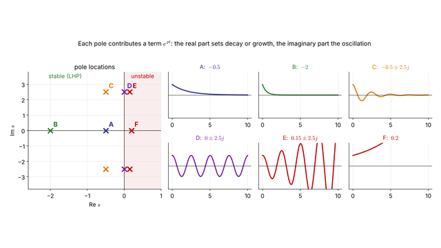
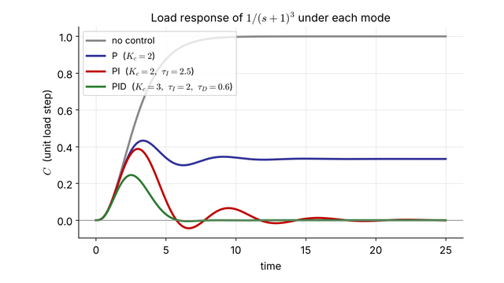
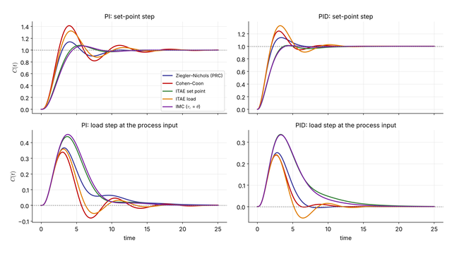
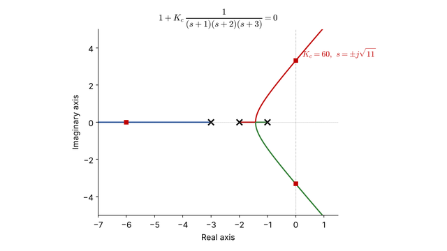
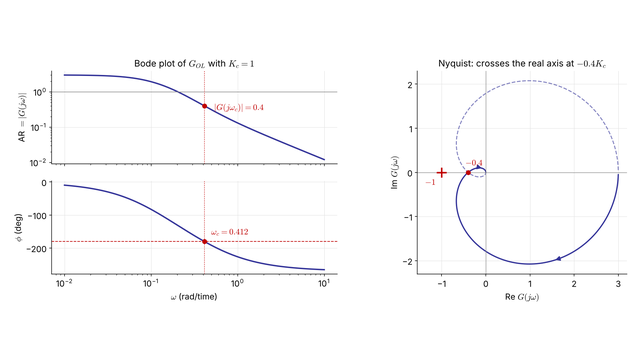
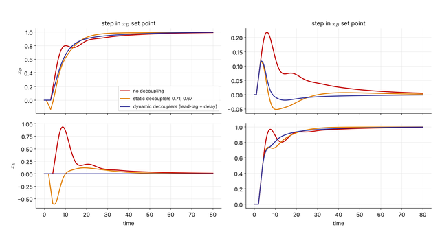

```{=html}
<div class="chapter-grid">
<article class="chapter-card">
  <a class="thumb" href="ch1/ch1_dynamics.html"></a>
  <div class="card-body">
    <div class="card-num">Chapter 1<span class="updated">updated 2026-10-28</span></div>
    <h3><a href="ch1/ch1_dynamics.html">Mathematical Preliminaries &amp; Dynamic Response</a></h3>
    <p class="topics">Laplace transform · partial fractions · poles &amp; zeros · 1st/2nd-order response · dead time &amp; Padé · FOPDT approximation</p>
    <div class="links">
      <a class="btn primary" href="ch1/ch1_dynamics.html">Slides</a>
      <a class="btn" href="ch1/ch1_dynamics.pdf">PDF <small>2.9 MB</small></a>
      <a class="btn" href="ch1/ch1_dynamics_handout.pdf">Handout <small>2.9 MB</small></a>
      <a class="btn" href="https://colab.research.google.com/github/SeoulTechPSE/ProCon/blob/main/ch1/ch1_dynamics.ipynb">Colab</a>
    </div>
    <div class="widgets"><a class="chip" href="ch1/interactive/response_explorer.html">▶ Response explorer</a></div>
  </div>
</article>
<article class="chapter-card">
  <a class="thumb" href="ch2/ch2_analysis.html"></a>
  <div class="card-body">
    <div class="card-num">Chapter 2<span class="updated">updated 2026-10-28</span></div>
    <h3><a href="ch2/ch2_analysis.html">Analysis of Single-Loop Control Systems</a></h3>
    <p class="topics">block diagrams · closed-loop transfer functions · P / PI / PD / PID · offset, reset windup, derivative kick</p>
    <div class="links">
      <a class="btn primary" href="ch2/ch2_analysis.html">Slides</a>
      <a class="btn" href="ch2/ch2_analysis.pdf">PDF <small>2.1 MB</small></a>
      <a class="btn" href="ch2/ch2_analysis_handout.pdf">Handout <small>2.1 MB</small></a>
      <a class="btn" href="https://colab.research.google.com/github/SeoulTechPSE/ProCon/blob/main/ch2/ch2_analysis.ipynb">Colab</a>
    </div>
    <div class="widgets"><a class="chip" href="ch2/interactive/loop_explorer.html">▶ Closed-loop explorer</a></div>
  </div>
</article>
<article class="chapter-card">
  <a class="thumb" href="ch3/ch3_tuning.html"></a>
  <div class="card-body">
    <div class="card-num">Chapter 3<span class="updated">updated 2026-10-28</span></div>
    <h3><a href="ch3/ch3_tuning.html">Tuning of Single-Loop Control Systems</a></h3>
    <p class="topics">process reaction curve · Ziegler–Nichols, Cohen–Coon, ITAE · direct synthesis · IMC</p>
    <div class="links">
      <a class="btn primary" href="ch3/ch3_tuning.html">Slides</a>
      <a class="btn" href="ch3/ch3_tuning.pdf">PDF <small>1.9 MB</small></a>
      <a class="btn" href="ch3/ch3_tuning_handout.pdf">Handout <small>1.9 MB</small></a>
      <a class="btn" href="https://colab.research.google.com/github/SeoulTechPSE/ProCon/blob/main/ch3/ch3_tuning.ipynb">Colab</a>
    </div>
    <div class="widgets"><a class="chip" href="ch3/interactive/tuning_explorer.html">▶ Tuning explorer</a></div>
  </div>
</article>
<article class="chapter-card">
  <a class="thumb" href="ch4/ch4_stability.html"></a>
  <div class="card-body">
    <div class="card-num">Chapter 4<span class="updated">updated 2026-10-28</span></div>
    <h3><a href="ch4/ch4_stability.html">Stability of Closed-Loop Systems</a></h3>
    <p class="topics">characteristic equation · Routh–Hurwitz · root locus · dead time &amp; RHP zeros</p>
    <div class="links">
      <a class="btn primary" href="ch4/ch4_stability.html">Slides</a>
      <a class="btn" href="ch4/ch4_stability.pdf">PDF <small>2.1 MB</small></a>
      <a class="btn" href="ch4/ch4_stability_handout.pdf">Handout <small>2.1 MB</small></a>
      <a class="btn" href="https://colab.research.google.com/github/SeoulTechPSE/ProCon/blob/main/ch4/ch4_stability.ipynb">Colab</a>
    </div>
    <div class="widgets"><a class="chip" href="ch4/interactive/rlocus_explorer.html">▶ Root-locus explorer</a></div>
  </div>
</article>
<article class="chapter-card">
  <a class="thumb" href="ch5/ch5_frequency.html"></a>
  <div class="card-body">
    <div class="card-num">Chapter 5<span class="updated">updated 2026-10-28</span></div>
    <h3><a href="ch5/ch5_frequency.html">Frequency-Response Analysis &amp; Design</a></h3>
    <p class="topics">Bode &amp; Nyquist plots · Bode/Nyquist stability · gain &amp; phase margins · tuning by margins</p>
    <div class="links">
      <a class="btn primary" href="ch5/ch5_frequency.html">Slides</a>
      <a class="btn" href="ch5/ch5_frequency.pdf">PDF <small>2.8 MB</small></a>
      <a class="btn" href="ch5/ch5_frequency_handout.pdf">Handout <small>2.8 MB</small></a>
      <a class="btn" href="https://colab.research.google.com/github/SeoulTechPSE/ProCon/blob/main/ch5/ch5_frequency.ipynb">Colab</a>
    </div>
    <div class="widgets"><a class="chip" href="ch5/interactive/freq_explorer.html">▶ Frequency-response explorer</a></div>
  </div>
</article>
<article class="chapter-card">
  <a class="thumb" href="ch6/ch6_multiloop.html"></a>
  <div class="card-body">
    <div class="card-num">Chapter 6<span class="updated">updated 2026-10-28</span></div>
    <h3><a href="ch6/ch6_multiloop.html">Multi-loop Systems</a></h3>
    <p class="topics">cascade · feedforward · Smith predictor · ratio control · RGA &amp; decoupling</p>
    <div class="links">
      <a class="btn primary" href="ch6/ch6_multiloop.html">Slides</a>
      <a class="btn" href="ch6/ch6_multiloop.pdf">PDF <small>2.1 MB</small></a>
      <a class="btn" href="ch6/ch6_multiloop_handout.pdf">Handout <small>2.2 MB</small></a>
      <a class="btn" href="https://colab.research.google.com/github/SeoulTechPSE/ProCon/blob/main/ch6/ch6_multiloop.ipynb">Colab</a>
    </div>
    <div class="widgets"><a class="chip" href="ch6/interactive/cascade_explorer.html">▶ Cascade explorer</a> <a class="chip" href="ch6/interactive/rga_explorer.html">▶ RGA explorer</a></div>
  </div>
</article>
</div>
```
