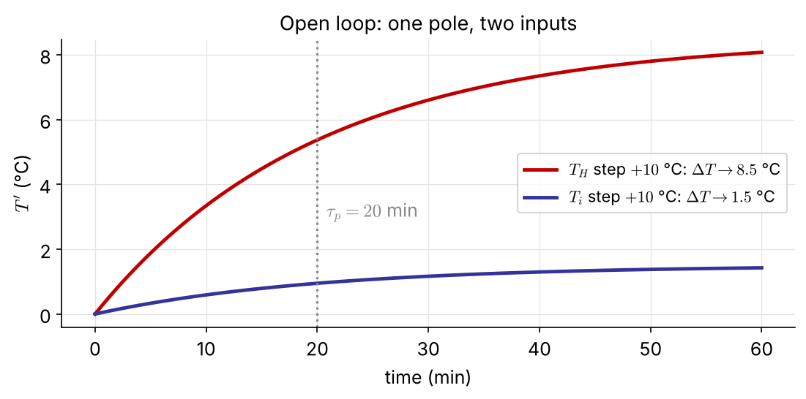
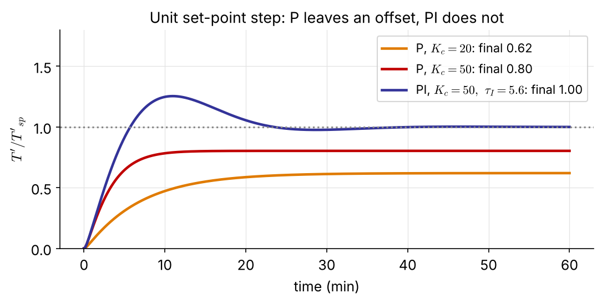
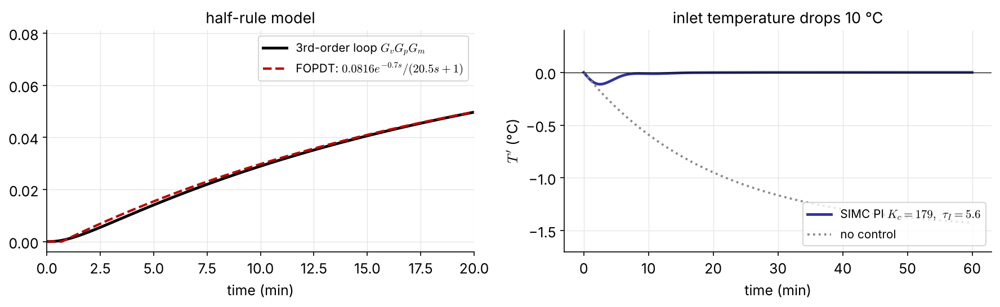
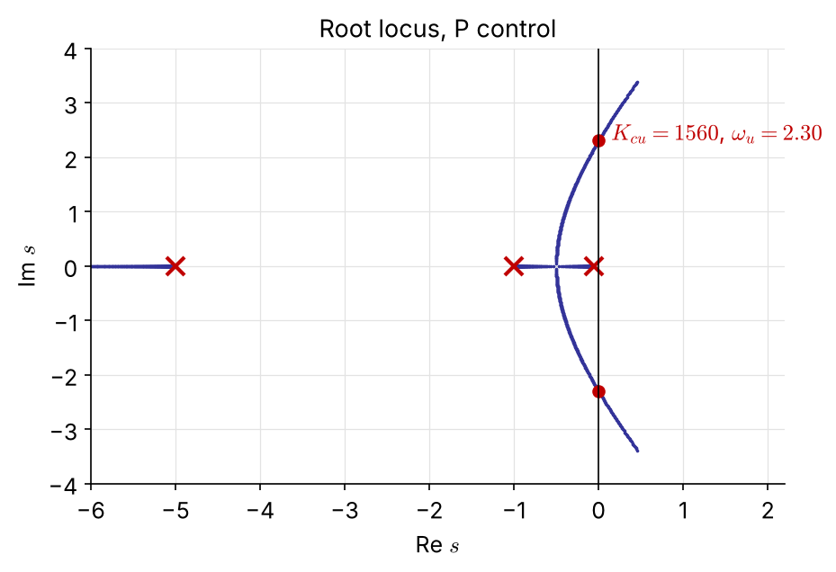
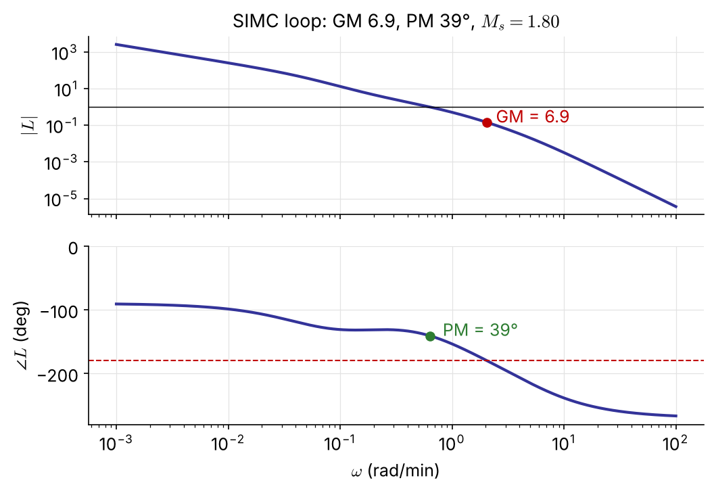
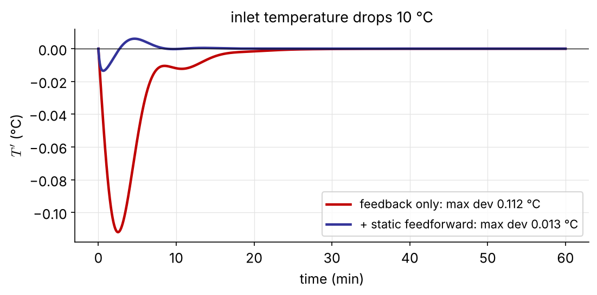

The same stirred-tank heater appears in Ex 1.2 and in the Ch 2 heater loop. Here it is carried through **every** chapter with one consistent set of numbers, so you can see how the tools fit together. All numbers and figures come from [`case/heater.py`](https://github.com/SeoulTechPSE/ProCon/blob/main/case/heater.py).

::: {.callout-note appearance="simple"}
**Process.** Liquid enters at $T_i$ and is heated by steam at $T_H$; $\tau=V/q$, $\kappa=UA/(\rho C_pq)=5.67$.

**Loop.** Controller $G_c$ (mA/mA) → I/P, valve and steam coil $G_v=\dfrac{0.6}{0.2s+1}$ (°C/mA) → tank → $T$ → thermocouple and transmitter $G_m=\dfrac{0.16}{s+1}$ (mA/°C), with $K_m=0.16$ in front of the comparator.
:::

## Ch 1 · Model {#ch1}

From the energy balance (Ex 1.2), in time-constant form:
$$
T'(s)=\underbrace{\frac{0.85}{20s+1}}_{G_p}\,T_H'(s)+\underbrace{\frac{0.15}{20s+1}}_{G_L}\,T_i'(s),
\qquad \tau_p=\frac{\tau}{1+\kappa}=20\ \text{min},\ K_p=\frac{\kappa}{1+\kappa}=0.85,\ K_d=\frac{1}{1+\kappa}=0.15
$$

{width="70%" fig-align="center"}

One pole at $-1/20$: both inputs give first-order responses with the same 20-min time constant; 63 % of the final change after 20 min. [Ch 1 slides →](ch1/ch1_dynamics.html)

## Ch 2 · Closing the loop {#ch2}

Open-loop gain $K_{OL}=K_cK_vK_pK_m=0.0816\,K_c$. With P control the offset is $1/(1+K_{OL})$; PI removes it.

{width="70%" fig-align="center"}

| Controller | $K_{OL}$ | final $T'/T'_{sp}$ |
|:--|:-:|:-:|
| P, $K_c=20$ | 1.63 | 0.62 |
| P, $K_c=50$ | 4.08 | 0.80 |
| PI, $K_c=50$, $\tau_I=5.6$ | — | 1.00 |

[Ch 2 slides →](ch2/ch2_analysis.html)

## Ch 3 · Tuning {#ch3}

The controller sees $G_vG_pG_m=\dfrac{0.0816}{(0.2s+1)(20s+1)(s+1)}$. **Half rule** (Ch 1): keep the 20-min lag, give half of the 1-min lag to it and the rest to dead time:
$$
G\approx\frac{0.0816\,e^{-0.7s}}{20.5s+1}
$$
**SIMC** with $\tau_c=\theta=0.7$: $\;K_c=\dfrac{20.5}{0.0816(1.4)}=179,\quad \tau_I=\min\{20.5,\,4(1.4)\}=5.6$ min (lag-dominant, so $\tau_I$ is capped).

{width="95%" fig-align="center"}

A 10 °C drop in $T_i$ would lower $T$ by 1.5 °C without control; with SIMC PI the largest deviation is 0.11 °C and it is gone in about 10 min. [Ch 3 slides →](ch3/ch3_tuning.html)

## Ch 4 · Stability {#ch4}

P control, characteristic equation:
$$
4s^3+24.2s^2+21.2s+1+0.0816K_c=0
$$
Routh: the $s^1$ row vanishes at $24.2\times21.2=4(1+0.0816K_c)$, so
$$
K_{cu}=1560,\qquad \omega_u=\sqrt{21.2/4}=2.30\ \text{rad/min},\qquad P_u=2.73\ \text{min}
$$

::: {.columns}
::: {.column width="55%"}
{width="100%"}
:::
::: {.column width="45%"}
Without the 1-min sensor lag the loop would be second order and could **never** go unstable: the measurement lag sets the limit. ZN-PI from $K_{cu}$ and $P_u$ would give $K_c=702$, $\tau_I=2.3$ min, with GM only 1.1: far too aggressive, so the SIMC setting of Ch 3 is preferred.
:::
:::

[Ch 4 slides →](ch4/ch4_stability.html)

## Ch 5 · Frequency response {#ch5}

::: {.columns}
::: {.column width="55%"}
{width="100%"}
:::
::: {.column width="45%"}
SIMC PI loop $L=G_cG_vG_pG_m$:

- gain margin **6.9**
- phase margin **39°**
- maximum sensitivity $M_s=$ **1.80** (target $\le2$)

Robust: the valve gain could rise sevenfold before instability. The phase margin is the tighter constraint; a slightly larger $\tau_c$ would raise it toward 45°.
:::
:::

[Ch 5 slides →](ch5/ch5_frequency.html)

## Ch 6 · Feedforward {#ch6}

$T_i$ can be measured, so add feedforward (Ch 6.2):
$$
G_{FF}=-\frac{G_L}{G_vG_p}=-\frac{0.15}{0.85\times0.6}\cdot(0.2s+1)\approx-0.294\ \text{mA/°C}\quad\text{(static part)}
$$

{width="70%" fig-align="center"}

Static feedforward cuts the peak deviation from 0.112 °C to 0.013 °C; feedback removes what is left. A **cascade** on the steam flow (Ch 6.1) would in the same way remove steam-pressure upsets before they reach the tank. [Ch 6 slides →](ch6/ch6_multiloop.html)

## Summary

| Chapter | Tool | Result for the heater |
|:--|:--|:--|
| 1 | energy balance, Laplace | $\tau_p=20$ min, $K_p=0.85$, $K_d=0.15$ |
| 2 | loop with units, P/PI | P offset $1/(1+0.0816K_c)$; PI: none |
| 3 | half rule + SIMC | $K_c=179$, $\tau_I=5.6$ min |
| 4 | Routh, root locus | $K_{cu}=1560$, $P_u=2.73$ min |
| 5 | Bode, $M_s$ | GM 6.9, PM 39°, $M_s=1.80$ |
| 6 | feedforward | peak deviation ÷ 8 for a $T_i$ upset |
