## What are we up to?

Before we design controllers we need a language for **how processes respond in time**: models in deviation variables, the Laplace transform, and transfer functions whose **poles** tell us the shape of the response without solving for it.

| Section | Topic | Key result |
|:-|:-----|:------|
| 1.1 | process models, deviation variables, linearization | linear ODEs with zero initial conditions |
| 1.2 | Laplace transform | table look-up, initial- and final-value theorems |
| 1.3 | partial-fraction expansion | each pole gives one term of $f(t)$ |
| 1.4 | transfer functions, poles and zeros | poles fix the time dependence, zeros the coefficients |
| 1.5–1.6 | first- and second-order systems | $\tau$, $K$, $\zeta$; overshoot, decay ratio, settling time |
| 1.7–1.9 | dead time, higher order, zeros | Padé, FOPDT approximation, inverse response |

::: {.small .navy}
Any linear model breaks into first-order terms by partial fractions, and complex-conjugate pairs combine into second-order terms, so first- and second-order systems are all we need to study in detail.
:::

# 1.1 Process Models and Deviation Variables

## A simple differential-equation model

::: {.columns}
::: {.column width="45%"}

:::
::: {.column width="55%"}
Mass balance of a well-mixed tank:
$$
\tau\frac{dc}{dt}=c_{in}-c,\qquad c(0)=c_0,\qquad \tau=\frac{V}{q}
$$

Define **deviation variables** from the initial steady state: $\bar c=c-c_0$, $\bar c_{in}=c_{in}-c_0$.

$$
\tau\frac{d\bar c}{dt}+\bar c=\bar c_{in},\qquad \bar c(0)=0
$$
:::
:::

::: {.box}
**Why deviation variables?** The initial condition becomes **zero**, so the Laplace transform of the model contains no initial-condition terms and gives a clean input–output ratio. For reference, the solution is the convolution $\bar c(t)=\dfrac1\tau\displaystyle\int_0^t\bar c_{in}(\alpha)e^{-(t-\alpha)/\tau}d\alpha$.
:::

## Linearization of nonlinear models

::: {.columns}
::: {.column width="40%"}


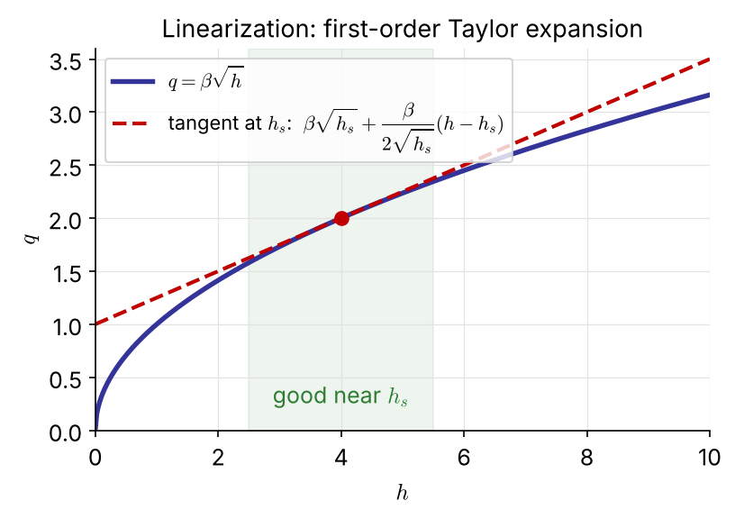{width="95%"}
:::
::: {.column width="60%" .small}
$$
A\frac{dh}{dt}=q_i-\beta\sqrt h,\qquad h(0)=h_s
$$

Steady state: $0=q_{i,s}-\beta\sqrt{h_s}$. Taylor-expand $\sqrt h$ about $h_s$:
$$
A\frac{dh}{dt}\simeq q_i-\beta\left[\sqrt{h_s}+\frac{1}{2\sqrt{h_s}}(h-h_s)\right]
$$

Subtract the steady state and use $\bar q_i=q_i-q_{i,s}$, $\bar h=h-h_s$ [FIX]{.fix}:
$$
A\frac{d\bar h}{dt}+\frac{\beta}{2\sqrt{h_s}}\bar h=\bar q_i,\qquad \bar h(0)=0
$$

**General case** (one state $y$, inputs $\mathbf u$): with $y'=y-y_s$, $\mathbf u'=\mathbf u-\mathbf u_s$,
$$
\frac{dy'}{dt}=\left.\frac{\partial f}{\partial y}\right|_s y'+\nabla_{\mathbf u}^Tf\big|_s\,\mathbf u'
$$
The model is accurate only **near the operating point**.
:::
:::

## [Example 1.1]{.ex} &nbsp; Linearize a mixed vessel

$$
V\frac{dc}{dt}=q\,c_i-q\,c \qquad (q \text{ and } c_i \text{ both vary with time})
$$

::: {.columns}
::: {.column width="55%"}
The product terms are nonlinear. Expand about $(q_s,c_{i,s},c_s)$:
$$
qc_i\simeq q_sc_{i,s}+c_{i,s}\,q'+q_s\,c_i'
$$
$$
qc\simeq q_sc_s+c_s\,q'+q_s\,c'
$$
Subtract the steady state $0=q_s(c_{i,s}-c_s)$:
$$
V\frac{dc'}{dt}=q_s(c_i'-c')+(c_{i,s}-c_s)\,q'
$$
:::
::: {.column width="45%"}
::: {.box}
At steady state $c_s=c_{i,s}$, so the flow term **vanishes**:
$$
\frac{V}{q_s}\frac{dc'}{dt}+c'=c_i'
$$
To first order, a flow change does not move the concentration; only $c_i$ does. [NEW]{.new}
:::
:::
:::

## [Example 1.2]{.ex} &nbsp; Stirred-tank heater

::: {.columns}
::: {.column width="42%"}

:::
::: {.column width="58%" .small}
$$
\rho C_pV\frac{dT}{dt}=\rho C_pq(T_i-T)+UA(T_H-T)
$$
With $\tau=V/q$ and $\kappa=UA/(\rho C_pq)$, in deviation variables:
$$
\tau\frac{d\bar T}{dt}+(1+\kappa)\bar T=\bar T_i+\kappa\bar T_H
$$
:::
:::

::: {.columns}
::: {.column width="50%"}
::: {.box .small}
**Pole-zero form**
$$
T(s)=\frac{K_i}{s+a}T_i(s)+\frac{K_H}{s+a}T_H(s)
$$
$a=\dfrac{1+\kappa}{\tau},\ K_i=\dfrac1\tau,\ K_H=\dfrac\kappa\tau$
:::
:::
::: {.column width="50%"}
::: {.box .small}
**Time-constant form** (used in control)
$$
T(s)=\frac{K_d}{\tau_ps+1}T_i(s)+\frac{K_p}{\tau_ps+1}T_H(s)
$$
$\tau_p=\dfrac{\tau}{1+\kappa},\ K_d=\dfrac1{1+\kappa},\ K_p=\dfrac{\kappa}{1+\kappa}$
:::
:::
:::

::: {.tiny .navy}
One output, two inputs: the heater temperature $T_H$ will be our **manipulated** variable, the inlet temperature $T_i$ a **disturbance**. Both see the same pole $-1/\tau_p$.
:::

## [Example 1.3]{.ex} &nbsp; Non-isothermal CSTR

::: {.columns}
::: {.column width="44%"}

:::
::: {.column width="56%" .small}
$$
V\frac{dc_A}{dt}=q(c_{Ai}-c_A)-Vk(T)\,c_A
$$
$$
\rho VC_p\frac{dT}{dt}=\rho qC_p(T_i-T)+(-\Delta H_R)Vk(T)c_A+UA(T_c-T)
$$
$k(T)c_A$ is nonlinear in **both** states. With $q$, $c_{Ai}$, $T_i$ constant, linearize ($k_s'=k_sE/RT_s^2$):
$$
\frac{d}{dt}\begin{bmatrix}c_A'\\T'\end{bmatrix}=\begin{bmatrix}a_{11}&a_{12}\\a_{21}&a_{22}\end{bmatrix}\begin{bmatrix}c_A'\\T'\end{bmatrix}+\begin{bmatrix}0\\b_2\end{bmatrix}T_c'
$$
:::
:::

::: {.columns}
::: {.column width="56%" .tiny}
$a_{11}=-\dfrac qV-k_s,\quad a_{12}=-k_s'c_{As},\quad a_{21}=\dfrac{(-\Delta H_R)k_s}{\rho C_p}$
$a_{22}=-\dfrac qV-\dfrac{UA}{\rho VC_p}+\dfrac{(-\Delta H_R)k_s'c_{As}}{\rho C_p},\quad b_2=\dfrac{UA}{\rho VC_p}$
:::
::: {.column width="44%"}
::: {.box .small}
$$
\frac{C_A'(s)}{T_c'(s)}=\frac{a_{12}b_2}{(s-a_{11})(s-a_{22})-a_{12}a_{21}}
$$
[NEW]{.new} &nbsp; second order: the two balances are coupled.
:::
:::
:::

## [Problem #1]{.ex} &nbsp; (homework)

::: {.box}
For the CSTR of Example 1.3, find all the approximate transfer functions relating the outputs $c_A$ and $T$ to the inputs $c_{A,i}$, $T_i$ and $T_c$.

Show that all six transfer functions share **one** denominator, and explain why.
:::

::: {.small .navy}
Hint: write the Laplace-transformed linear model as $(s\mathbf I-\mathbf A)\mathbf x=\mathbf B\mathbf u$ and solve with Cramer's rule; the denominator is $\det(s\mathbf I-\mathbf A)$.
:::

# 1.2 Laplace Transform

## Definition and the look-up table approach

$$
\mathcal L[f(t)]=\int_0^\infty f(t)e^{-st}dt=F(s),\qquad
f(t)=\mathcal L^{-1}[F(s)]=\frac{1}{2\pi j}\int_{\gamma-j\infty}^{\gamma+j\infty}F(s)e^{st}ds
$$

::: {.columns}
::: {.column width="50%"}
- In control we **never** use the inverse integral: we break $F(s)$ into simple parts and read the answer from a **table**.
- $\mathcal L$ is a **linear operator**:
$$
\mathcal L[af_1+bf_2]=aF_1(s)+bF_2(s)
$$
- A linear ODE becomes an **algebraic** equation in $s$
:::
::: {.column width="50%"}
::: {.box}
The real goal: predict the **time response without the inverse transform**. The answer lies in the roots of the characteristic equation (§1.4).
:::
:::
:::

## Transforms of common functions

::: {.columns}
::: {.column width="50%" .small}
| $f(t)$ | $F(s)$ |
|:--|:--:|
| $\delta(t)$ (unit impulse) | $1$ |
| $u(t)$ (unit step) | $\dfrac1s$ |
| $t$ (ramp) | $\dfrac1{s^2}$ |
| $t^{n-1}/(n-1)!$ | $\dfrac1{s^n}$ |
| $e^{-at}$ | $\dfrac1{s+a}$ |
| $t^{n-1}e^{-at}/(n-1)!$ | $\dfrac1{(s+a)^n}$ |
| $\sin\omega t$, &nbsp; $\cos\omega t$ | $\dfrac{\omega}{s^2+\omega^2}$, &nbsp; $\dfrac{s}{s^2+\omega^2}$ |
| $e^{-at}\sin\omega t$, &nbsp; $e^{-at}\cos\omega t$ | $\dfrac{\omega}{(s+a)^2+\omega^2}$, &nbsp; $\dfrac{s+a}{(s+a)^2+\omega^2}$ |
:::
::: {.column width="50%" .small}
| Operation | Transform |
|:--|:--:|
| $\dfrac{df}{dt}$ | $sF(s)-f(0)$ |
| $\dfrac{d^2f}{dt^2}$ | $s^2F(s)-sf(0)-f'(0)$ |
| $\displaystyle\int_0^tf\,dt$ | $\dfrac{F(s)}s$ |
| $f(t-t_0)u(t-t_0)$ | $e^{-st_0}F(s)$ |
| $e^{-at}f(t)$ | $F(s+a)$ |

::: {.tiny}
Derivation by integration by parts, e.g.
$\mathcal L[df/dt]=fe^{-st}\big|_0^\infty+s\int_0^\infty fe^{-st}dt=sF(s)-f(0)$. With deviation variables all $f^{(k)}(0)=0$, so $d/dt\to s$ and $\int dt\to1/s$.
:::

::: {.tiny .navy}
Try: derive $\mathcal L[\cos\omega t]$ from $\cos\omega t=(e^{j\omega t}+e^{-j\omega t})/2$.
:::
:::
:::

## Inputs common to control problems

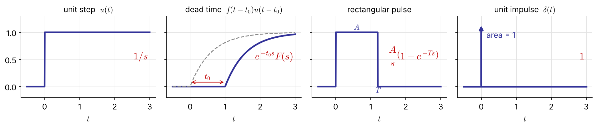{width="100%"}

::: {.columns}
::: {.column width="50%" .small}
- **Pulse**: $A[u(t)-u(t-T)]\ \Rightarrow\ \dfrac As(1-e^{-sT})$
- **Impulse**: $\delta(t)=\displaystyle\lim_{T\to0}\frac{u(t)-u(t-T)}{T}$, so $\mathcal L[\delta]=\displaystyle\lim_{T\to0}\frac{1-e^{-sT}}{Ts}=1$
:::
::: {.column width="50%" .small}
- $\displaystyle\int_{-\infty}^\infty\delta\,dt=1$, $\quad\displaystyle\int_{-\infty}^\infty f(t)\delta(t-t_0)\,dt=f(t_0)$
- **Dead time** (time shift) multiplies by $e^{-st_0}$: an exponential, not a polynomial, in $s$ (§1.7).
:::
:::

## Initial- and final-value theorems

Values of $f(t)$ at the two extremes **without** the inverse transform:

$$
\lim_{t\to0^+}f(t)=\lim_{s\to\infty}sF(s),\qquad\qquad \lim_{t\to\infty}f(t)=\lim_{s\to0}sF(s)
$$

::: {.columns}
::: {.column width="50%" .small}
Proof of the final value: $\displaystyle\lim_{s\to0}\int_0^\infty\frac{df}{dt}e^{-st}dt=\int_0^\infty df=f(\infty)-f(0)$, and the left side is $\lim_{s\to0}[sF(s)-f(0)]$.

::: {.boxr}
The final-value theorem holds **only if $f(\infty)$ exists**: all poles of $sF(s)$ must lie in the left half-plane. [FIX]{.fix}
:::
:::
::: {.column width="50%" .small}
[Example 1.4]{.ex} &nbsp; What is $f(\infty)$?

(a) $F=\dfrac{6(s-2)(s+2)}{s(s+1)(s+3)(s+4)}$: $\ sF(0)=\dfrac{6(-2)(2)}{(3)(4)}=$ **$-2$**

(b) $F=\dfrac1{s-2}$, i.e. $f=e^{2t}$: $\ sF(0)=0$, but $f\to\infty$: theorem **not applicable** (pole at $+2$).

(c) $F=\dfrac{6(s+3)}{s^3+s^2-4s-4}=\dfrac{6(s+3)}{(s+1)(s+2)(s-2)}$: again a pole at $+2$; $f(\infty)$ **does not exist**.
:::
:::

# 1.3 Partial-Fraction Expansion

## Breaking $F(s)$ into table entries

$$
F(s)=\frac{q(s)}{p(s)}=\frac{\alpha_1}{s+a_1}+\frac{\alpha_2}{s+a_2}+\cdots+\frac{\alpha_n}{s+a_n}
\quad\Rightarrow\quad f(t)=\sum_i\alpha_ie^{-a_it}
$$

$-a_i$ are the roots of $p(s)=0$ (order $n$ > order of $q$). Heaviside's cover-up rule:

$$
\alpha_i=(s+a_i)\left.\frac{q(s)}{p(s)}\right|_{s=-a_i}
$$

::: {.columns}
::: {.column width="50%"}
::: {.box .small}
1. The **time dependence** of $f(t)$ comes entirely from the roots of the **denominator**.
2. The **numerator** affects only the coefficients $\alpha_i$.
:::
:::
::: {.column width="50%"}
::: {.box .small}
3. Poles **closer to the origin** give terms that decay more slowly: they are **dominant**.
4. Three cases: distinct real, complex, and repeated roots.
:::
:::
:::

## [Example 1.5]{.ex} &nbsp; Case 1: distinct real roots

::: {.columns}
::: {.column width="58%" .small}
$s^3+s^2-4s-4=(s+1)(s+2)(s-2)$. Two numerators, same denominator:

| | $\dfrac{6s^2-12}{(s+1)(s+2)(s-2)}$ | $\dfrac{6s}{(s+1)(s+2)(s-2)}$ |
|:--|:--:|:--:|
| $\alpha_1=\left.\dfrac{q}{(s+2)(s-2)}\right\vert_{-1}$ | $\dfrac{-6}{-3}=2$ | $\dfrac{-6}{-3}=2$ |
| $\alpha_2=\left.\dfrac{q}{(s+1)(s-2)}\right\vert_{-2}$ | $\dfrac{12}{4}=3$ | $\dfrac{-12}{4}=-3$ |
| $\alpha_3=\left.\dfrac{q}{(s+1)(s+2)}\right\vert_{2}$ | $\dfrac{12}{12}=1$ | $\dfrac{12}{12}=1$ |
| $f(t)$ | $2e^{-t}+3e^{-2t}+e^{2t}$ | $2e^{-t}-3e^{-2t}+e^{2t}$ |

::: {.navy}
Same three exponentials, different coefficients: the numerator changes **only the weights**.
:::
:::
::: {.column width="42%"}
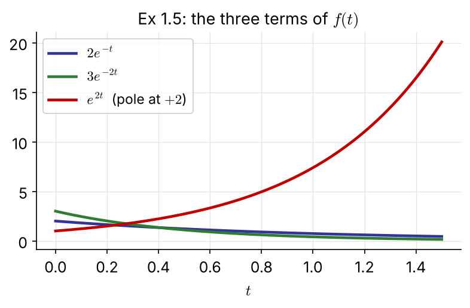{width="100%"}

::: {.tiny}
The same procedure gives $\dfrac{6}{(s+1)(s+2)(s+3)}=\dfrac3{s+1}-\dfrac6{s+2}+\dfrac3{s+3}$.
:::
:::
:::

## [Example 1.6]{.ex} &nbsp; Case 2: complex roots

$$
F(s)=\frac{s+5}{s^2+4s+13},\qquad s^2+4s+13=0\ \Rightarrow\ s=-2\pm3j
$$

::: {.columns}
::: {.column width="50%" .small}
**Method 1: cover-up with complex numbers**
$$
\alpha=\left.\frac{s+5}{s-(-2-3j)}\right|_{s=-2+3j}=\frac{3+3j}{6j}=\frac{1-j}{2},\quad \alpha^*=\frac{1+j}{2}
$$
$$
f(t)=\tfrac{1-j}{2}e^{(-2+3j)t}+\tfrac{1+j}{2}e^{(-2-3j)t}
$$
Euler's formula collects the terms into real functions.
:::
::: {.column width="50%" .small}
**Method 2: complete the square** (faster)
$$
\frac{s+5}{(s+2)^2+3^2}=\frac{s+2}{(s+2)^2+3^2}+\frac{3}{(s+2)^2+3^2}
$$
$$
f(t)=e^{-2t}(\cos3t+\sin3t)
$$
:::
:::

::: {.box}
Phase-lag form (the one we use): $\ \cos3t+\sin3t=\sqrt2\sin(3t+\phi),\ \phi=\tan^{-1}1=\pi/4$, so
$f(t)=\sqrt2\,e^{-2t}\sin(3t+\pi/4)$. Roots $-a\pm bj$ always give $e^{-at}$ times an oscillation of frequency $b$
:::

## [Example 1.7]{.ex} &nbsp; Case 3: repeated roots

$$
\frac{2}{(s+1)^3(s+2)}=\frac{\alpha_1}{s+1}+\frac{\alpha_2}{(s+1)^2}+\frac{\alpha_3}{(s+1)^3}+\frac{\alpha_4}{s+2}
$$

::: {.columns}
::: {.column width="50%" .small}
$\alpha_4=\left.\dfrac2{(s+1)^3}\right|_{-2}=-2$. Multiply by $(s+1)^3$:
$$
\frac2{s+2}=\alpha_1(s+1)^2+\alpha_2(s+1)+\alpha_3+\alpha_4\frac{(s+1)^3}{s+2}
$$
Set $s=-1$, then differentiate and set $s=-1$ again:

$\alpha_3=2,\quad \alpha_2=\left.-\dfrac2{(s+2)^2}\right|_{-1}=-2,\quad \alpha_1=\dfrac12\left.\dfrac4{(s+2)^3}\right|_{-1}=2$
:::
::: {.column width="50%"}
$$
f(t)=2\left[\left(1-t+\tfrac{t^2}2\right)e^{-t}-e^{-2t}\right]
$$

::: {.box .small}
In general
$$
\mathcal L^{-1}\left[\sum_{k=1}^n\frac{\alpha_k}{(s+a)^k}\right]=\left[\alpha_1+\alpha_2t+\cdots+\frac{\alpha_nt^{n-1}}{(n-1)!}\right]e^{-at}
$$
Still based on the root $-a$, but the polynomial in $t$ makes it **decay more slowly**.
:::
:::
:::

## Partial fractions by computer

::: {.panel-tabset}
### Python

```{.python}
import sympy as sp
s, t = sp.symbols('s t'); tp = sp.Symbol('t', positive=True)

for F in [(6*s**2 - 12)/(s**3 + s**2 - 4*s - 4),      # Ex 1.5
          (s + 5)/(s**2 + 4*s + 13),                    # Ex 1.6
          2/((s + 1)**3*(s + 2))]:                      # Ex 1.7
    print(sp.apart(F, s), '  ->  ', sp.inverse_laplace_transform(F, s, tp))

import numpy as np, scipy.signal as sig
r, p, k = sig.residue([6, 0, -12], [1, 1, -4, -4])      # residues, poles, direct term
print(np.round(r, 4), np.round(p, 4))                   # [3, 2, 1]  at  [-2, -1, 2]
```

### MATLAB

```{.matlab}
[r, p, k] = residue([6 0 -12], [1 1 -4 -4])      % Ex 1.5: residues and poles
roots([1 1 -4 -4])                               % 2, -2, -1

syms s t
ilaplace((s + 5)/(s^2 + 4*s + 13))               % Ex 1.6
ilaplace(2/((s + 1)^3*(s + 2)))                  % Ex 1.7
partfrac(2/((s + 1)^3*(s + 2)), s)
```
:::

## [Problem #2]{.ex} &nbsp; (homework)

::: {.columns}
::: {.column width="50%"}
::: {.box}
(a) Find $f(t)$ for
$$
F(s)=\frac{s+\beta}{(s+a)^2+\omega^2}
$$
:::
:::
::: {.column width="50%"}
::: {.box}
(b) Find $f(t)$ for
$$
F(s)=\frac{s\sin\phi+\omega\cos\phi}{s^2+\omega^2}
$$
:::
:::
:::

::: {.small .navy}
Check your answers with `sympy.inverse_laplace_transform` or MATLAB `ilaplace`.
:::

# 1.4 Transfer Functions, Poles and Zeros

## The transfer function

For a linear ODE with zero initial conditions ($n\ge m$)
$$
a_ny^{(n)}+\cdots+a_1y'+a_0y=b_mx^{(m)}+\cdots+b_1x'+b_0x
$$
the Laplace transform gives the **transfer function**, the ratio of output to input:
$$
G(s)=\frac{Y(s)}{X(s)}=\frac{b_ms^m+\cdots+b_1s+b_0}{a_ns^n+\cdots+a_1s+a_0}=\frac{Q(s)}{P(s)}
$$

::: {.columns}
::: {.column width="50%"}
::: {.box .small}
**Pole-zero form**
$$
G(s)=\frac{b_m}{a_n}\frac{(s-z_1)\cdots(s-z_m)}{(s-p_1)\cdots(s-p_n)}
$$
$P(s)$ is the **characteristic polynomial**; its roots are the **poles**, the roots of $Q(s)$ the **zeros**.
:::
:::
::: {.column width="50%"}
::: {.box .small}
**Time-constant form** (real roots)
$$
G(s)=K\frac{(\tau_as+1)\cdots(\tau_ms+1)}{(\tau_1s+1)\cdots(\tau_ns+1)}
$$
**Steady-state gain**: final change of $y$ per unit step in $x$,
$K=\lim_{s\to0}sG(s)\dfrac1s=G(0)=\dfrac{b_0}{a_0}$
:::
:::
:::

## Poles tell the shape of the response

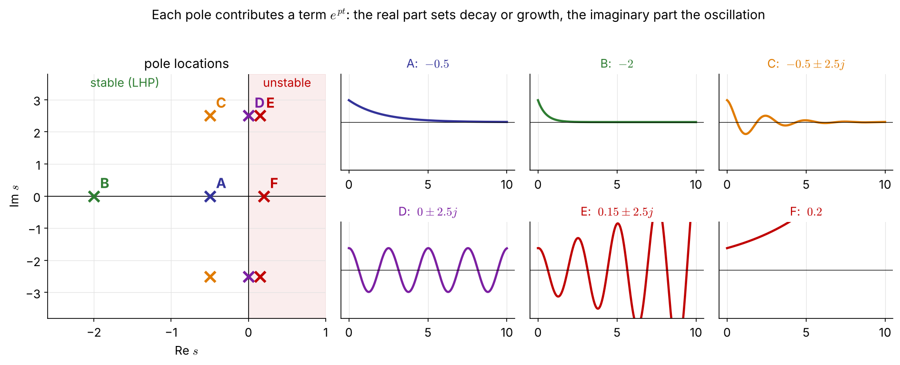{width="100%"}

::: {.columns}
::: {.column width="50%" .small}
- real pole $p$ → $e^{pt}$; repeated $m$ times → $(\alpha_1+\cdots+\alpha_mt^{m-1})e^{pt}$
- complex pair $-\zeta/\tau\pm j\sqrt{1-\zeta^2}/\tau$ → $e^{-\zeta t/\tau}\sin(\sqrt{1-\zeta^2}\,t/\tau+\phi)$
:::
::: {.column width="50%" .small}
- the discussion of poles is **independent of the input**; the actual $y(t)$ also depends on $x(t)$
- zeros change only the coefficients
- **Stability**: all poles must have **negative real parts** (Ch 4).
:::
:::

## Back to the first-order tank: step and impulse

From §1.1, $\ \tau\dfrac{d\bar c}{dt}+\bar c=\bar c_{in}\ \Rightarrow\ (\tau s+1)C(s)=C_{in}(s)\ \Rightarrow\ G(s)=\dfrac{C(s)}{C_{in}(s)}=\dfrac{1}{\tau s+1}$, one pole at $-1/\tau$.

::: {.columns}
::: {.column width="50%"}
::: {.box}
**Unit step** $C_{in}=1/s$
$$
C=\frac1{(\tau s+1)s}=\frac1s-\frac1{s+1/\tau}
$$
$$
\bar c(t)=1-e^{-t/\tau}
$$
:::
:::
::: {.column width="50%"}
::: {.box}
**Unit impulse** $C_{in}=1$
$$
C=\frac{1}{\tau s+1}=\frac1\tau\frac1{s+1/\tau}
$$
$$
\bar c(t)=\frac1\tau e^{-t/\tau}
$$
:::
:::
:::

::: {.small .navy}
Without specifying the input we already know $\bar c(t)$ must contain $e^{-t/\tau}$: that is what the pole tells us.
:::

# 1.5 First-Order Systems

## First-order model

$$
a_1\frac{dy}{dt}+a_0y=bx(t)\quad\Rightarrow\quad \tau\frac{dy}{dt}+y=Kx(t),\qquad G(s)=\frac{Y(s)}{X(s)}=\frac{K}{\tau s+1}
$$

$\tau=a_1/a_0$: **time constant** (시간상수), $K=b/a_0$: **steady-state gain** (정상상태 이득), one real pole at $-1/\tau$.

::: {.columns}
::: {.column width="56%"}
**Step** $x=Mu(t)$:
$$
Y=\frac{KM}{s(\tau s+1)}\ \Rightarrow\ y(t)=KM\left(1-e^{-t/\tau}\right)
$$
**Impulse** $x=M\delta(t)$:
$$
y(t)=\frac{KM}{\tau}e^{-t/\tau}
$$
Final value check: $\lim_{s\to0}s\dfrac{KM}{s(\tau s+1)}=KM$.
:::
::: {.column width="44%" .small}
| $t$ | $y/KM=1-e^{-t/\tau}$ |
|:-:|:-:|
| $\tau$ | **0.632** |
| $2\tau$ | 0.865 |
| $3\tau$ | **0.950** |
| $4\tau$ | 0.982 |
| $5\tau$ | **0.993** |

::: {.navy}
After $3\tau$ within 5%, after $5\tau$ within 1%: "settled".
:::
:::
:::

## Effect of $\tau$ and $K$

::: {.small .center}
The **larger the time constant, the slower** the response. The **larger the gain, the more sensitive** the output to the input.
:::

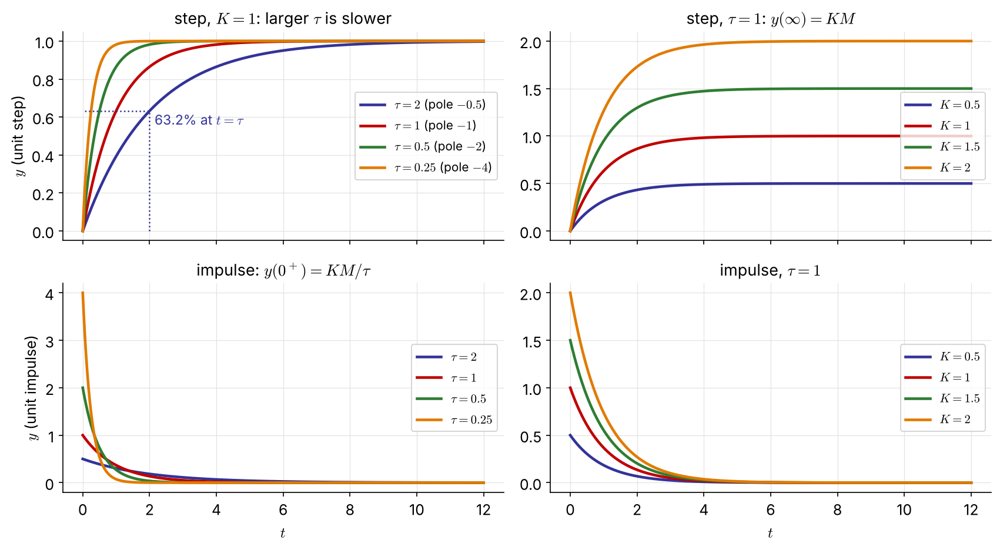{width="70%" fig-align="center"}

## Ramp input and the integrating process

::: {.columns}
::: {.column width="48%"}
**Ramp** $x=at$, $X=a/s^2$:
$$
Y=\frac{Ka}{s^2(\tau s+1)}=\frac{Ka\tau^2}{\tau s+1}-\frac{Ka\tau}{s}+\frac{Ka}{s^2}
$$
$$
y(t)=Ka\tau\left(e^{-t/\tau}-1\right)+Kat
$$

$\to Ka(t-\tau)$ for $t\gg\tau$: the output lags the input by $\tau$.

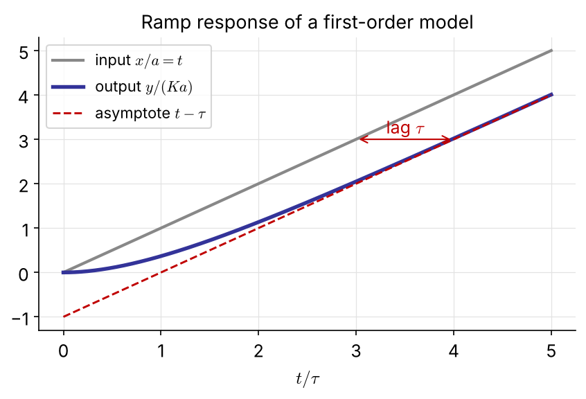{width="78%"}
:::
::: {.column width="52%"}
**Integrating process** ($a_0=0$):
$$
\frac{dy}{dt}=K_Ix(t)\ \Rightarrow\ G(s)=\frac{K_I}{s}
$$
a **pole at the origin**.



::: {.small}
$A\dfrac{d\bar h}{dt}=\bar q_{in}-\bar q\ \Rightarrow\ H(s)=\dfrac1A\dfrac{Q_{in}(s)-Q(s)}{s}$

A step input gives a **ramp**; an impulse is **not** forgotten, the level keeps whatever was added. Not self-regulating: levels need control.
:::
:::
:::

## [Example 1.8]{.ex} &nbsp; Two stirred tanks in series

::: {.columns}
::: {.column width="50%"}


::: {.small}
$\tau_1\dfrac{d\bar c_1}{dt}+\bar c_1=\bar c_i,\quad \tau_2\dfrac{d\bar c_2}{dt}+\bar c_2=\bar c_1$
$$
\frac{C_2(s)}{C_i(s)}=\frac{1}{(\tau_1s+1)(\tau_2s+1)}
$$

$\tau_1=V_1/q=2$ min, $\ \tau_2=V_2/q=1.5$ min
:::
:::
::: {.column width="50%" .small}
Feed: $c_i=6$ for $0<t<0.25$ min, otherwise 1, so $\bar c_i$ is a pulse of height 5:
$$
C_i(s)=\frac5s\left(1-e^{-s/4}\right)\quad\text{or, as an impulse,}\quad C_i(s)=\frac54
$$
$$
C_2(s)=\frac{5(1-e^{-s/4})}{s(2s+1)(1.5s+1)}\quad\text{or}\quad\frac{5/4}{(2s+1)(1.5s+1)}
$$

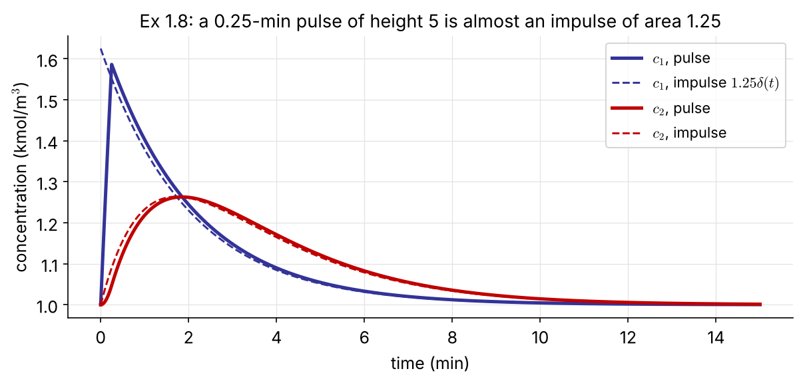{width="100%"}

::: {.tiny}
The original MATLAB script used `pulselength = 1.25`, a pulse 5× too long. [FIX]{.fix}
:::
:::
:::

## [Problem #3]{.ex} &nbsp; (homework)

::: {.box}
For Example 1.8, carry out the inverse transforms:

(a) the impulse response $\bar c_2(t)$ for $C_i=5/4$;

(b) the pulse response $\bar c_2(t)$, using the dead-time property for the factor $e^{-s/4}$.

Plot both together with $\bar c_1(t)$ and compare with the figure on the previous slide.
:::

# 1.6 Second-Order Systems

## Second-order model

$$
\tau^2\frac{d^2y}{dt^2}+2\zeta\tau\frac{dy}{dt}+y=Kx(t)\quad\Rightarrow\quad
G(s)=\frac{K}{\tau^2s^2+2\zeta\tau s+1}=\frac{K\omega_n^2}{s^2+2\zeta\omega_ns+\omega_n^2}
$$

$\tau$: natural period, $\omega_n=1/\tau$: natural frequency, $\zeta$: **damping ratio** (감쇠계수), $K$: steady-state gain. Poles:
$$
p_{1,2}=-\frac{\zeta}{\tau}\pm\frac{\sqrt{\zeta^2-1}}{\tau}\qquad(\text{stable only if }\zeta>0,\ \text{since }\tau>0)
$$

| $\zeta$ | poles | name | response |
|:-:|:--|:--|:--|
| $\zeta>1$ | two distinct real, $-1/\tau_1,\ -1/\tau_2$ | **overdamped** | sluggish, $G=K/[(\tau_1s+1)(\tau_2s+1)]$ |
| $\zeta=1$ | repeated real, $-1/\tau$ | **critically damped** | fastest without oscillation |
| $0<\zeta<1$ | complex pair $-\zeta/\tau\pm j\sqrt{1-\zeta^2}/\tau$ | **underdamped** | overshoot, decaying oscillation; $\tau$ is **not** a time constant |
| $\zeta=0$ | purely imaginary $\pm j/\tau$ | **undamped** | sustained oscillation at $\omega_n$ |

## [Example 1.9]{.ex} &nbsp; Oscillations of a damped manometer

::: {.columns}
::: {.column width="40%"}

:::
::: {.column width="60%" .small}
A pressure step $p_a-p_b$ sets the liquid in motion (laminar, isothermal). A momentum balance on the liquid column gives

$$
\tfrac43\pi R^2L\rho\frac{d^2h}{dt^2}=-8\pi L\mu\frac{dh}{dt}-2\pi R^2\rho gh+\pi R^2(p_a-p_b)
$$
$$
\frac{d^2h}{dt^2}+\frac{6\mu}{R^2\rho}\frac{dh}{dt}+\frac{3g}{2L}h=\frac34\frac{p_a-p_b}{\rho L}
$$

Compare with $s^2+2\zeta\omega_ns+\omega_n^2$:
$$
\omega_n=\sqrt{\frac{3g}{2L}},\qquad \zeta=\frac{3\mu}{R^2\rho\,\omega_n}
$$

::: {.box}
Critical damping $\zeta=1$ at $R_{cr}=\left(\dfrac{6\mu^2L}{\rho^2g}\right)^{1/4}$. [NEW]{.new} Wider tubes oscillate, narrower tubes creep.
:::

::: {.tiny}
Bird, Stewart & Lightfoot, *Transport Phenomena*, 2nd ed., pp. 219–221.
:::
:::
:::

## Step response of a second-order model

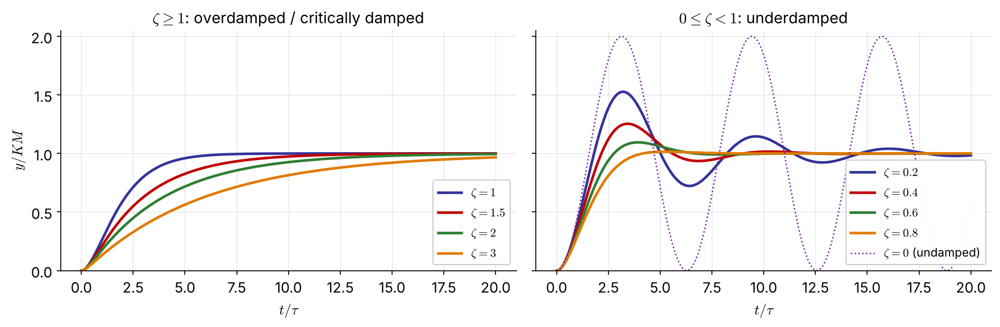{width="92%" fig-align="center"}

::: {.columns}
::: {.column width="50%" .tiny}
$\zeta>1$: $\ y=KM\left[1-e^{-\zeta t/\tau}\left(\cosh\dfrac{\sqrt{\zeta^2-1}}{\tau}t+\dfrac{\zeta}{\sqrt{\zeta^2-1}}\sinh\dfrac{\sqrt{\zeta^2-1}}{\tau}t\right)\right]$ (simpler with $e^{-t/\tau_1}$, $e^{-t/\tau_2}$)

$\zeta=1$: $\ y=KM\left[1-\left(1+\dfrac t\tau\right)e^{-t/\tau}\right]$
:::
::: {.column width="50%" .tiny}
$0\le\zeta<1$: $\ y=KM\left[1-\dfrac{e^{-\zeta t/\tau}}{\sqrt{1-\zeta^2}}\sin\left(\dfrac{\sqrt{1-\zeta^2}}{\tau}t+\phi\right)\right]$, $\ \phi=\tan^{-1}\dfrac{\sqrt{1-\zeta^2}}{\zeta}$

Rarely used directly; the underdamped one yields the characteristics on the next slide.
:::
:::

## Features of the underdamped step response

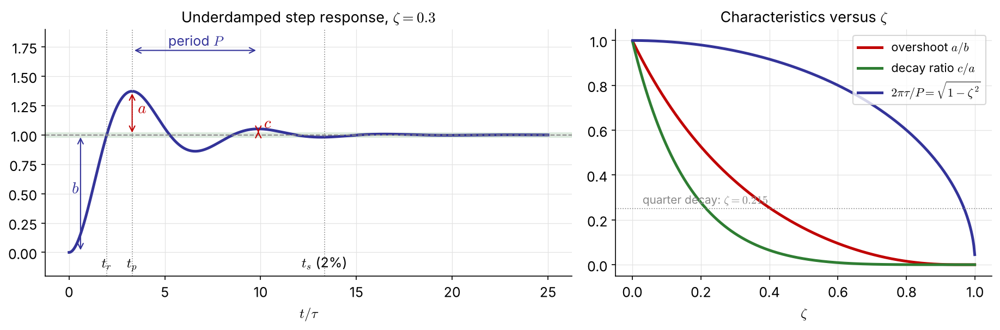{width="94%" fig-align="center"}

::: {.ftab}
| overshoot | peak time | rise time | period | settling time | decay ratio |
|:-:|:-:|:-:|:-:|:-:|:-:|
| $\dfrac ab=\exp\left(\dfrac{-\pi\zeta}{\sqrt{1-\zeta^2}}\right)$ | $t_p=\dfrac{\pi\tau}{\sqrt{1-\zeta^2}}$ | $t_r=\dfrac{\tau(\pi-\cos^{-1}\zeta)}{\sqrt{1-\zeta^2}}$ | $P=\dfrac{2\pi\tau}{\sqrt{1-\zeta^2}}$ | <span style="font-size:0.82em">$t_s\approx$<br>$\dfrac{3\tau}{\zeta}$&nbsp;(5%)<br>$\dfrac{4\tau}{\zeta}$&nbsp;(2%)</span> | $\dfrac ca=\text{OS}^2$ |
:::

::: {.tiny .navy}
Settling: the envelope $e^{-\zeta t/\tau}$ behaves like a first-order term with time constant $\tau/\zeta$. Smaller $\zeta$: faster rise, larger overshoot, longer settling.
:::

## Second-order responses in code

::: {.panel-tabset}
### Python

```{.python}
import numpy as np, control as ct, matplotlib.pyplot as plt

t = np.linspace(0, 15, 1501)
for zeta in (0.5, 1.0, 1.5):                    # s^2 + 2 zeta s + 1  (tau = 1)
    G = ct.tf(1, [1, 2*zeta, 1])
    plt.plot(t, ct.step_response(G, t).outputs, label=f'zeta = {zeta}')
plt.legend(); plt.xlabel('t')

info = ct.step_info(ct.tf(1, [1, 0.6, 1]))      # zeta = 0.3
print(info['Overshoot'], info['PeakTime'], info['SettlingTime'])   # 37.2 %, 3.29, ...
```

### MATLAB

```{.matlab}
t = 0:0.01:15;
step(tf(1, [1 1 1]), tf(1, [1 2 1]), tf(1, [1 3 1]), t)   % zeta = 0.5, 1, 1.5
legend('\zeta = 0.5', '\zeta = 1', '\zeta = 1.5')

S = stepinfo(tf(1, [1 0.6 1]))                             % zeta = 0.3
% Simulink: Step -> three Transfer Fcn blocks in parallel -> Scope
```
:::

## [Problem #4]{.ex} &nbsp; (homework)

::: {.box}
(a) Show that the overdamped step response can be written with two exponentials $e^{-t/\tau_1}$ and $e^{-t/\tau_2}$, and find $\tau_1$, $\tau_2$ in terms of $\tau$ and $\zeta$.

(b) Starting from the underdamped solution, derive the phase-lag form and $\phi=\tan^{-1}\left(\sqrt{1-\zeta^2}/\zeta\right)$.

(c) Derive the overshoot, peak time, rise time, period and decay ratio in the table.
:::

# 1.7 Processes with Dead Time

## Dead time (time delay, transport lag)

::: {.columns}
::: {.column width="52%"}


Caused by fluid travelling down a pipe or a slow analyzer: **시간지연 / 수송지연**.
$$
y(t)=x(t-t_d)\quad\Rightarrow\quad \frac{Y(s)}{X(s)}=e^{-t_ds}
$$
$$
\frac{Ke^{-t_ds}}{\tau s+1},\qquad \frac{Ke^{-t_ds}}{\tau^2s^2+2\zeta\tau s+1}
$$
:::
::: {.column width="48%" .small}
Classical tools work with **polynomials** in $s$, so we use the **Padé approximation**, a ratio of polynomials that matches the Taylor series of $e^{-t_ds}$:

$$
\text{(1/1)}\quad e^{-t_ds}\approx\frac{1-\frac{t_d}2s}{1+\frac{t_d}2s}
$$
$$
\text{(2/2)}\quad e^{-t_ds}\approx\frac{t_d^2s^2-6t_ds+12}{t_d^2s^2+6t_ds+12}
$$

::: {.box}
Each adds poles in the LHP **and zeros in the RHP**, which produce a small initial **inverse response** instead of a flat delay.
:::

::: {.tiny}
Padé $P^N_M(x)=\sum_0^Na_nx^n/\sum_0^Mb_nx^n$, $b_0=1$: the $N+M+1$ coefficients follow from the Taylor coefficients $c_n$ by $a_k=\sum_{j=0}^{k}c_{k-j}b_j$.
:::
:::
:::

## [Example 1.10]{.ex} &nbsp; Padé approximation of $e^{-3s}/(10s+1)$

::: {.columns}
::: {.column width="46%"}
$$
\frac{Y}{X}\approx\frac{-1.5s+1}{(10s+1)(1.5s+1)}
$$

::: {.panel-tabset}
### Python

```{.python}
import numpy as np, control as ct
G = ct.tf(1, [10, 1])
num, den = ct.pade(3, 1)         # 1/1 Pade
P1 = ct.tf(num, den)
t = np.linspace(0, 50, 5001)
y1 = ct.step_response(G*P1, t).outputs
y0 = ct.step_response(G, t).outputs
ye = np.interp(t-3, t, y0, left=0)  # exact
```

### MATLAB

```{.matlab}
G  = tf(1, [10 1]);
P1 = tf([-1.5 1], [1.5 1]);   % pade(3,1)
step(G*P1); hold on
step(G*exp(-3*tf('s')))      % exact delay
legend('Pade 1/1', 'exact')
```
:::
:::
::: {.column width="54%"}
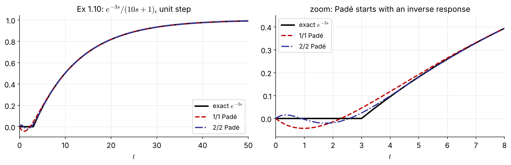{width="100%"}

::: {.small}
Far from $t=0$ both approximations are excellent; at early times 1/1 dips to $-0.04$, and 2/2 wiggles around zero.
:::
:::
:::

## [Problem #5]{.ex} &nbsp; (homework)

::: {.box}
(a) Show that the 1/1 Padé approximation is more accurate than the first-order Taylor expansion $e^{-t_ds}\approx1-t_ds$. (Compare the Taylor series of both.)

(b) Derive the 2/2 Padé approximation and find its poles and zeros for $t_d=3$.
:::

# 1.8 Higher-Order Processes and Approximations

## Non-interacting tanks in series

::: {.columns}
::: {.column width="46%"}

:::
::: {.column width="54%" .small}
$A_i\dfrac{dh_i}{dt}=q_{i-1}-q_i,\ q_i=\dfrac{h_i}{R_i}$ (linear resistance):
$$
\frac{H_i(s)}{H_{i-1}(s)}=\frac{K_i}{\tau_is+1},\quad \tau_i=A_iR_i,\ K_i=\frac{R_i}{R_{i-1}}
$$
$$
\frac{H_n(s)}{Q_1(s)}=\frac{R_n}{(\tau_1s+1)\cdots(\tau_ns+1)}
$$

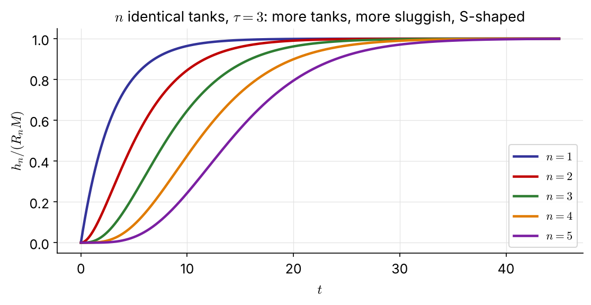{width="92%"}

The more tanks, the longer the $n$-th tank waits to "see" a change: the response looks like a **delay** followed by a lag.
:::
:::

## [Example 1.11]{.ex} &nbsp; Low-order approximation with dead time

::: {.columns}
::: {.column width="40%" .small}
Keep the **dominant** (large) time constants and lump the small ones into a dead time:
$$
G(s)\approx\frac{Ke^{-t_ds}}{(\tau_1s+1)(\tau_2s+1)},\quad t_d\approx\sum_{i\ne1,2}\tau_i
$$

$$
\frac YX=\frac{3}{(0.1s+1)(0.5s+1)(s+1)(3s+1)}
$$

- FOPDT: $\dfrac{3e^{-1.6s}}{3s+1}$
- SOPDT: $\dfrac{3e^{-0.6s}}{(s+1)(3s+1)}$

::: {.box}
**Half rule** (Skogestad) [NEW]{.new}: split the largest neglected time constant, half to the lag, half to the delay, e.g. $\dfrac{3e^{-0.35s}}{(1.25s+1)(3s+1)}$.
:::
:::
::: {.column width="60%"}
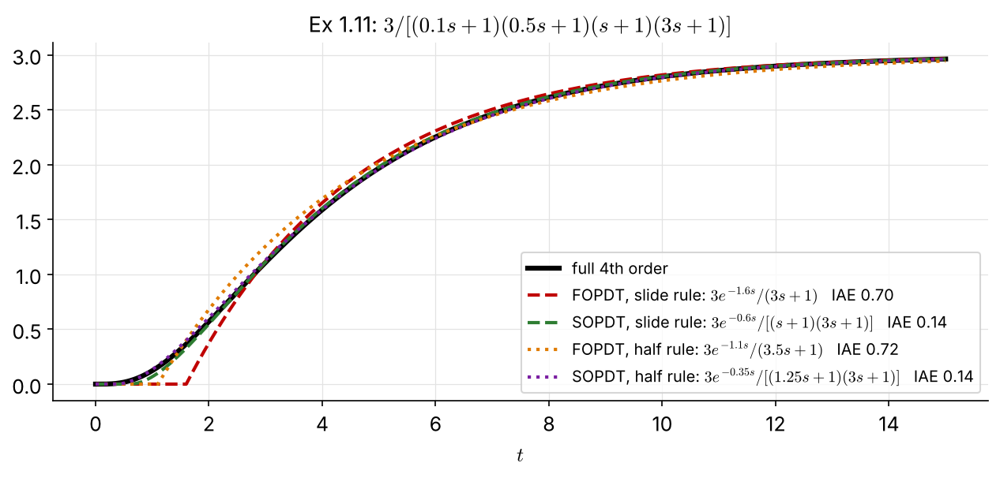{width="100%"}

::: {.small}
The second-order approximation is clearly better (IAE 0.14 vs 0.70). FOPDT models are the basis of the empirical tuning rules of Ch 3.
:::
:::
:::

## Interacting tanks

::: {.columns}
::: {.column width="48%"}


::: {.small}
$A_1\dfrac{dh_1}{dt}=q_i-\dfrac{h_1-h_2}{R_1},\quad A_2\dfrac{dh_2}{dt}=\dfrac{h_1-h_2}{R_1}-\dfrac{h_2}{R_2}$
$$
\frac{H_1}{Q_i}=\frac{R_1\tau_2s+R_1+R_2}{p(s)},\qquad \frac{H_2}{Q_i}=\frac{R_2}{p(s)}
$$
$$
p(s)=\tau_1\tau_2s^2+\left(\tau_1+\tau_2+\tau_1\frac{R_2}{R_1}\right)s+1
$$
:::
:::
::: {.column width="52%"}
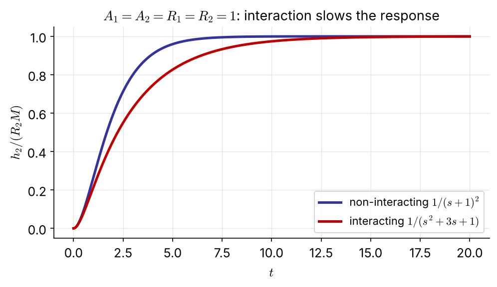{width="100%"}

::: {.small}
1. Even the first tank is second order (with a zero).
2. Interaction adds $\tau_1R_2/R_1$ to the middle coefficient; the poles stay **real and negative**.
:::

::: {.box .small}
**Which damps inlet-flow disturbances better?** The interacting pair: the extra term pushes one pole closer to the origin, so the response is slower and smoother. [NEW]{.new}
:::
:::
:::

## [Problem #6]{.ex} &nbsp; (homework) Blending tank and transfer pipe

::: {.columns}
::: {.column width="55%" .small}
A nearly perfectly mixed blending tank (first order) feeds a downstream unit through a long transfer pipe. A test shows that the pipe behaves as if its volume were split into **five** equal perfectly stirred tanks in series.

$V_{tank}=2\ \text{m}^3,\quad V_{pipe}=0.1\ \text{m}^3,\quad q_{total}=1\ \text{m}^3/\text{min}$
:::
::: {.column width="45%" .small}
(a) What is the most accurate transfer function $C'_{out}(s)/C'_{in}(s)$ you can develop?

(b) What approximate low-order transfer function could represent this process?

(c) What do you conclude about the need to model the pipe's mixing accurately?

(d) Simulate the approximate and full-order responses to a step change in $c_{in}$.
:::
:::

# 1.9 Effect of Zeros

## Lead-lag element

::: {.columns}
::: {.column width="46%" .small}
Poles govern the inherent dynamics; zeros add finer "fingerprints" by changing the coefficients.
$$
\frac{Y}{X}=\frac{\tau_zs+1}{\tau s+1}\ \xrightarrow{X=1/s}\ Y=\frac1s+\frac{\tau_z-\tau}{\tau s+1}
$$
$$
y(t)=1-\left(1-\frac{\tau_z}{\tau}\right)e^{-t/\tau},\qquad y(0^+)=\frac{\tau_z}{\tau}
$$

- the exponential still comes from the pole $-1/\tau$
- $\tau_z>\tau$: jump above 1, **overshoot**
- $0<\tau_z<\tau$: jump, then rise
- $\tau_z<0$ (RHP zero): **inverse response**
- $\tau_z=\tau$: **pole-zero cancellation**, $y=1$
:::
::: {.column width="54%"}
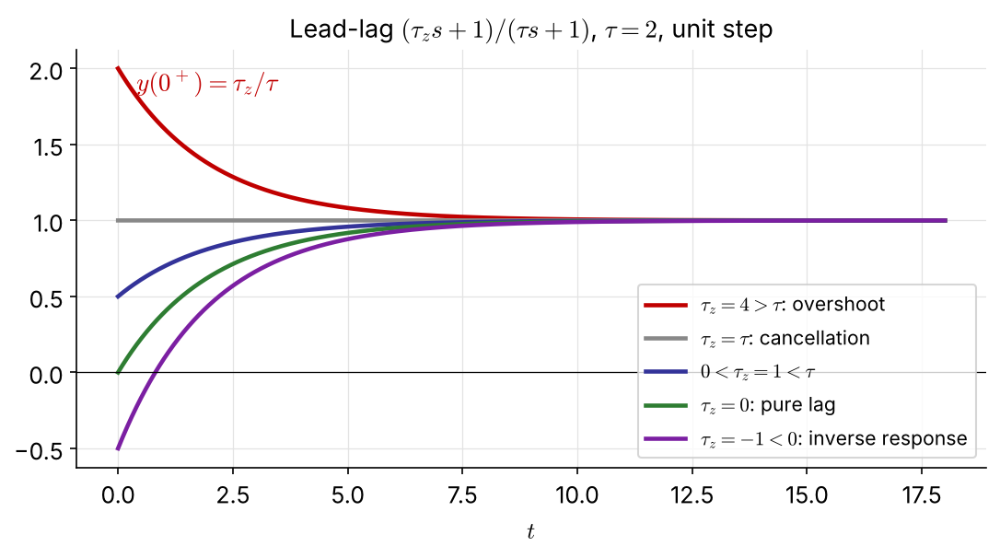{width="100%"}
:::
:::

## Transfer functions in parallel

::: {.columns}
::: {.column width="44%"}


::: {.small}
Two competing effects with different time constants:
$$
\frac{Y}{X}=\frac{K_1}{\tau_1s+1}+\frac{K_2}{\tau_2s+1}=\frac{K(\tau_zs+1)}{(\tau_1s+1)(\tau_2s+1)}
$$
$K=K_1+K_2,\quad \tau_z=\dfrac{K_1\tau_2+K_2\tau_1}{K_1+K_2}$
:::
:::
::: {.column width="56%" .small}
With **opposing** effects ($K_2<0$), superposition gives a rough picture right away.

::: {.navy}
The fast element wins first, the large-gain element wins at the end: $\tau_1\gg\tau_2$ gives $\tau_z<0$ and an inverse response.
:::
:::
:::

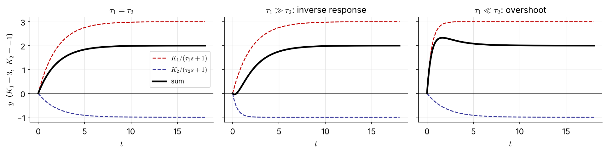{width="76%" fig-align="center"}

## [Problem #7]{.ex} &nbsp; (homework)

$$
\frac YX=\frac{K(\tau_zs+1)}{(\tau_1s+1)(\tau_2s+1)},\qquad \tau_1>\tau_2
$$

::: {.box}
Calculate the response to a step of magnitude $M$ and show that

(a) $y(t)$ has an extremum only if $\dfrac{1-\tau_z/\tau_2}{1-\tau_z/\tau_1}>1$;
(b) overshoot occurs only for $\tau_z/\tau_1>1$;
(c) inverse response occurs only for $\tau_z<0$;
(d) if an extremum exists, find the time at which it occurs.
:::

## Interactive: poles, zeros, dead time [NEW]{.new}

::: {.screen-only}

:::

::: {.print-only}
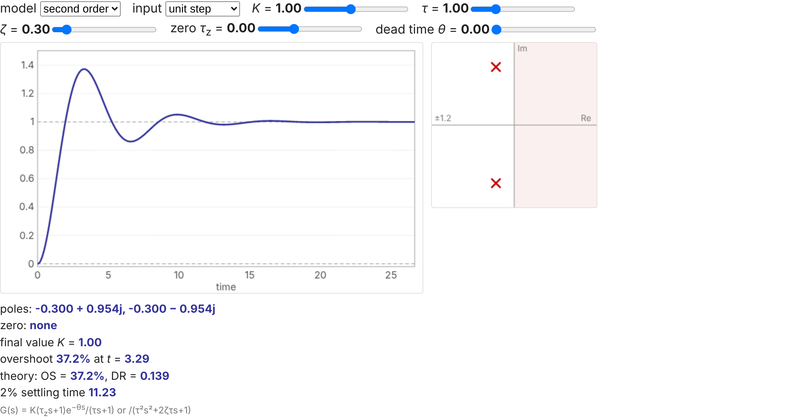{width="88%"}

::: {.small .center}
Interactive version: [seoultechpse.github.io/ProCon/ch1/ch1_dynamics.html](https://seoultechpse.github.io/ProCon/ch1/ch1_dynamics.html) — first or second order, $K$, $\tau$, $\zeta$, zero $\tau_z$, dead time $\theta$.
:::
:::

## Summary

::: {.columns}
::: {.column width="50%"}
::: {.box .small}
**Tools**

- deviation variables → zero initial conditions
- linearize about the operating point
- Laplace transform + table; final value only if stable
- partial fractions: one term per pole
- $G(s)=Q(s)/P(s)$, gain $K=G(0)$
:::
:::
::: {.column width="50%"}
::: {.box .small}
**Responses**

- first order: $\tau$ (63.2%), $K$; integrator $K_I/s$
- second order: $\zeta$ sets over/critical/under damping; OS, DR $=$ OS², $t_s\approx4\tau/\zeta$
- dead time $e^{-t_ds}$ → Padé; high order → FOPDT/SOPDT
- zeros: overshoot, inverse response (RHP zero)
:::
:::
:::

::: {.small .navy}
Next (Ch 2): close the loop with a controller and see how $K_c$, $\tau_I$, $\tau_D$ move these poles.
:::

## Resources

::: {.box}
- **Slides (interactive HTML):** [seoultechpse.github.io/ProCon/ch1/ch1_dynamics.html](https://seoultechpse.github.io/ProCon/ch1/ch1_dynamics.html)
- **PDF:** [slides](https://seoultechpse.github.io/ProCon/ch1/ch1_dynamics.pdf) · [handout with note space](https://seoultechpse.github.io/ProCon/ch1/ch1_dynamics_handout.pdf)
- **Python notebook:** [Open in Colab](https://colab.research.google.com/github/SeoulTechPSE/ProCon/blob/main/ch1/ch1_dynamics.ipynb) — every transform (sympy), calculation and figure of this chapter
- **Response explorer:** [standalone page](https://seoultechpse.github.io/ProCon/ch1/interactive/response_explorer.html)
:::
