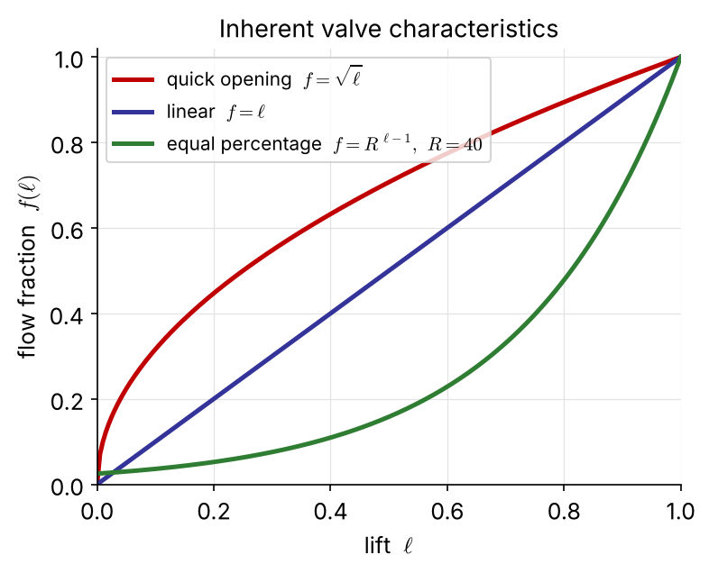
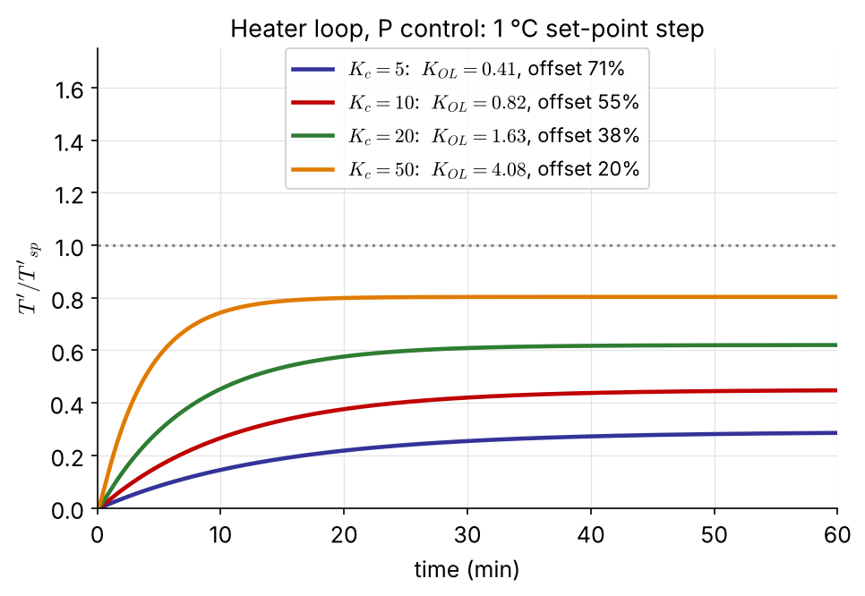
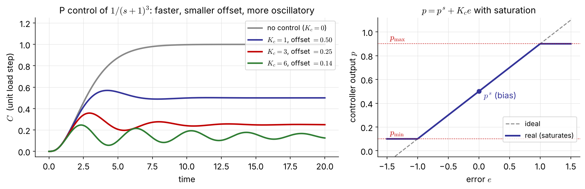
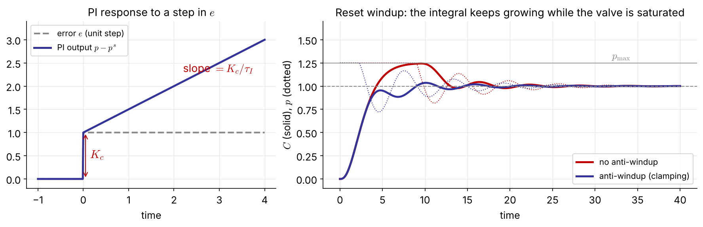
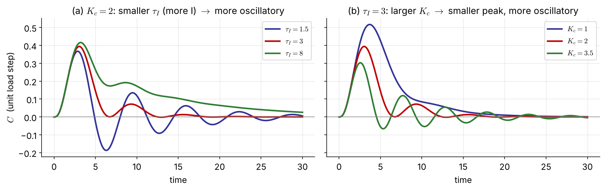
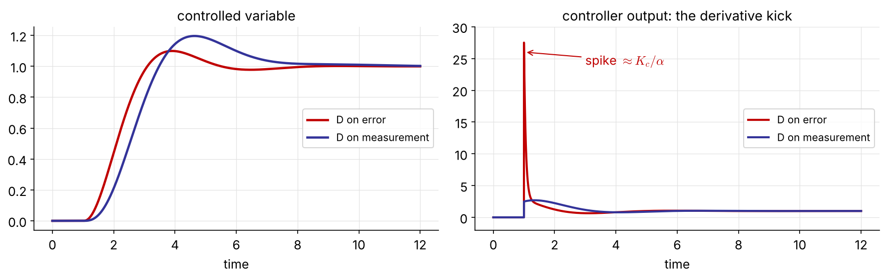
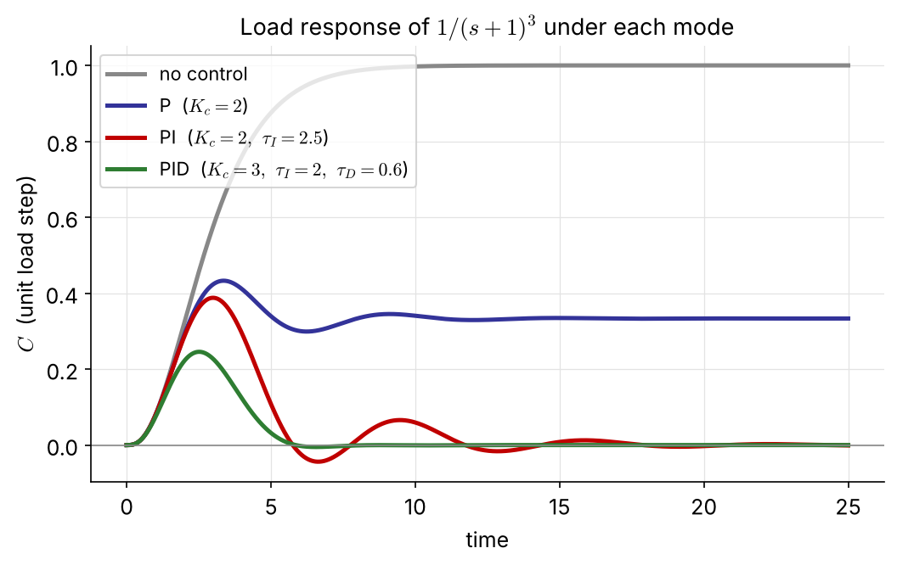
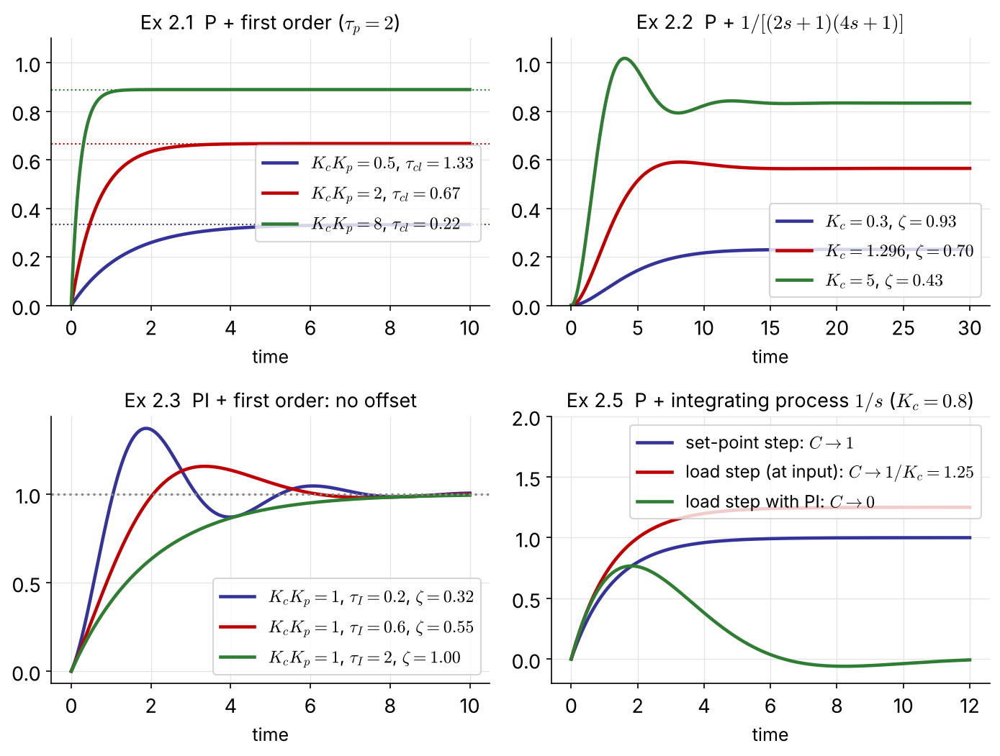
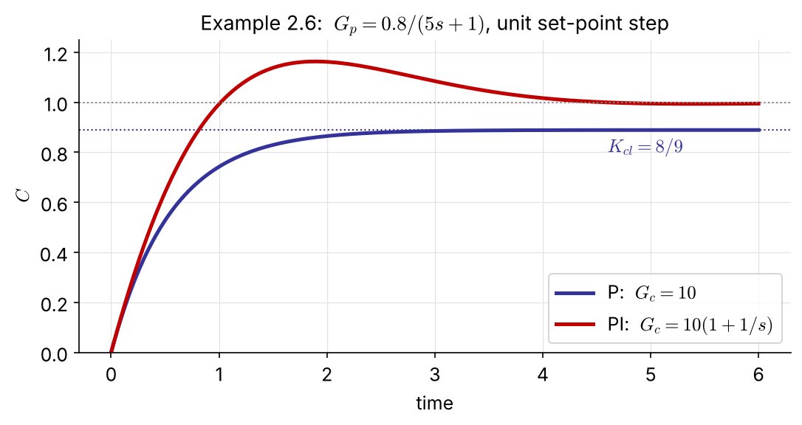
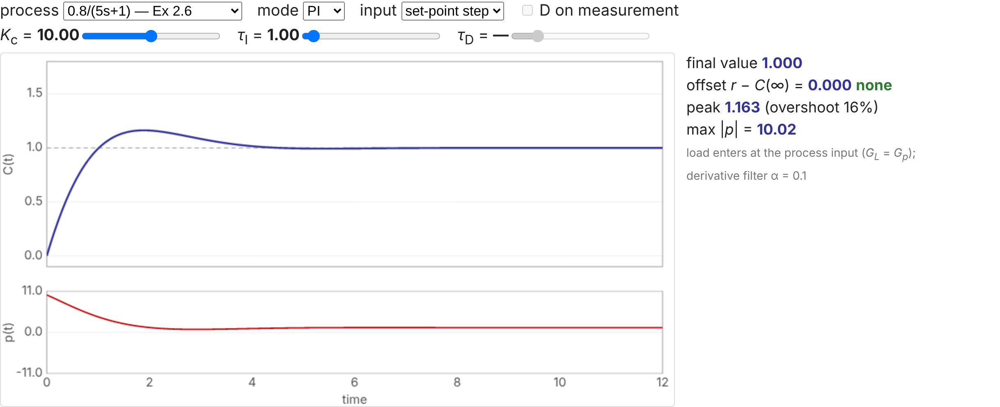

## What are we up to?

We finally launch into **controllers**. Two things come first:

1. how to **set up** a control problem and derive the **closed-loop transfer functions** and the **characteristic equation**;
2. what the three modes of the classical **PID controller** do, and what each costs.

| Section | Topic | Key result |
|:-|:-----|:------|
| 2.1 | the feedback loop, block diagrams, hardware | $C=G_{sp}R+G_{load}L$, characteristic equation $1+G_{OL}=0$ |
| 2.2 | P, PI, PD and PID control | offset, reset windup, derivative kick |
| 2.3 | closed-loop response, Examples 2.1–2.6 | how $K_c,\ \tau_I,\ \tau_D$ change gain, time constant and $\zeta$ |
| 2.4 | which controller for which variable | level, flow, temperature, pressure, composition |

::: {.small .navy}
Feedback control is old: water-level regulators in Greece around 250 B.C., James Watt's fly-ball governor in 1788.
:::

# 2.1 Classical Feedback Control System

## A liquid-level loop



::: {.columns}
::: {.column width="50%" .small}
- **set point** (reference) $h^s$: the level we want
- **controlled** = **measured variable**: level $h$
- **manipulated variable**: outlet flow $q$
- **disturbance** (load): inlet flow $q_i$
:::
::: {.column width="50%" .small}
The controller acts on the **error**, the negative of the deviation:

$$
e(t)=h^s-h(t),\qquad p(t)=p^s+f\big[e(t)\big]
$$

$f$ is the **control law**; $p^s$ is the **controller bias**, the output when $e=0$.
:::
:::

::: {.tiny}
A *system* means the process together with the controller and its accessories (sensor, transmitter, actuator).
:::

## Block-diagram algebra



::: {.columns}
::: {.column width="48%" .small}
For negative feedback, $E=R-HY$ and $Y=GE$, so $Y=G(R-HY)$ and

$$
\frac{Y}{R}=\frac{G}{1+GH}
$$
:::
::: {.column width="52%"}
::: {.box}
**Rule.** Closed-loop TF $=$ (product of the blocks on the **forward path**) $/$ (1 $+$ product of **all** blocks around the loop).

The denominator, set to zero, is the **characteristic equation** of the closed loop.
:::
:::
:::

## The standard loop: stirred-tank heater



::: {.small}
Process model $T=G_LT_i+G_pT_H$. We manipulate the steam temperature $T_H$ ($M$), so the inlet temperature $T_i$ becomes the load $L$. Closing the loop:

$$
C=\underbrace{\frac{K_mG_cG_aG_p}{1+G_mG_cG_aG_p}}_{G_{sp}}\,R+\underbrace{\frac{G_L}{1+G_mG_cG_aG_p}}_{G_{load}}\,L
$$
:::

::: {.tiny .navy}
$K_m$ converts the set point (°C) into the same mA signal as the measurement, so $K_m$ must equal the steady-state gain of $G_m$. [NEW]{.new}
:::

## Servo and regulator problems

::: {.columns}
::: {.column width="50%"}
::: {.box}
**Servo problem** — set-point change, $L=0$:
$$
C=G_{sp}R,\qquad \text{ideal: } C=R
$$
(perfect tracking)
:::
:::
::: {.column width="50%"}
::: {.box}
**Regulator problem** — disturbance, $R=0$:
$$
C=G_{load}L,\qquad \text{ideal: } C=0
$$
(perfect disturbance rejection)
:::
:::
:::

Both transfer functions share **one** denominator, the **closed-loop characteristic equation**:

$$
1+G_mG_cG_aG_p=1+G_{OL}=0
$$

::: {.boxr}
Dynamics and stability are therefore **the same** for set-point and load changes. Only the numerators, and so the size and shape of the response, differ.
:::

## Choosing the controlled and manipulated variables

::: {.columns}
::: {.column width="50%"}
**Controlled variables**: those that

1. are dictated by the problem (the temperature of a refrigerator)
2. are not self-regulating (a liquid level)
3. may exceed equipment or process constraints
4. interact with other variables (reactor temperature affects yield)
:::
::: {.column width="50%"}
**Manipulated variables**: those that

1. have a direct effect on the output
2. have a large steady-state gain (sensitivity)
3. have no dead time
4. do not interact with other loops
:::
:::

::: {.small .navy}
In a SISO system everything else becomes a **load** variable.
:::

## [Problem #1]{.ex} &nbsp; (homework)



::: {.small}
The temperature $T$ of a tray near the top of a distillation column is controlled by adjusting the reflux flow $R$. Draw a **block diagram** for this feedback loop. Treat both the feed flow rate $F$ and the feed composition $x_F$ as disturbances.
:::

::: {.tiny .navy}
Hint: two load blocks, $G_F$ and $G_{x_F}$, enter the same summing junction as $G_p$.
:::

## Hardware around the loop



::: {.small}
Every block has **units**. Standard signal ranges let instruments from different vendors talk to each other: **4–20 mA** for electronic signals (4 mA is the live zero), **3–15 psi** for pneumatic valve actuators, with an **I/P transducer** in between.
:::

## Sensor and transmitter: $G_m$

::: {.columns}
::: {.column width="52%" .small}
$$
G_m=\frac{T_m}{T}=\frac{K_me^{-t_ds}}{\tau_ms+1}
$$

- $K_m$: gain of sensor plus transmitter (mA/°C)
- $\tau_m$: sensor lag, $t_d$: transport lag

**Thermowell**, energy balance:
$$
m_mC_m\frac{dT_m}{dt}=U_mA_m(T-T_m)\ \Rightarrow\ \tau_m=\frac{m_mC_m}{U_mA_m}
$$

A fast sensor with no transport lag gives simply $G_m=K_m$.
:::
::: {.column width="48%"}
::: {.box .small}
[Example]{.ex} &nbsp; 20–120 °C is transmitted linearly as 4–20 mA.

$$
I=mT+I_0,\quad m=\frac{16\ \text{mA}}{100\ ^\circ\text{C}}=0.16\ \text{mA}/^\circ\text{C}
$$
$I_0=4-20(0.16)=0.8$ mA

- 66 °C $\to I=0.16(66)+0.8=$ **11.36 mA**
- 6.5 mA $\to$ $T=(6.5-0.8)/0.16=$ **35.6&nbsp;°C**

The transmitter gain is
$$
K_m=\frac{\text{output span}}{\text{input span}}=0.16\ \text{mA}/^\circ\text{C}
$$
:::
:::
:::

## Actuator: the control valve, $G_a$

::: {.columns}
::: {.column width="50%"}
{width="92%"}
:::
::: {.column width="50%" .small}
$$
q=C_vf(\ell)\sqrt{\frac{\Delta P_v}{g_s}}
$$

$C_v$: valve coefficient, $\ell$: lift (0–1), $f(\ell)$: valve characteristic.

The actuator must cover the range of the manipulated variable and **respond faster than the process**.

**Fail-safe action** [NEW]{.new}: *air-to-open* (fail closed) or *air-to-close* (fail open), chosen for safety when the air supply fails. It fixes the sign of the valve gain.

Lumping I/P, valve and steam coil:
$$
G_a=G_v=\frac{K_v}{\tau_vs+1},\quad K_v=0.6\ ^\circ\text{C/mA},\ \tau_v=0.2\ \text{min}
$$
:::
:::

## The heater loop assembled [NEW]{.new}

::: {.columns}
::: {.column width="56%"}
{width="100%"}
:::
::: {.column width="44%" .small}
$$
G_p=\frac{0.85}{20s+1},\quad G_v=\frac{0.6}{0.2s+1}
$$

$G_m=K_m=0.16$ mA/°C (the transmitter above).

With P control, $G_c=K_c$ (mA/mA):
$$
K_{OL}=K_cK_vK_pK_m=0.0816\,K_c
$$
$$
\text{offset}=\frac{1}{1+K_{OL}}
$$

The loop gain is the product of **all** the gains, so a sluggish transmitter or valve gain must be made up by $K_c$. P control alone always leaves an offset, which motivates integral action.
:::
:::

# 2.2 PID Controllers

## Proportional control

::: {.columns}
::: {.column width="46%" .small}
$$
p(t)=p^s+K_ce(t)\ \Rightarrow\ G_c(s)=\frac{P(s)}{E(s)}=K_c
$$
(in deviation variables, $e^s=0$)

- $K_c$: **proportional gain** (controller sensitivity)
- **proportional band**: $\text{PB}=\dfrac{100}{K_c}\,\%$

**Action**: [NEW]{.new} *reverse acting* ($K_c>0$): output falls as the measurement rises. *Direct acting* ($K_c<0$) is needed when the process gain is negative, so that $K_cK_p>0$.
:::
::: {.column width="54%" .small}
- larger $K_c$: faster response, smaller offset
- too large $K_c$: oscillation, eventually **instability**
- the output **saturates** at $p_{\min}$, $p_{\max}$
- **offset** always remains: to hold $e=0$ at a new steady state, $p$ must move away from $p^s$, but $p-p^s=K_ce$ needs $e\ne0$
:::
:::

{width="76%" fig-align="center"}

## Proportional-integral control

$$
p(t)=p^s+K_c\left[e(t)+\frac{1}{\tau_I}\int_0^te\,dt\right]\ \Rightarrow\ G_c(s)=K_c\left[1+\frac{1}{\tau_Is}\right]
$$

::: {.small}
$\tau_I$: **integral (reset) time**; $1/\tau_I$ is the reset rate. Integral action is never used alone. The integral keeps changing as long as $e\ne0$, so it can supply the new output that a steady state needs while $e=0$: **no offset**.
:::

{width="96%"}

::: {.small}
**Reset windup**: when $e$ persists (start-up, large set-point changes) the integral grows until the valve saturates, then must "unwind", which causes a long overshoot. **Anti-windup** stops integrating while the output is saturated.
:::

## The price of integral action

{width="100%"}

::: {.columns}
::: {.column width="50%" .small}
- removing the offset usually costs a **more oscillatory** response: short rise time, but more overshoot or a longer settling time
:::
::: {.column width="50%" .small}
- so $K_c$ is usually **lowered** when integral action is added
- more integral action (small $\tau_I$) is faster but less damped
:::
:::

## Derivative action

::: {.columns}
::: {.column width="50%" .small}
$$
p(t)=p^s+K_c\left[e+\tau_D\frac{de}{dt}\right]\ \Rightarrow\ G_c=K_c[1+\tau_Ds]
$$

- P and I act on the present and the past; D anticipates from **how fast** $e$ changes.
- D does nothing while $e$ is constant, so it is never used alone.
- D opposes rapid change: it can damp the overshoot that integral action causes.
- D amplifies **noise**; PD is not useful with large dead time or noisy signals.
:::
::: {.column width="50%"}
::: {.box}
Ideal derivative action cannot be built (more zeros than poles), so a **lead-lag** element is used:
$$
G_c=K_c\frac{\tau_Ds+1}{\alpha\tau_Ds+1},\qquad 0.05\le\alpha\le0.2
$$

This adds a fast pole at $s=-1/(\alpha\tau_D)$ that limits the high-frequency gain to $K_c/\alpha$.
:::
:::
:::

## Derivative kick

::: {.columns}
::: {.column width="58%"}

:::
::: {.column width="42%" .small}
A set-point step makes $de/dt$ infinite, and the filtered D produces a spike of about $K_c/\alpha$ in the controller output.

Acting on the **measurement** instead of the error removes it: $R$ reaches the output only through the PI part. For a load change ($R$ constant) nothing changes, since then $de/dt=-dC/dt$.
:::
:::

{width="90%" fig-align="center"}

## PID control and its forms

| Form | $G_c(s)$ | Where |
|:--|:--|:--|
| ideal (ISA) | $K_c\left[1+\dfrac{1}{\tau_Is}+\tau_Ds\right]=K_c\dfrac{\tau_I\tau_Ds^2+\tau_Is+1}{\tau_Is}$ | analysis |
| parallel | $K_c+\dfrac{K_I}{s}+K_Ds$, &nbsp; $K_I=\dfrac{K_c}{\tau_I},\ K_D=K_c\tau_D$ | Simulink, textbooks |
| real (filtered D) | $K_c\left[1+\dfrac{1}{\tau_Is}+\dfrac{\tau_Ds}{\alpha\tau_Ds+1}\right]$ | most industrial controllers |
| series (interacting) | $K_c\left[\dfrac{\tau_Is+1}{\tau_Is}\right]\left[\dfrac{\tau_Ds+1}{\alpha\tau_Ds+1}\right]$ | pneumatic, older analog |

::: {.small}
- The ideal PID has a numerator of higher order than its denominator, so it is **not physically realizable**. We still use it in analysis for its clean algebra and the insight it gives.
- Simulink's PID block: $P+I\dfrac1s+D\dfrac{N}{1+N/s}$, so $N=1/(\alpha\tau_D)$.
- **Check the form** before copying settings from one controller to another. [NEW]{.new}
:::

## The three modes side by side

::: {.columns}
::: {.column width="58%"}
{width="100%"}
:::
::: {.column width="42%" .small}
| | P | I | D |
|:--|:-:|:-:|:-:|
| speed | ↑ | ↑ | – |
| offset | ↓ but stays | **removed** | – |
| overshoot | ↑ | ↑ | ↓ |
| stability margin | ↓ | ↓ | ↑ (usually) |
| noise sensitivity | – | – | ↑ |

::: {.tiny}
Arrows: effect of increasing $K_c$, $1/\tau_I$ and $\tau_D$. [NEW]{.new}
:::

Start simple: P, then PI; add D only if it helps.
:::
:::

## [Problem #2]{.ex} &nbsp; (homework)



::: {.small}
Proportional-only control of the stirred-tank heater above. The transmitter has a span of 50 °F and a zero of 55 °F. Nominal conditions are $\bar T=80$ °F and $\bar T_i=65$ °F. $K_c=5$, $K_v=1.2$ (dimensionless), $K_{IP}=0.75$ psi/mA, $\tau=5$ min; valve and transmitter dynamics are negligible. After the set point is changed from 80 to 85 °F, the tank temperature settles at 84.14 °F.

\(a\) What is the offset? &nbsp; (b) What is the process gain $K_2$? &nbsp; (c) What is the pressure signal $p_t$ to the valve at the final steady state?
:::

# 2.3 Closed-Loop System Response

## Unity-feedback servo loop

::: {.columns}
::: {.column width="62%"}

:::
::: {.column width="38%"}
$$
\frac{C}{R}=\frac{G_cG_p}{1+G_cG_p}
$$
:::
:::

1. Choose $G_c$ (P, PI, PD, PID) and $G_p$ and substitute.
2. Rearrange into standard first- or second-order form, so the **closed-loop gain**, **time constant** and **damping ratio** can be read off.
3. The final-value theorem gives the **offset** for a unit step: $e(\infty)=1-\lim_{s\to0}\dfrac{C}{R}$.

::: {.small .navy}
$G_m=G_a=1$ and $L=0$ keep the algebra light. The ideas carry over to the full loop.
:::

## [Example 2.1]{.ex} &nbsp; P control, first-order process

$G_c=K_c,\quad G_p=\dfrac{K_p}{\tau_ps+1}$ &nbsp;&nbsp; What is $C(\infty)$ after a unit set-point step?

$$
\frac{C}{R}=\frac{K_cK_p}{\tau_ps+1+K_cK_p}=\frac{K_{cl}}{\tau_{cl}s+1},\qquad
K_{cl}=\frac{K_cK_p}{1+K_cK_p},\quad \tau_{cl}=\frac{\tau_p}{1+K_cK_p}
$$

::: {.columns}
::: {.column width="50%"}
::: {.box}
- still **first order**
- faster: $\tau_{cl}<\tau_p$
- $C(\infty)=K_{cl}<1$: offset
$$
e(\infty)=\frac{1}{1+K_cK_p}
$$
:::
:::
::: {.column width="50%" .small}
Larger $K_c$ shrinks both $\tau_{cl}$ and the offset, but the offset vanishes only as $K_c\to\infty$.

A first-order process under P control **cannot** oscillate or go unstable for $K_cK_p>0$; real loops do because of the lags and dead time this model ignores.
:::
:::

## [Example 2.2]{.ex} &nbsp; P control, second-order overdamped process

$G_p=\dfrac{K_p}{(\tau_1s+1)(\tau_2s+1)}$, $\;\tau_1=2,\ \tau_2=4$ min, $K_p=1$. Which $K_c$ gives $\zeta=0.7$?

$$
\frac{C}{R}=\frac{K_cK_p}{\tau_1\tau_2s^2+(\tau_1+\tau_2)s+1+K_cK_p}=\frac{K_{cl}}{\tau^2s^2+2\zeta\tau s+1}
$$

$$
\tau=\sqrt{\frac{\tau_1\tau_2}{1+K_cK_p}},\qquad \zeta=\frac{\tau_1+\tau_2}{2\sqrt{\tau_1\tau_2(1+K_cK_p)}}
$$

::: {.columns}
::: {.column width="54%"}
::: {.box .small}
$\zeta=\dfrac{3}{\sqrt{8(1+K_c)}}=0.7\ \Rightarrow\ 1+K_c=2.296$

**$K_c=1.30$**, &nbsp; offset $=\dfrac{1}{1+K_c}=0.44$: large!
:::
:::
::: {.column width="46%" .small .navy}
Raising $K_c$ lowers $\zeta$: the closed loop becomes underdamped although the open loop is overdamped. Speed and damping trade off, and the offset at $\zeta=0.7$ is unacceptable.
:::
:::

## [Example 2.3]{.ex} &nbsp; PI control, first-order process

$G_c=K_c\left(1+\dfrac{1}{\tau_Is}\right)$, $\;G_p=\dfrac{K_p}{\tau_ps+1}$. What is the offset?

$$
\frac{C}{R}=\frac{K_cK_p(\tau_Is+1)}{\tau_I\tau_ps^2+\tau_I(1+K_cK_p)s+K_cK_p}=\frac{\tau_Is+1}{\tau^2s^2+2\zeta\tau s+1}
$$

$$
\tau=\sqrt{\frac{\tau_I\tau_p}{K_cK_p}},\qquad \zeta=\frac12(1+K_cK_p)\sqrt{\frac{\tau_I}{K_cK_p\tau_p}}
$$

::: {.columns}
::: {.column width="50%"}
::: {.box}
$\lim_{s\to0}C/R=1$: **no offset**.

The integrator raises the order by one: a first-order process can now **oscillate** (small $\tau_I$, large $K_c$).
:::
:::
::: {.column width="50%" .small}
The closed loop also has a **zero** at $s=-1/\tau_I$, which adds overshoot beyond what $\zeta$ alone predicts.
:::
:::

## [Example 2.4]{.ex} &nbsp; PD control, first-order process

$G_c=K_c(1+\tau_Ds)$, $\;G_p=\dfrac{K_p}{\tau_ps+1}$

$$
\frac{C}{R}=\frac{K_cK_p(\tau_Ds+1)}{(\tau_p+K_cK_p\tau_D)s+1+K_cK_p}
=K_{cl}\,\frac{\tau_Ds+1}{\tau_{cl}s+1}
$$

$$
K_{cl}=\frac{K_cK_p}{1+K_cK_p},\qquad \tau_{cl}=\frac{\tau_p+K_cK_p\tau_D}{1+K_cK_p}
$$

::: {.columns}
::: {.column width="50%"}
::: {.box}
- same closed-loop gain as P: **offset remains**
- still first order; D adds a lead (zero)
:::
:::
::: {.column width="50%" .small}
The ideal D makes $C$ jump at $t=0^+$ to $K_{cl}\tau_D/\tau_{cl}$. On a first-order process derivative action brings little; it pays off on higher-order processes, where it adds damping.
:::
:::

## [Example 2.5]{.ex} &nbsp; P control, integrating process

$G_c=K_c$, $\;G_p=\dfrac{K_p}{s}$ (e.g. a level with a pumped outlet). What is the offset?

::: {.columns}
::: {.column width="50%"}
**Servo**
$$
\frac{C}{R}=\frac{K_cK_p}{s+K_cK_p}=\frac{1}{\tau s+1},\ \ \tau=\frac{1}{K_cK_p}
$$

::: {.box}
$C(\infty)=1$: **no offset** for set-point changes. The process already contains an integrator.
:::
:::
::: {.column width="50%"}
**Regulator** [NEW]{.new} (load at the process input, $G_L=G_p$)
$$
\frac{C}{L}=\frac{K_p}{s+K_cK_p}\ \Rightarrow\ C(\infty)=\frac{1}{K_c}
$$

::: {.boxr}
A step **disturbance** still leaves an offset. Only an integrator in the **controller** (PI) removes it.
:::
:::
:::

## Examples 2.1–2.5 at a glance

::: {.columns}
::: {.column width="64%"}
{width="100%"}
:::
::: {.column width="36%" .small}
| Ex | $G_c$ | $G_p$ | CL order | offset |
|:-:|:-:|:-:|:-:|:-:|
| 2.1 | P | 1st | 1 | $\dfrac{1}{1+K_cK_p}$ |
| 2.2 | P | 2nd | 2 | $\dfrac{1}{1+K_cK_p}$ |
| 2.3 | PI | 1st | 2 | 0 |
| 2.4 | PD | 1st | 1 | $\dfrac{1}{1+K_cK_p}$ |
| 2.5 | P | $K_p/s$ | 1 | 0 (servo) |

::: {.navy}
Offset disappears only when the loop contains an **integrator** between the error and the disturbance.
:::
:::
:::

## [Example 2.6]{.ex} &nbsp; Closed-loop simulation

::: {.columns}
::: {.column width="50%"}
::: {.panel-tabset}
### Python

```{.python}
import numpy as np, control as ct
import matplotlib.pyplot as plt

Gp = ct.tf(0.8, [5, 1])
t = np.linspace(0, 6, 601)

Gc = 10                        # P
Gcl = ct.feedback(Gp*Gc, 1)    # 8/9
plt.plot(t, ct.step_response(Gcl, t).outputs)

Gc = ct.tf([10, 10], [1, 0])   # PI
Gcl = ct.feedback(Gp*Gc, 1)
plt.plot(t, ct.step_response(Gcl, t).outputs)
```

### MATLAB

```{.matlab}
Gp = tf(0.8, [5 1]);

Gc  = 10;                        % P
Gcl = feedback(Gp*Gc, 1);
step(Gcl); hold on

Gc  = tf([10 10], [1 0]);        % PI: 10(1 + 1/s)
Gcl = feedback(Gp*Gc, 1);
step(Gcl)
```
:::
:::
::: {.column width="50%"}
{width="100%"}

::: {.small}
P: $K_{cl}=8/9$, offset 0.11. PI: no offset, $\zeta=0.71$, 16% overshoot. In Simulink the same loop is a Step, a Sum, two gains with an integrator (PI) and a Transfer Fcn block.
:::
:::
:::

## Interactive: try the modes yourself [NEW]{.new}

::: {.screen-only}

:::

::: {.print-only}
{width="90%"}

::: {.small .center}
Interactive version: [seoultechpse.github.io/ProCon/ch2/ch2_analysis.html](https://seoultechpse.github.io/ProCon/ch2/ch2_analysis.html) — process, mode, $K_c$, $\tau_I$, $\tau_D$, set-point or load step.
:::
:::

# 2.4 Choice of Controllers

## Which mode for which variable?

| Variable | Usual choice | Why |
|:--|:--|:--|
| **level** | P | only needs to stay within a range around the set point |
| **flow** | PI | fast, noisy loop: low to moderate $K_c$, small $\tau_I$ for fast tracking |
| **temperature** | PID | heat-transfer lags make it sluggish; offsets are rarely acceptable; PI alone is slow |
| **pressure**, flash-drum vapor | PI | fast and tight, like flow control |
| **pressure**, column top (via condenser cooling) | P, or PID if speed matters | slow heat-exchanger dynamics rule out PI |
| **composition**, fast analyzer (pH, UV/IR) | PI or PID | decide from the process dynamics |
| **composition**, slow analyzer (GC) | sampled-data control | large measurement delay |

::: {.small .navy}
Know the hardware (actuators, sensors) from handbooks and manuals. Prevalent time delay is what makes chemical process control harder than many mechanical or electrical systems.
:::

## [Problem #3]{.ex} &nbsp; (homework) Blending tank

::: {.columns}
::: {.column width="55%"}


::: {.small}
The exit concentration $c_3$ is controlled with stream 2.

\(a\) Draw the block diagram of the composition loop.
(b) Derive each transfer function and substitute numbers.
(c) The PI controller was tuned at the nominal conditions. Should it be retuned when (i) $\bar c_2$ changes to 8.5 lb/ft³; (ii) the transmitter span becomes 3–14 lb/ft³; (iii) its zero is moved so that it reads 4–10 lb/ft³? Justify briefly.
:::
:::
::: {.column width="45%" .tiny}
1. The tank is perfectly mixed; all densities are equal and constant.
2. $q_2$ and $c_2$ vary with time; stream 1 is constant.
3. Exit valve: $q_3=C_v\sqrt{h}$.
4. A 2-min delay in the composition measurement; the transmitter output varies linearly from 4 to 20 mA as $c_3$ goes from 3 to 9 lb/ft³.
5. Pneumatic valve, negligible dynamics:

| $p_t$ (psi) | 6 | 9 | 12 |
|:--|--:|--:|--:|
| $q_2$ (gal/min) | 20 | 15 | 10 |

6. Electronic, direct-acting PI controller.
7. I/P transducer: negligible dynamics, 0.3 psi/mA.
8. Nominal: $\rho=75$ lb/ft³, $\bar q_1=10$, $\bar q_2=15$ gal/min, $\bar c_3=5$, $\bar c_2=7$ lb/ft³, $C_v=12.5$ gal/min/ft$^{1/2}$, tank diameter 4 ft.
:::
:::

## Summary

::: {.columns}
::: {.column width="50%"}
::: {.box}
**Setting up**

- $C=G_{sp}R+G_{load}L$
- forward path $/$ (1 + loop)
- one characteristic equation $1+G_{OL}=0$ for servo and regulator
- every block has units; $K_m$ in front of the comparator equals the gain of $G_m$
:::
:::
::: {.column width="50%"}
::: {.box}
**PID modes**

- **P**: faster, but leaves an offset
- **I**: removes the offset, costs damping; beware windup
- **D**: adds damping, amplifies noise; filter it and put it on the measurement
- closed-loop order, $\tau$ and $\zeta$ follow from substituting $G_c$ and $G_p$
:::
:::
:::

::: {.small .navy}
Next (Ch 3): how to choose $K_c$, $\tau_I$ and $\tau_D$. Then (Ch 4–5): when the loop goes unstable.
:::

## Resources

::: {.box}
- **Slides (interactive HTML):** [seoultechpse.github.io/ProCon/ch2/ch2_analysis.html](https://seoultechpse.github.io/ProCon/ch2/ch2_analysis.html)
- **PDF:** [slides](https://seoultechpse.github.io/ProCon/ch2/ch2_analysis.pdf) · [handout with note space](https://seoultechpse.github.io/ProCon/ch2/ch2_analysis_handout.pdf)
- **Python notebook:** [Open in Colab](https://colab.research.google.com/github/SeoulTechPSE/ProCon/blob/main/ch2/ch2_analysis.ipynb) — every derivation (sympy), calculation and figure of this chapter
- **Closed-loop explorer:** [standalone page](https://seoultechpse.github.io/ProCon/ch2/interactive/loop_explorer.html)
:::
