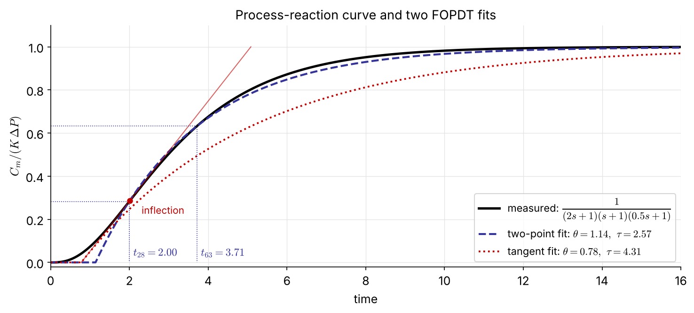
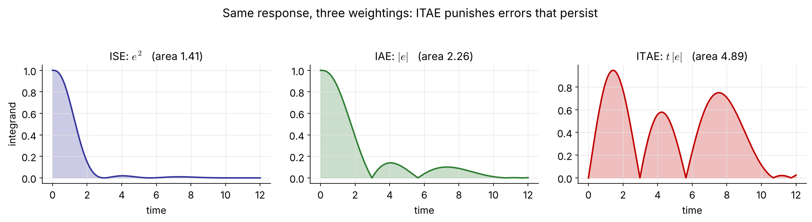
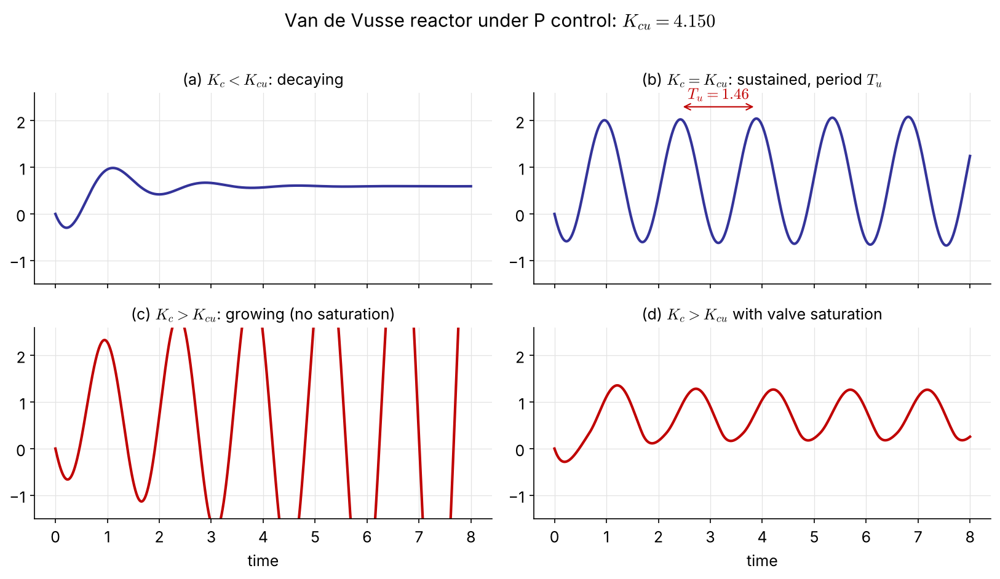
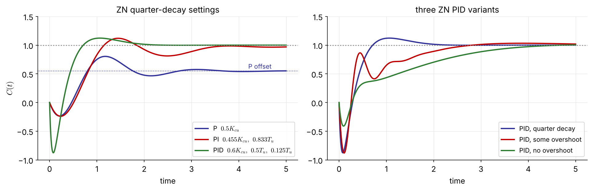
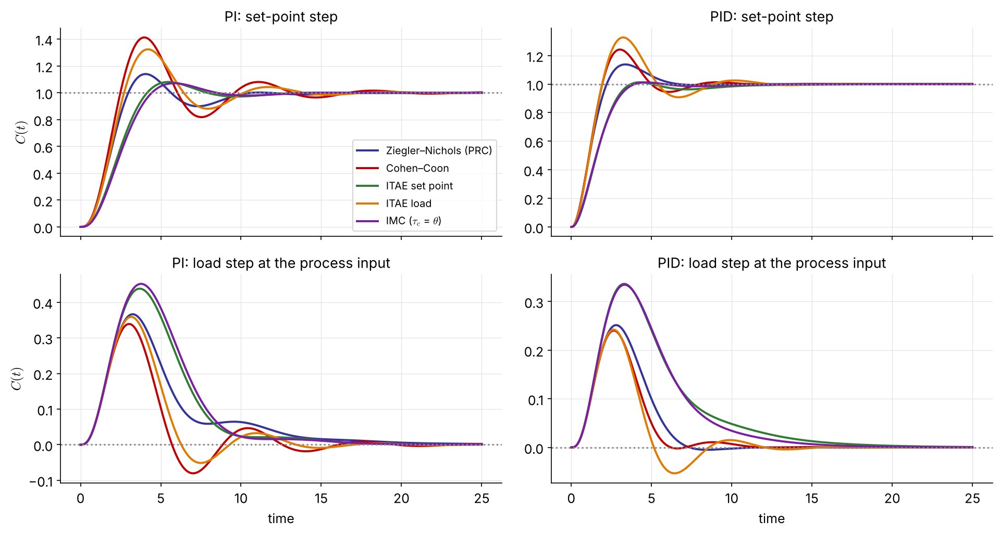
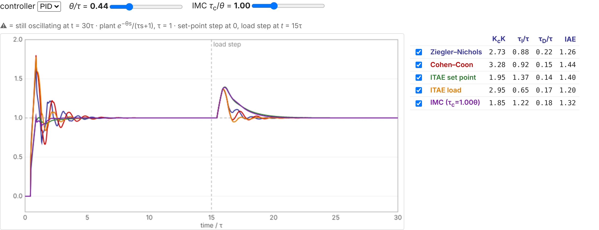
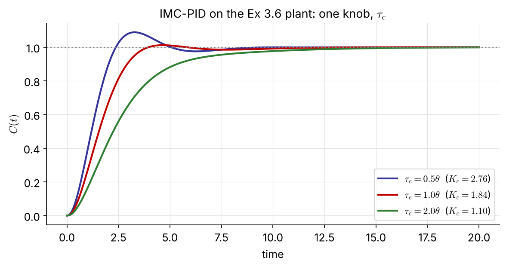
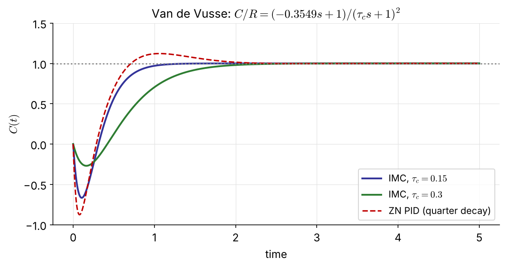

## What are we up to?

A PID controller needs only **three numbers**, $K_c$, $\tau_I$ and $\tau_D$, yet choosing them is one of the most confusing parts of learning control.

::: {.boxr}
Different tuning techniques give **similar but not identical** results. There is no "best" or "absolutely correct" answer, only trade-offs between speed, overshoot and robustness.
:::

| Approach | Experiment | Model | Methods |
|:--|:--|:--|:--|
| **Empirical** (3.1) | open-loop step test | FOPDT fit $\dfrac{Ke^{-\theta s}}{\tau s+1}$ | Ziegler–Nichols, Cohen–Coon, ITAE |
|  | closed-loop test | $K_{cu}$, $T_u$ only | ZN ultimate cycle |
| **Model-based** (3.2) | — | transfer function | direct synthesis, IMC |

# 3.1 Tuning with Empirical Relations

## Empirical tuning in practice

1. Run an **experiment**: an open-loop step test, or a closed-loop test.
2. **Fit** the response to a simple model.
3. Compute the settings from **empirical relations**.

::: {.box}
The settings are a **quick-and-dirty starting point**. They are seldom optimal and usually need **field tuning** after installation to meet the actual response specifications.
:::

## Process-reaction curve: the open-loop step test



::: {.small}
With the controller disconnected, step the controller output by $P=M/s$ and record the **measured** output. What we see is the lumped response of valve, process and sensor:

$$
G_{PRC}=\frac{C_m}{P}=G_aG_pG_m\;\approx\;\frac{Ke^{-\theta s}}{\tau s+1}
$$
:::

## Fitting the FOPDT model [NEW]{.new}

{width="82%"}

::: {.columns .small}
::: {.column width="50%"}
**Two-point method (Smith)**: read $t_{28}$ and $t_{63}$ at 28.3 % and 63.2 % of the final change
$$
\tau=1.5\,(t_{63}-t_{28}),\qquad \theta=t_{63}-\tau,\qquad K=\frac{\Delta C_m}{\Delta P}
$$
:::
::: {.column width="50%"}
**Tangent method**: draw the tangent at the inflection point. Its intercepts give $\theta$ and $\tau$.

Simple, but it **overestimates** $\tau$ and underestimates $\theta$, so it gives aggressive settings.
:::
:::

## Ziegler–Nichols and Cohen–Coon (open-loop test)

::: {.ftab}
| Controller | | Cohen–Coon | Ziegler–Nichols |
|:--|:--|:--:|:--:|
| P | $K_cK$ | $\dfrac{\tau}{\theta}+\dfrac13$ | $\dfrac{\tau}{\theta}$ |
| PI | $K_cK$ | $0.9\dfrac{\tau}{\theta}+\dfrac{1}{12}$ | $0.9\dfrac{\tau}{\theta}$ |
| | $\tau_I$ | $\theta\,\dfrac{30+3\theta/\tau}{9+20\theta/\tau}$ | $3.3\,\theta$ |
| PID | $K_cK$ | $\dfrac43\dfrac{\tau}{\theta}+\dfrac14$ | $1.2\dfrac{\tau}{\theta}$ |
| | $\tau_I$ | $\theta\,\dfrac{32+6\theta/\tau}{13+8\theta/\tau}$ | $2\,\theta$ |
| | $\tau_D$ | $\theta\,\dfrac{4}{11+2\theta/\tau}$ | $0.5\,\theta$ |
:::

::: {.small .navy}
Both aim at a **quarter-decay ratio**, which is fast but oscillatory. Note $K_c\propto 1/K$ and $K_c\propto\tau/\theta$: the larger the dead time relative to the time constant, the gentler the controller.
:::

## Minimum error-integral criteria

::: {.columns}
::: {.column width="38%"}
$$
\mathrm{ISE}=\int_0^\infty e^2(t)\,dt
$$
$$
\mathrm{IAE}=\int_0^\infty |e(t)|\,dt
$$
$$
\mathrm{ITAE}=\int_0^\infty t\,|e(t)|\,dt
$$
:::
::: {.column width="62%" .small}
- **ISE** weights large errors heavily: fast initial response, but oscillatory.
- **IAE** weights all errors equally.
- **ITAE** weights errors that **persist**: it penalizes slow oscillation, so the settings are well damped and **conservative**. Recommended. [FIX]{.fix}
:::
:::

{width="96%"}

## Minimum-ITAE tuning relations

::: {.columns}
::: {.column width="50%"}
**Load change**
$$
K_c=\frac{a_1}{K}\left(\frac{\tau}{\theta}\right)^{b_1},\quad
\tau_I=\frac{\tau}{a_2}\left(\frac{\theta}{\tau}\right)^{b_2}
$$

| | $a_1$ | $b_1$ | $a_2$ | $b_2$ | $a_3$ | $b_3$ |
|:--|--:|--:|--:|--:|--:|--:|
| PI | 0.859 | 0.977 | 0.674 | 0.680 | — | — |
| PID | 1.357 | 0.947 | 0.842 | 0.738 | 0.381 | 0.995 |
:::
::: {.column width="50%"}
**Set-point change**
$$
K_c=\frac{a_1}{K}\left(\frac{\tau}{\theta}\right)^{b_1},\quad
\tau_I=\frac{\tau}{a_2-b_2\,\theta/\tau}
$$

| | $a_1$ | $b_1$ | $a_2$ | $b_2$ | $a_3$ | $b_3$ |
|:--|--:|--:|--:|--:|--:|--:|
| PI | 0.586 | 0.916 | 1.03 | 0.165 | — | — |
| PID | 0.965 | 0.855 | 0.796 | 0.147 | 0.308 | 0.929 |
:::
:::

$$
\text{both:}\qquad \tau_D=a_3\,\tau\left(\frac{\theta}{\tau}\right)^{b_3}
$$

::: {.small .navy}
Load settings are more aggressive (higher $K_c$, shorter $\tau_I$) than set-point settings. Choose the table for the disturbance you expect most.
:::

## Ziegler–Nichols ultimate-cycle method (closed-loop test)

::: {.columns}
::: {.column width="44%" .small}
For processes that are **open-loop stable** but can be destabilized by feedback.

1. P-only control: set $\tau_I$ to its maximum and $\tau_D$ to its minimum if they cannot be switched off.
2. Raise $K_c$ slowly, with small set-point or load bumps, until the oscillation is **sustained**.
3. Record the **ultimate gain** $K_{cu}$ and the **ultimate period** $T_u$.

::: {.box}
These are exactly the $K_{cu}$ and $\omega_u=2\pi/T_u$ of Ch 4 (Routh, direct substitution) and Ch 5 (gain margin).
:::
:::
::: {.column width="56%"}
{width="100%"}

::: {.tiny}
With valve saturation (d) the oscillation stays bounded and *looks* sustained [even above $K_{cu}$,]{style="white-space:nowrap"} so check that the valve is not hitting its limits.
:::
:::
:::

## Ziegler–Nichols ultimate-cycle settings

::: {.ftab}
| Controller | | $K_c$ | $\tau_I$ | $\tau_D$ |
|:--|:--|:--:|:--:|:--:|
| P | | $0.5\,K_{cu}$ | — | — |
| PI | | $0.455\,K_{cu}$ | $0.833\,T_u$ | — |
| PID | quarter decay | $0.6\,K_{cu}$ | $0.5\,T_u$ | $0.125\,T_u$ |
| | some overshoot | $0.33\,K_{cu}$ | $0.5\,T_u$ | $0.333\,T_u$ |
| | no overshoot | $0.2\,K_{cu}$ | $0.5\,T_u$ | $0.333\,T_u$ |
:::

::: {.small .navy}
Advantages: no model is needed, and the test is done on the real loop. Drawbacks: the plant is pushed to the edge of instability, and it takes time.
:::

## Example: the Van de Vusse reactor

$$
G_p(s)=\frac{0.5858\,(-0.3549s+1)}{0.1858s^2+0.8627s+1}\qquad\text{(RHP zero: inverse response)}
$$

::: {.columns}
::: {.column width="45%" .small}
Raising $K_c$ under P control (ultimate-cycle figure, two slides back):

$$
K_{cu}=4.150,\qquad T_u=1.46
$$
[FIX]{.fix} <span class="tiny">(the original read $T_u=1.45$ off the plot; exact: $\omega_u=4.297$, $T_u=2\pi/\omega_u=1.462$)</span>

| | $K_c$ | $\tau_I$ | $\tau_D$ |
|:--|--:|--:|--:|
| P | 2.07 | — | — |
| PI | 1.89 | 1.22 | — |
| PID | 2.49 | 0.73 | 0.18 |
:::
::: {.column width="55%"}
{width="100%"}

::: {.small}
- P: offset, steady state 0.55
- PI: no offset, slow and oscillatory
- PID: fastest, but the deep **inverse response** ($-0.88$) is the price of high gain on an RHP-zero process
:::
:::
:::

## Van de Vusse in code

::: {.panel-tabset}
### Python

```{.python}
import numpy as np, control as ct
from tuning import pid_tf          # ideal PID with filtered derivative (alpha = 0.1)

Gp = ct.tf(0.5858*np.array([-0.3549, 1]), [0.1858, 0.8627, 1])
Kcu, _, wu, _ = ct.margin(Gp)       # 4.150 — no trial and error needed
Tu = 2*np.pi/wu                     # 1.462

settings = {'P':   (0.5*Kcu,),
            'PI':  (0.455*Kcu, 0.833*Tu),
            'PID': (0.6*Kcu, 0.5*Tu, 0.125*Tu)}
t = np.linspace(0, 5, 2001)
for name, pars in settings.items():
    T = ct.feedback(pid_tf(*pars)*Gp, 1)
    plt.plot(t, ct.step_response(T, t).outputs, label=name)
```

### MATLAB

```{.matlab}
Gp = tf(0.5858*[-0.3549 1], [0.1858 0.8627 1]);
[Kcu, ~, wu] = margin(Gp);   Tu = 2*pi/wu;      % 4.150, 1.462

C_P   = 0.5*Kcu;
C_PI  = pidstd(0.455*Kcu, 0.833*Tu);
C_PID = pidstd(0.6*Kcu, 0.5*Tu, 0.125*Tu, 10);  % N = 10 <-> alpha = 0.1
step(feedback(C_P*Gp,1), feedback(C_PI*Gp,1), feedback(C_PID*Gp,1), 5)
legend('P','PI','PID')
```
:::

## [Example 3.6]{.ex} &nbsp; Same plant, five tuning rules [NEW]{.new}

"True" process $\;\dfrac{1}{(2s+1)(s+1)(0.5s+1)}$, two-point FOPDT fit $\;K=1,\ \tau=2.57,\ \theta=1.14\;(\theta/\tau=0.44)$

| PID | $K_c$ | $\tau_I$ | $\tau_D$ | OS | IAE&nbsp;sp | IAE&nbsp;load | GM | PM |
|:--------------|--:|--:|--:|--:|--:|--:|--:|--:|
| Ziegler–Nichols | 2.71 | 2.28 | 0.57 | 14% | 1.48 | 0.87 | 21 | 55° |
| Cohen–Coon | 3.26 | 2.39 | 0.38 | 24% | 1.67 | **0.74** | 21 | 44° |
| ITAE set point | 1.93 | 3.52 | 0.37 | **1%** | 1.84 | 1.82 | 37 | 67° |
| ITAE load | 2.93 | 1.68 | 0.44 | 33% | 2.07 | 0.81 | 23 | 38° |
| IMC, $\tau_c=\theta$ | 1.84 | 3.14 | 0.47 | **1%** | 1.74 | 1.71 | 37 | 68° |

::: {.small .navy}
The aggressive rules (CC, ITAE load) reject loads best and overshoot most. The gentle ones (ITAE set point, IMC) are almost overshoot-free and have twice the phase margin. **No rule wins on every criterion.**
:::

## Example 3.6: responses

{width="88%"}

## Tuning rules in code

::: {.panel-tabset}
### Python

```{.python}
import numpy as np, control as ct
from tuning import RULES, pid_tf, fit_two_point     # tuning.py in ch3/

G = ct.tf(1, np.polymul(np.polymul([2, 1], [1, 1]), [0.5, 1]))
t = np.linspace(0, 30, 30001)
K, tau, theta = fit_two_point(t, ct.step_response(G, t).outputs)   # 1, 2.57, 1.14

for name, rule in RULES.items():
    Kc, tI, tD = rule('PID', K, tau, theta)
    T = ct.feedback(pid_tf(Kc, tI, tD)*G, 1)
    gm, pm, *_ = ct.margin(pid_tf(Kc, tI, tD)*G)
    print(f'{name:22s} Kc={Kc:.2f} tI={tI:.2f} tD={tD:.2f}  GM={gm:.1f} PM={pm:.0f}')
```

### MATLAB

```{.matlab}
G = tf(1, conv(conv([2 1],[1 1]),[0.5 1]));
[y, t] = step(G, 30);
t28 = t(find(y >= 0.283, 1));   t63 = t(find(y >= 0.632, 1));
tau = 1.5*(t63 - t28);   theta = t63 - tau;   K = y(end);   % 2.57, 1.14, 1

r = theta/tau;                                    % ITAE set point, PID
Kc = 0.965/K*(1/r)^0.855;  tI = tau/(0.796 - 0.147*r);  tD = 0.308*tau*r^0.929;
C = pidstd(Kc, tI, tD, 10);
figure, step(feedback(C*G, 1)),  figure, margin(C*G)
```
:::

## Interactive: compare the rules yourself [NEW]{.new}

::: {.screen-only}

:::

::: {.print-only}
{width="100%"}

::: {.small .center}
Interactive version: [seoultechpse.github.io/ProCon/ch3/ch3_tuning.html](https://seoultechpse.github.io/ProCon/ch3/ch3_tuning.html) — vary $\theta/\tau$, PI/PID and the IMC $\tau_c$.
:::
:::

# 3.2 Direct Synthesis and Internal Model Control

## Design the closed-loop response first

A different philosophy: **specify the desired closed-loop response**, then solve for the controller. The result depends on the process model, so this is a **model-based design**.

Servo problem ($L=0$, $G_m=G_a=1$):

$$
\frac{C}{R}=\frac{G_cG_p}{1+G_cG_p}\quad\Longrightarrow\quad
G_c=\frac{1}{G_p}\left(\frac{C/R}{1-C/R}\right)\qquad(3.2\text{-}1)
$$

::: {.columns}
::: {.column width="50%"}
$C/R=1$ would need infinite gain. Instead ask for a first-order response with **unit gain** (no offset):
$$
\frac{C}{R}=\frac{1}{\tau_cs+1}\;\Rightarrow\; G_c=\frac{1}{G_p}\,\frac{1}{\tau_cs}
$$
<span class="small">(3.2-2), (3.2-3)</span>
:::
::: {.column width="50%"}
::: {.box .small}
$\tau_c$ is the **design parameter**: the closed-loop time constant. The closed-loop pole is $s=-1/\tau_c$ whatever $G_p$ is.

It looks like magic. In reality, saturation limits how small $\tau_c$ can be, and there is a more serious catch (next slide).
:::
:::
:::

## The catch, and two more target responses

::: {.boxr .small}
$G_c=1/(G_p\tau_cs)$ **cancels** the process: the poles of $G_c$ are the zeros of $G_p$. An RHP zero (Van de Vusse) gives an **unstable controller**, and the cancellation is internally unstable even though $C/R$ looks fine. Dead time would need $e^{+\theta s}$, which requires knowing the future. IMC fixes both. [NEW]{.new}
:::

::: {.columns}
::: {.column width="50%"}
**Dead time in the target** (cannot be removed):
$$
\frac{C}{R}=\frac{e^{-\theta s}}{\tau_cs+1}\qquad(3.2\text{-}4)
$$
$$
G_c=\frac{1}{G_p}\frac{e^{-\theta s}}{(\tau_cs+1)-e^{-\theta s}}\approx\frac{1}{G_p}\frac{e^{-\theta s}}{(\tau_c+\theta)s}
$$
using $e^{-\theta s}\approx1-\theta s$ in the denominator.
:::
::: {.column width="50%"}
**Underdamped target**:
$$
\frac{C}{R}=\frac{1}{\tau^2s^2+2\zeta\tau s+1}\qquad(3.2\text{-}6)
$$
$$
G_c=\frac{1}{G_p}\,\frac{1}{\tau^2s^2+2\zeta\tau s}\qquad(3.2\text{-}7)
$$
:::
:::

## [Example 3.1]{.ex} &nbsp; First-order process → PI

$$
G_p=\frac{K_p}{\tau_ps+1},\qquad \frac{C}{R}=\frac{1}{\tau_cs+1}
$$

$$
G_c=\frac{\tau_ps+1}{K_p}\,\frac{1}{\tau_cs}=\frac{\tau_p}{K_p\tau_c}\left(1+\frac{1}{\tau_ps}\right)
$$

::: {.box}
PI controller: $\;K_c=\dfrac{\tau_p}{K_p\tau_c},\qquad \tau_I=\tau_p$
:::

::: {.small}
$K_c$ is inversely proportional to the process gain, and a faster target (small $\tau_c$) means a larger gain. The integral time simply equals the process time constant.
:::

## [Example 3.2]{.ex} &nbsp; Second-order overdamped process → PID

$$
G_p=\frac{K_p}{(\tau_1s+1)(\tau_2s+1)}\quad\Rightarrow\quad G_c=\frac{(\tau_1s+1)(\tau_2s+1)}{K_p\tau_cs}
$$

::: {.columns}
::: {.column width="55%"}
**Ideal PID**: expand the numerator and factor out $(\tau_1+\tau_2)$:

$$
G_c=\frac{\tau_1+\tau_2}{K_p\tau_c}\left[1+\frac{1}{(\tau_1+\tau_2)s}+\frac{\tau_1\tau_2}{\tau_1+\tau_2}\,s\right]
$$
:::
::: {.column width="45%"}
**Series (interacting) PID**, $\tau_1>\tau_2$:

$$
G_c=\frac{\tau_1}{K_p\tau_c}\left(1+\frac{1}{\tau_1s}\right)(\tau_2s+1)
$$
:::
:::

::: {.small .navy}
Same controller, two parameterizations: industrial controllers come in both forms, so check which one before entering the numbers.
:::

## [Example 3.3]{.ex} &nbsp; FOPDT process → PI [NEW]{.new}

<span class="small">(left blank in the original)</span>

$$
G_p=\frac{K_pe^{-\theta s}}{\tau_ps+1},\qquad\frac{C}{R}=\frac{e^{-\theta s}}{\tau_cs+1}\quad(3.2\text{-}4)
$$

$$
G_c\approx\frac{\tau_ps+1}{K_pe^{-\theta s}}\,\frac{e^{-\theta s}}{(\tau_c+\theta)s}=\frac{\tau_ps+1}{K_p(\tau_c+\theta)s}
$$

::: {.box}
PI controller: $\;K_c=\dfrac{\tau_p}{K_p(\tau_c+\theta)},\qquad\tau_I=\tau_p$
:::

::: {.small}
The dead time cancels exactly and acts like extra $\tau_c$, so $K_c$ stays finite even for $\tau_c\to0$.
:::

## [Example 3.4]{.ex} &nbsp; Overdamped process, underdamped target [NEW]{.new}

<span class="small">(left blank in the original)</span>

$$
G_p=\frac{K_p}{(\tau_1s+1)(\tau_2s+1)},\qquad\frac{C}{R}=\frac{1}{\tau^2s^2+2\zeta\tau s+1}\quad(3.2\text{-}6)
$$

$$
G_c=\frac{(\tau_1s+1)(\tau_2s+1)}{K_p\,s\,(\tau^2s+2\zeta\tau)}=\frac{(\tau_1s+1)(\tau_2s+1)}{K_p\,2\zeta\tau\, s\left(\dfrac{\tau}{2\zeta}s+1\right)}
$$

::: {.box}
PID with a derivative filter of time constant $\tau/2\zeta$:

$$
K_c=\frac{\tau_1+\tau_2}{2\zeta\tau K_p},\qquad \tau_I=\tau_1+\tau_2,\qquad\tau_D=\frac{\tau_1\tau_2}{\tau_1+\tau_2}
$$
:::

## Internal model control (IMC)



::: {.columns .small}
::: {.column width="50%"}
The controller $G_c^*$ runs alongside a **model** $\tilde G_p$. Only the **mismatch** $C-\tilde C$ (model error plus disturbance) is fed back.

$$
E=R-(C-\tilde C),\quad P=G_c^*E,\quad \tilde C=\tilde G_pP
$$
:::
::: {.column width="50%"}
$$
P=\frac{G_c^*}{1-G_c^*\tilde G_p}\,(R-C)\;\Rightarrow\;
\boxed{G_c=\frac{G_c^*}{1-G_c^*\tilde G_p}}\quad(3.2\text{-}8)
$$
An IMC design is implemented as a conventional controller $G_c$.
:::
:::

## IMC closed loop and the model controller

$$
C=\left[\frac{(1-G_c^*\tilde G_p)\,G_L}{1+G_c^*(G_p-\tilde G_p)}\right]L+\left[\frac{G_pG_c^*}{1+G_c^*(G_p-\tilde G_p)}\right]R
$$

::: {.small}
With a perfect model ($\tilde G_p=G_p$), $C/R=G_pG_c^*$: an open-loop design, which is stable whenever $G_p$ and $G_c^*$ are.
:::

**Split** the model so the inverse never contains an RHP zero or a dead time:

$$
\tilde G_p=\tilde G_{p+}\,\tilde G_{p-},\qquad
G_c^*=\frac{1}{\tilde G_{p-}}\underbrace{\left[\frac{1}{\tau_cs+1}\right]^r}_{\text{IMC filter}},\quad r=1,2,\ldots\qquad(3.2\text{-}9)
$$

::: {.columns .small}
::: {.column width="50%"}
- $\tilde G_{p+}$: all RHP zeros and dead time, scaled to steady-state gain 1
- $\tilde G_{p-}$: the invertible rest
:::
::: {.column width="50%"}
::: {.box}
Perfect model: $\;\dfrac{C}{R}=\dfrac{\tilde G_{p+}}{(\tau_cs+1)^r}$. The non-invertible part is **kept**, not cancelled. Choose $r$ so that $G_c^*$ is proper.
:::
:::
:::

## [Example 3.5]{.ex} &nbsp; IMC for a FOPDT process

$$
\tilde G_p=\frac{K_pe^{-\theta s}}{\tau_ps+1}\approx\underbrace{\frac{K_p}{(\tau_ps+1)\left(\frac{\theta}{2}s+1\right)}}_{\tilde G_{p-}}\underbrace{\left(-\frac{\theta}{2}s+1\right)}_{\tilde G_{p+}}
\qquad\text{(1st-order Padé)}
$$

::: {.columns}
::: {.column width="50%"}
$r=1$:
$$
G_c^*=\frac{(\tau_ps+1)\left(\frac{\theta}{2}s+1\right)}{K_p(\tau_cs+1)}\qquad(3.2\text{-}11)
$$
Into (3.2-8):
$$
G_c=\frac{(\tau_ps+1)(\theta s+2)}{K_p(\theta+2\tau_c)\,s}
$$
:::
::: {.column width="50%"}
::: {.box}
**Ideal PID**
$$
K_c=\frac{1}{K_p}\,\frac{2\tau_p/\theta+1}{2\tau_c/\theta+1}
$$
$$
\tau_I=\tau_p+\frac{\theta}{2},\qquad \tau_D=\frac{\tau_p}{2\tau_p/\theta+1}
$$
:::
::: {.small}
Checked symbolically in the notebook. Dropping the Padé factor in $\tilde G_{p-}$ gives the PI of Ex 3.3.
:::
:::
:::

## Choosing $\tau_c$ [NEW]{.new}

::: {.columns}
::: {.column width="58%"}
{width="100%"}
:::
::: {.column width="42%" .small}
$\tau_c$ is the **single knob** that trades speed for robustness:

- smaller $\tau_c$: faster, more overshoot, less tolerant of model error
- larger $\tau_c$: slower, more robust

::: {.box}
Rule of thumb: [$\tau_c\approx\theta$]{.key}. For the IMC-PI on an exact FOPDT the loop becomes $e^{-\theta s}/(2\theta s)$:
$$
\mathrm{GM}=\pi=3.1,\qquad\mathrm{PM}=61^\circ
$$
:::
:::
:::

## [Example 3.7]{.ex} &nbsp; IMC for the Van de Vusse reactor [NEW]{.new}

::: {.columns}
::: {.column width="50%" .small}
$\tilde G_{p+}=-0.3549s+1$ (RHP zero), $\;\tilde G_{p-}=\dfrac{0.5858}{0.1858s^2+0.8627s+1}$

$\tilde G_{p-}$ has relative degree 2, so take $r=2$:
$$
\frac{C}{R}=\frac{-0.3549s+1}{(\tau_cs+1)^2}
$$
(3.2-8) gives a **PID with a derivative filter**:
$$
G_c=\frac{0.1858s^2+0.8627s+1}{0.5858\,s\,(\tau_c^2s+2\tau_c+0.3549)}
$$
$K_c=\dfrac{0.8627}{0.5858(2\tau_c+0.3549)},\ \tau_I=0.863,\ \tau_D=0.215$
:::
::: {.column width="50%"}
{width="100%"}

::: {.small}
No overshoot, and $\tau_c$ sets the depth of the inverse response: $-0.67$ for $\tau_c=0.15$ ($K_c=2.25$), $-0.27$ for $\tau_c=0.3$ ($K_c=1.54$), against $-0.88$ for ZN PID.
:::
:::
:::

## Summary: which method when?

| Situation | Method | Remarks |
|:--|:--|:--|
| a step test is allowed | ZN / Cohen–Coon / ITAE from a FOPDT fit | fit by the two-point method |
| loop cannot be opened; plant tolerates cycling | ZN ultimate cycle | $K_{cu}$, $T_u$; Ch 4–5 compute them from a model |
| a model is available | **IMC** (or direct synthesis) | one physical knob $\tau_c$; handles RHP zeros and dead time |
| robustness matters most | ITAE set point, IMC with $\tau_c\ge\theta$ | check GM and PM (Ch 5) |
| load rejection matters most | ITAE load, Cohen–Coon | expect more overshoot on set-point changes |

::: {.small .navy}
Whatever the rule: verify by simulation, then field-tune.
:::

## [Problem #1]{.ex} &nbsp; (homework)

::: {.columns}
::: {.column width="64%"}


::: {.small}
A process stream is heated in a shell-and-tube exchanger, and $T_2$ is controlled with the steam valve. In an open-loop test the steam pressure $P_s$ was stepped from 18 to 20 psig. Valve $K_v=0.9$ psi/psi, I/P transducer $K_{IP}=0.75$ psi/mA.

Determine PID settings by
(a) IMC (choose a reasonable $\tau_c$), (b) ITAE (set point), (c) ITAE (disturbance).
:::
:::
::: {.column width="36%"}
| $t$ (min) | $T_{2m}$ (mA) |
|--:|--:|
| 0 | 12.0 |
| 1 | 12.0 |
| 2 | 12.5 |
| 3 | 13.1 |
| 4 | 14.0 |
| 5 | 14.8 |
| 6 | 15.4 |
| 7 | 16.1 |
| 8 | 16.4 |
| 9 | 16.8 |
| 10 | 16.9 |
| 11 | 17.0 |
| 12 | 16.9 |
:::
:::

## Resources

::: {.box}
- **Slides (interactive HTML):** [seoultechpse.github.io/ProCon/ch3/ch3_tuning.html](https://seoultechpse.github.io/ProCon/ch3/ch3_tuning.html)
- **PDF:** [slides](https://seoultechpse.github.io/ProCon/ch3/ch3_tuning.pdf) · [handout with note space](https://seoultechpse.github.io/ProCon/ch3/ch3_tuning_handout.pdf)
- **Python notebook:** [Open in Colab](https://colab.research.google.com/github/SeoulTechPSE/ProCon/blob/main/ch3/ch3_tuning.ipynb) — every calculation and figure of this chapter
- **Tuning relations:** [`tuning.py`](https://github.com/SeoulTechPSE/ProCon/blob/main/ch3/tuning.py) (ZN, Cohen–Coon, ITAE, IMC, FOPDT fitting)
:::
