## What are we up to?

The foremost concern in control-system design is to [keep the closed loop stable]{.key} — and the stability limit itself is a design tool.

::: {.columns}
::: {.column width="55%"}
**Three techniques for the same question**

1. **Routh–Hurwitz** — the stability *region* in parameter space
2. **Direct substitution** $s=j\omega$ — the *boundary*: ultimate gain $K_{cu}$ and frequency $\omega_u$
3. **Root locus** — *where* the closed-loop poles go as $K_c$ varies → dynamics, design
:::
::: {.column width="45%"}
::: {.box .small}
**Running examples** (each solved by all three methods)

- Ex 4.2: P control of $\dfrac{1}{(s+1)(s+2)(s+3)}$
- Ex 4.3: PI control of $\dfrac{1}{(s+1)^2}$
- Ex 4.4: P control with dead time $e^{-2s}$
:::
:::
:::

# 4.1 Definition of Stability

## Closed-loop characteristic equation

$$
C=\left(\frac{K_mG_cG_aG_p}{1+G_mG_cG_aG_p}\right)R+\left(\frac{G_L}{1+G_mG_cG_aG_p}\right)L
$$

Both servo and regulator responses share the same denominator → **characteristic equation**

$$
1+G_mG_cG_aG_p=0 \qquad\left(\text{often written } 1+K_cG_0(s)=0\right)
$$

::: {.boxr}
**General stability criterion.** The closed-loop system is stable **if and only if all roots of the characteristic equation lie in the open left-half plane** (negative real parts). A root on the imaginary axis → *marginally stable*; any root in the RHP → unstable.
:::

## Pole location ↔ time response

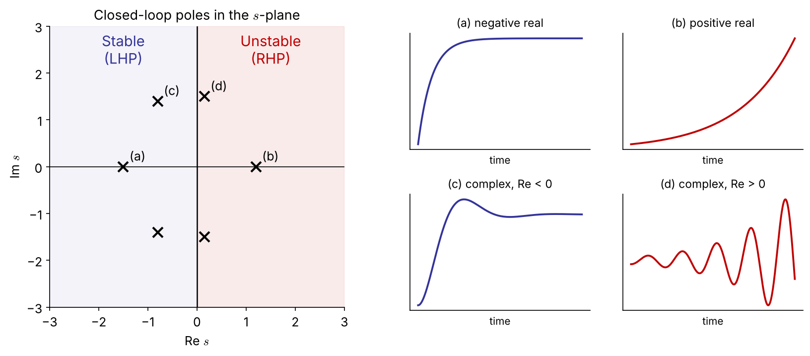{width="100%"}

::: {.small}
Real part → growth/decay rate; imaginary part → oscillation frequency. Stability depends on the **sign of the real part only**.
:::

## [Example 4.1]{.ex} &nbsp; Stabilizing an unstable process with P control

Unstable process $G_p=\dfrac{K}{s-a}$ $(a>0)$, unity feedback $G_m=G_a=1$, $G_c=K_c$:

$$
1+K_c\frac{K}{s-a}=0 \;\Rightarrow\; s-a+K_cK=0 \;\Rightarrow\; s=a-K_cK
$$

::: {.box}
Closed loop is stable iff $\;K_cK>a$
:::

::: {.incremental}
- Feedback can **create** stability, not only lose it (e.g., exothermic CSTR operated at an unstable steady state).
- There is a **minimum** gain here; in Ex 4.2 we will meet a **maximum** gain.
:::

# 4.2 Routh–Hurwitz Criterion

## (1) Hurwitz test: a necessary condition

$$
P(s)=a_ns^n+a_{n-1}s^{n-1}+\cdots+a_1s+a_0,\qquad a_n>0
$$

- If all roots are in the LHP, then **all coefficients are positive** (none missing).
- If **any coefficient is negative** → at least one root has a positive real part.
- If **any coefficient is zero** → not all roots are in the open LHP. [FIX]{.fix}
  <br><span class="small">(The roots may be on the imaginary axis *or* in the RHP — e.g. $s^3+1$ has roots $-1,\ \tfrac12\pm j\tfrac{\sqrt3}{2}$.)</span>

::: {.boxr .small}
All coefficients positive is **necessary but not sufficient** for $n\ge 3$ → we need the Routh array.
:::

## (2) Routh array: necessary and sufficient

::: {.columns}
::: {.column width="56%"}
| row | | | |
|:--|:--:|:--:|:--:|
| $s^n$ | $a_n$ | $a_{n-2}$ | $a_{n-4}$ |
| $s^{n-1}$ | $a_{n-1}$ | $a_{n-3}$ | $a_{n-5}$ |
| $s^{n-2}$ | $b_1$ | $b_2$ | $\cdots$ |
| $s^{n-3}$ | $c_1$ | $c_2$ | $\cdots$ |
| $\vdots$ | | | |
| $s^0$ | $\ast$ | | |

::: {.small}
$$
b_1=\frac{a_{n-1}a_{n-2}-a_na_{n-3}}{a_{n-1}},\qquad b_2=\frac{a_{n-1}a_{n-4}-a_na_{n-5}}{a_{n-1}}
$$
$$
c_1=\frac{b_1a_{n-3}-a_{n-1}b_2}{b_1},\ \ldots
$$
:::
:::
::: {.column width="44%"}
::: {.boxr}
**Routh criterion.** All roots in the LHP ⇔ every element of the **first column** is positive. [FIX]{.fix}

The **number of sign changes** in the first column = number of **RHP roots**.
:::

::: {.box .small}
**Results worth memorizing**

- $n=2$: all $a_i>0$ (that's all)
- $n=3$: all $a_i>0$ **and** $\;a_2a_1>a_3a_0$
:::

<span class="small">General 4th-order formulas → Appendix</span>
:::
:::

## (3) Special cases [NEW]{.new}

::: {.columns}
::: {.column width="50%"}
**Case 1 — zero in the first column**

Replace the 0 by a small $\varepsilon>0$, continue, then let $\varepsilon\to0^+$.

$P(s)=s^4+s^3+2s^2+2s+3$

| | | | |
|:--|:--:|:--:|:--:|
| $s^4$ | 1 | 2 | 3 |
| $s^3$ | 1 | 2 | |
| $s^2$ | $0\to\varepsilon$ | 3 | |
| $s^1$ | $2-3/\varepsilon\to-\infty$ | | |
| $s^0$ | 3 | | |

Two sign changes → **2 RHP roots** ($0.41\pm1.29j$)
:::
::: {.column width="50%"}
**Case 2 — a whole row of zeros**

The roots contain pairs symmetric about the origin (typically $\pm j\omega$).

1. Form the **auxiliary polynomial** $A(s)$ from the row *above*.
2. Replace the zero row by $dA/ds$ and continue.
3. Roots of $A(s)=0$ are those symmetric roots.

::: {.boxr .small}
In stability problems a zero row appears exactly **at the ultimate gain**, and $A(j\omega)=0$ gives $\omega_u$ — see Ex 4.2 at $K_c=60$.
:::
:::
:::

## [Example 4.2]{.ex} &nbsp; P control of a third-order process

$$
1+K_c\frac{1}{(s+3)(s+2)(s+1)}=0\;\Rightarrow\; s^3+6s^2+11s+(6+K_c)=0
$$

::: {.columns}
::: {.column width="45%"}
| | | |
|:--|:--:|:--:|
| $s^3$ | 1 | 11 |
| $s^2$ | 6 | $6+K_c$ |
| $s^1$ | $\dfrac{66-(6+K_c)}{6}=10-\dfrac{K_c}{6}$ | 0 |
| $s^0$ | $6+K_c$ | |
:::
::: {.column width="55%"}
First column positive:

- $10-K_c/6>0 \Rightarrow K_c<60$
- $6+K_c>0 \Rightarrow K_c>-6$

::: {.box}
$-6<K_c<60\quad$ (with a positive controller gain: $0<K_c<60$)
:::

Same as the 3rd-order rule $a_2a_1>a_3a_0$: $\;6\cdot11>6+K_c$.
:::
:::

## Example 4.2 at $K_c=60$: a row of zeros [NEW]{.new}

| | | |
|:--|:--:|:--:|
| $s^3$ | 1 | 11 |
| $s^2$ | 6 | 66 |
| $s^1$ | **0** | |

Auxiliary polynomial from the $s^2$ row:

$$
A(s)=6s^2+66=0\;\Rightarrow\; s=\pm j\sqrt{11}
$$

::: {.boxr}
At the stability limit the closed loop has a pair of **pure imaginary poles** $s=\pm j\omega_u$, $\ \omega_u=\sqrt{11}$ — the system oscillates with constant amplitude.

→ This is exactly what **direct substitution** ($s=j\omega$) looks for (§4.3).
:::

## [Example 4.3]{.ex} &nbsp; PI control of a critically damped process

$G_p=\dfrac{1}{s^2+2s+1}$, $\;G_c=K_c\left(1+\dfrac{1}{\tau_Is}\right)$:

$$
1+K_c\frac{\tau_Is+1}{\tau_Is(s^2+2s+1)}=0\;\Rightarrow\;
\tau_Is^3+2\tau_Is^2+\tau_I(1+K_c)s+K_c=0
$$

::: {.columns}
::: {.column width="50%"}
| | | |
|:--|:--:|:--:|
| $s^3$ | $\tau_I$ | $\tau_I(1+K_c)$ |
| $s^2$ | $2\tau_I$ | $K_c$ |
| $s^1$ | $\tau_I(1+K_c)-\dfrac{K_c}{2}$ | |
| $s^0$ | $K_c$ | |
:::
::: {.column width="50%"}
::: {.box}
$K_c>0,\ \tau_I>0,\quad \tau_I>\dfrac{K_c}{2(1+K_c)}$
:::

- Since $\dfrac{K_c}{2(1+K_c)}<\dfrac12$, **any** $\tau_I\ge 0.5$ is stable for all $K_c>0$.
- Too much integral action (small $\tau_I$) is destabilizing.
:::
:::

## Routh array in code

::: {.panel-tabset}
### Python

```{.python}
import sympy as sp
from routh import routh_array          # routh.py (handles epsilon & zero-row cases)

s, Kc, tI = sp.symbols('s K_c tau_I', positive=True)

R = routh_array((s+3)*(s+2)*(s+1) + Kc, s)                 # Ex 4.2
sp.solve([r[0] > 0 for r in R], Kc)                        # -> Kc < 60

R = routh_array(tI*s*(s**2 + 2*s + 1) + Kc*(tI*s + 1), s)  # Ex 4.3
sp.simplify(R[2][0])                                       # -> tau_I*(Kc+1) - Kc/2

routh_array((s+3)*(s+2)*(s+1) + 60, s)                     # zero row -> A(s) = 6(s^2+11)
```

### MATLAB

```{.matlab}
syms s Kc tI positive
p = sym2poly_sym(expand((s+3)*(s+2)*(s+1) + Kc), s);   % [1 6 11 Kc+6]
R = routh_array(p);   R(:,1)                         % first column

function c = sym2poly_sym(P, s), c = coeffs(P, s, 'All'); end

function R = routh_array(p)            % basic version (no special cases)
  n = numel(p)-1;  cols = floor(n/2)+1;  R = sym(zeros(n+1, cols));
  R(1,1:numel(p(1:2:end))) = p(1:2:end);
  R(2,1:numel(p(2:2:end))) = p(2:2:end);
  for i = 3:n+1
    for j = 1:cols-1
      R(i,j) = simplify((R(i-1,1)*R(i-2,j+1) - R(i-2,1)*R(i-1,j+1))/R(i-1,1));
    end
  end
end
```
:::

# 4.3 Direct-Substitution Analysis

## Finding the stability boundary with $s=j\omega$

At the moment a system becomes unstable, a pair of closed-loop poles sits **on the imaginary axis**. Substitute $s=j\omega$ and set **real and imaginary parts to zero**:

- the gain at this limit → **ultimate (critical) gain** $K_{cu}$
- the frequency → **ultimate (crossover) frequency** $\omega_u$, ultimate period $P_u=2\pi/\omega_u$

[Example 4.2A]{.ex} &nbsp; $(j\omega)^3+6(j\omega)^2+11(j\omega)+6+K_c=0$

$$
\text{Im: } \omega(11-\omega^2)=0\Rightarrow \omega_u=\sqrt{11}=3.32,\qquad
\text{Re: } 6+K_c-6\omega^2=0\Rightarrow K_{cu}=60
$$

::: {.box .small}
[Example 4.3A]{.ex} &nbsp; With $s=j\omega$ in $\tau_Is^3+2\tau_Is^2+\tau_I(1+K_c)s+K_c=0$: Im gives $\omega_u^2=1+K_c$, Re gives $K_c=2\tau_I\omega_u^2$ ⇒ $\tau_I=\dfrac{K_c}{2(1+K_c)}$ — the same boundary as Routh. Direct substitution finds the **boundary**; Routh gives the **region**.
:::

## [Example 4.4]{.ex} &nbsp; First-order process with dead time

$$
1+K_c\frac{0.8e^{-2s}}{5s+1}=0
$$

$e^{-2s}$ is not a polynomial → Routh cannot be applied directly. With $s=j\omega$:

$$
0.8K_c\,e^{-2j\omega}=-(1+5j\omega)
$$

::: {.columns}
::: {.column width="50%"}
**Magnitude:** $\;0.8K_c=\sqrt{1+25\omega^2}$

**Phase:** $\;-2\omega-\tan^{-1}(5\omega)=-\pi$
:::
::: {.column width="50%"}
::: {.box}
Solve the phase equation numerically:

$\omega_u=0.895\ \text{rad/time}$

$K_{cu}=\dfrac{\sqrt{1+25\omega_u^2}}{0.8}=5.73$
:::
:::
:::

Stable for $0<K_c<5.73$.

## Dead time: exact vs. Padé approximation [NEW]{.new}

First-order Padé: $\;e^{-\theta s}\approx\dfrac{1-\theta s/2}{1+\theta s/2}=\dfrac{1-s}{1+s}\;$ ⇒ $\;5s^2+(6-0.8K_c)s+(1+0.8K_c)=0$ ⇒ [$K_{cu}=7.5$, $\omega_u=1.18$]{.navy}

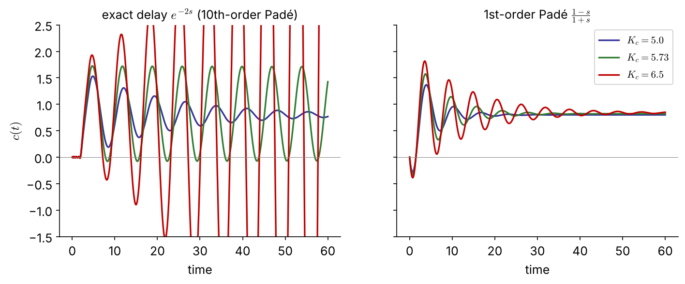{width="88%"}

::: {.boxr .small}
The 1st-order Padé model **overestimates** the ultimate gain by 31 % (7.5 vs 5.73): at $K_c=6.5$ it predicts a stable loop that actually oscillates with growing amplitude. Use approximations with care — they err on the **unsafe** side here.
:::

## Dead time in code

::: {.panel-tabset}
### Python

```{.python}
import numpy as np, control as ct
from scipy.optimize import brentq

# exact: phase condition -2w - atan(5w) = -pi
wu  = brentq(lambda w: 2*w + np.arctan(5*w) - np.pi, 0.1, 2.0)
Kcu = np.sqrt(1 + 25*wu**2)/0.8                     # 0.895, 5.73

# Pade approximations of e^{-2s}
G = ct.tf(0.8, [5, 1])
for order in (1, 10):
    D = ct.tf(*ct.pade(2, order))
    gm, pm, wcg, wcp = ct.margin(G*D)               # gain margin = Kcu
    print(order, gm, wcg)                           # 1: 7.50, 1.18   10: 5.73, 0.895
```

### MATLAB

```{.matlab}
wu  = fzero(@(w) 2*w + atan(5*w) - pi, [0.1 2]);
Kcu = sqrt(1 + 25*wu^2)/0.8                % 5.73

G = tf(0.8, [5 1]);
[n1,d1] = pade(2,1);   [Gm1,~,Wcg1] = margin(G*tf(n1,d1))     % 7.50, 1.18
Gd = tf(0.8, [5 1], 'InputDelay', 2);
[Gm, ~, Wcg] = margin(Gd)                                     % exact: 5.73, 0.895
```
:::

## Which technique? (decision chart)



## From $K_{cu}, P_u$ to controller tuning [NEW]{.new}

The ultimate gain and period are the basis of **closed-loop (Ziegler–Nichols) tuning** — the starting point for the PID term project.

::: {.columns}
::: {.column width="48%"}
| Controller | $K_c$ | $\tau_I$ | $\tau_D$ |
|:--|:--:|:--:|:--:|
| P | $0.5K_{cu}$ | — | — |
| PI | $0.45K_{cu}$ | $P_u/1.2$ | — |
| PID | $0.6K_{cu}$ | $P_u/2$ | $P_u/8$ |
:::
::: {.column width="52%"}
| | $K_{cu}$ | $P_u$ | ZN-PI $(K_c,\tau_I)$ |
|:--|:--:|:--:|:--:|
| Ex 4.2 | 60 | 1.89 | 27, 1.58 |
| Ex 4.4 | 5.73 | 7.02 | 2.58, 5.85 |
:::
:::

::: {.small}
- In the plant, $K_{cu}$ and $P_u$ are found **experimentally** (gain ramp-up, or a relay test) — no model needed.
- ZN settings give a quarter-decay response: a *starting point*, usually detuned afterwards (tuning rules: Ch 3).
:::

# 4.4 Root-Locus Analysis

## What is a root locus?

**Root locus**: the paths traced by the closed-loop poles as a parameter (usually $K_c$) varies from 0 to $\infty$.

$$
1+K_cG_0(s)=0,\qquad G_0=\frac{Q(s)}{P(s)}=\frac{(s-z_1)\cdots(s-z_m)}{(s-p_1)\cdots(s-p_n)}
$$

$K_cG_0$ is the **open-loop** transfer function ($G_0=G_mG_aG_p$ for P control; other controllers contribute to $G_0$).

$$
(s-p_1)\cdots(s-p_n)+K_c(s-z_1)\cdots(s-z_m)=0
$$

- $n$ loci (order of the characteristic polynomial)
- $K_c=0$: loci **start at the open-loop poles**; $K_c\to\infty$: they **end at the open-loop zeros**
- Proper systems $n\ge m$: the remaining $(n-m)$ loci go to infinity along asymptotes

::: {.small .navy}
With first- or second-order processes, no time delay and no RHP zeros, the closed loop is stable for all $K_c>0$ (Ex 4.6 a–b).
:::

## Angle and magnitude conditions [NEW]{.new}

A point $s$ is on the locus iff $K_cG_0(s)=-1$ for some $K_c>0$:

::: {.columns}
::: {.column width="50%"}
::: {.box}
**Angle condition** (shapes the locus, independent of $K_c$)
$$
\sum_j\angle(s-z_j)-\sum_i\angle(s-p_i)=(2k+1)\pi
$$
:::
:::
::: {.column width="50%"}
::: {.box}
**Magnitude condition** (gives $K_c$ at that point)
$$
K_c=\frac{\prod_i|s-p_i|}{\prod_j|s-z_j|}
$$
:::
:::
:::

[Check on Ex 4.2]{.ex} at $s=j\sqrt{11}$:

- angles: $\tan^{-1}\!\sqrt{11}+\tan^{-1}\!\tfrac{\sqrt{11}}{2}+\tan^{-1}\!\tfrac{\sqrt{11}}{3}=73.2^\circ+58.9^\circ+47.9^\circ=180^\circ$ ✓
- gain: $K_c=|j\sqrt{11}+1|\,|j\sqrt{11}+2|\,|j\sqrt{11}+3|=\sqrt{12}\sqrt{15}\sqrt{20}=60$ ✓

::: {.small}
Every sketching rule on the next slides follows from these two conditions — and the magnitude condition replaces graphical `rlocfind` with an exact number.
:::

## Sketching rules (1)–(5)

1. Mark open-loop poles **×** and zeros **○**. The plot is **symmetric** about the real axis.
2. **Number of loci** = number of open-loop poles $n$.
3. Loci **start at poles** ($K_c=0$) and **end at zeros** or at **infinity**. A $q$-th order pole (zero) emits (absorbs) $q$ loci.
4. **Real axis:** a point is on the locus iff the number of real poles + zeros **to its right** is **odd** (count multiplicities).
5. **Imaginary-axis crossings:** by Routh (zero row) or by $s=j\omega$.

## Sketching rules (6)–(8)

6. **Asymptotes** of the $(n-m)$ loci going to infinity:
$$
\gamma=\frac{\sum p_i-\sum z_j}{n-m},\qquad \theta_k=\frac{(2k+1)\pi}{n-m},\ k=0,\ldots,n-m-1
$$
7. **Departure / arrival angles** at complex poles / zeros ($q$ = multiplicity):
$$
q\phi_{\text{dep}}=\sum\psi_j-\sum_{\text{other}}\phi_i-(2k+1)\pi,\qquad
q\psi_{\text{arr}}=\sum\phi_i-\sum_{\text{other}}\psi_j+(2k+1)\pi
$$
8. **Break-away / break-in points** (multiple roots) on the real axis:
$$
Q(s)\frac{dP}{ds}-P(s)\frac{dQ}{ds}=0
$$
Two branches meet at 180° and leave at ±90°; three meet at 120° and leave rotated by 60°.

## [Example 4.2B]{.ex} &nbsp; Root locus of Ex 4.2

::: {.columns}
::: {.column width="52%"}
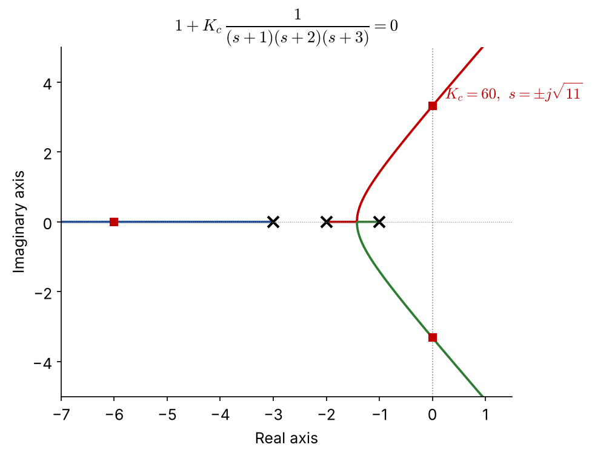{width="100%"}
:::
::: {.column width="48%" .small}
- Poles $-1,-2,-3$; no zeros; $n-m=3$
- Real axis: $(-2,-1)$ and $(-\infty,-3)$
- Asymptotes: $\gamma=\dfrac{-6}{3}=-2$, $\ \theta=\pm60^\circ,180^\circ$
- Break-away: $\dfrac{dP}{ds}=3s^2+12s+11=0$ $\Rightarrow s=-1.42$ (the other root $-2.58$ is not on the locus)
- Crossing: $s=\pm j\sqrt{11}$ at $K_{cu}=60$ (Routh / direct substitution)

::: {.boxr}
Three methods, one answer: $K_{cu}=60,\ \omega_u=\sqrt{11}$
:::
:::
:::

## [Example 4.6]{.ex} &nbsp; Representative root-locus shapes

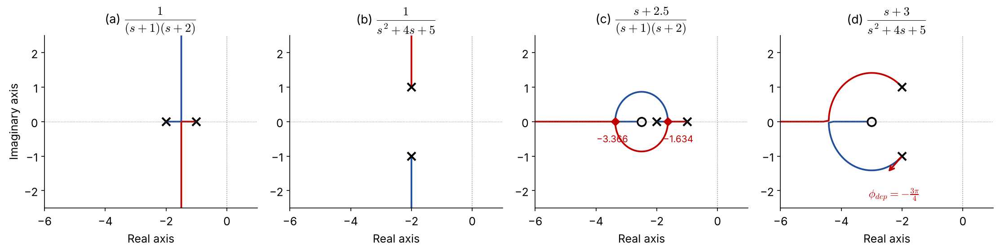{width="100%"}

::: {.columns .small}
::: {.column width="25%"}
(a) real poles: break-away at $-1.5$, vertical asymptotes; **always stable**
:::
::: {.column width="25%"}
(b) complex poles: vertical lines from $-2\pm j$; **always stable**, more oscillatory
:::
::: {.column width="25%"}
(c) zero at $-2.5$: loci leave the axis and **return** — a circle around the zero
:::
::: {.column width="25%"}
(d) complex poles + zero: departure angle $\mp3\pi/4$, break-in at $-4.41$
:::
:::

## Example 4.6 (c), (d): the calculations

::: {.columns}
::: {.column width="50%"}
**(c)** $\;G_0=\dfrac{s+2.5}{(s+1)(s+2)}$, $\;P=s^2+3s+2$, $\;Q=s+2.5$

$$
\begin{aligned}
Q\frac{dP}{ds}-P\frac{dQ}{ds}&=(s+2.5)(2s+3)\\
&\quad-(s^2+3s+2)\\
&=s^2+5s+5.5=0
\end{aligned}
$$

$s=-1.634$ (break-away), $\ s=-3.366$ (break-in)
:::
::: {.column width="50%"}
**(d)** $\;G_0=\dfrac{s+3}{s^2+4s+5}$, poles $-2\pm j$, zero $-3$

Departure from the lower pole $p_2=-2-j$: [FIX]{.fix}

- from zero $-3$: $\ \psi=\angle(1-j)=-\pi/4$
- from pole $p_1=-2+j$: $\ \phi_1=\angle(-2j)=-\pi/2$

$$
\phi_{\text{dep}}=-\tfrac{\pi}{4}-\left(-\tfrac{\pi}{2}\right)-\pi=-\tfrac{3\pi}{4}
$$
(upper pole: $+3\pi/4$ by symmetry)
:::
:::

## Effect of adding a **zero** [NEW]{.new}

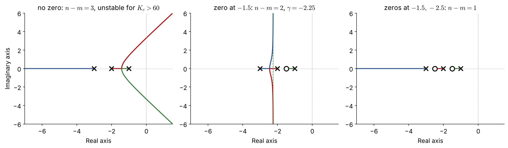{width="100%"}

::: {.columns .small}
::: {.column width="55%"}
- One LHP zero reduces $n-m$ from 3 to 2: asymptotes become **vertical** at $\gamma=\dfrac{-6-(-z)}{2}<0$ → loci never cross into the RHP
- Holds for any zero $z\in\{0.5,1.5,2.5,3.5\}$: $\gamma=-2.75\ldots-1.25$
:::
::: {.column width="45%"}
::: {.boxr}
An LHP zero **pulls the loci to the left** (stabilizing). A PD controller $K_c(1+\tau_Ds)$ adds exactly such a zero → Problem #1.
:::
:::
:::

## Effect of adding a **pole**: PI control ([Example 4.3B]{.ex})

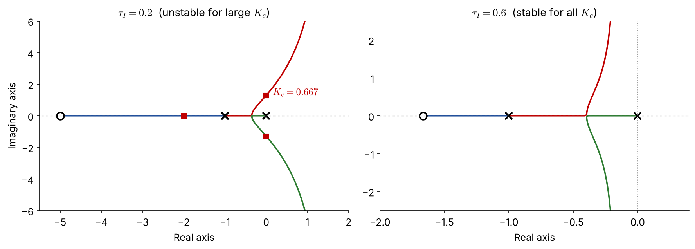{width="92%"}

::: {.columns .small}
::: {.column width="55%"}
PI adds a pole at the **origin** and a zero at $-1/\tau_I$; $n-m=2$, $\ \gamma=\dfrac{-2+1/\tau_I}{2}$

- $\tau_I=0.2$: $\gamma=+1.5$ → crosses at $K_c=0.667$ (Routh: $\tau_I=\frac{K_c}{2(1+K_c)}$ ✓)
- $\tau_I=0.6$: $\gamma=-0.17$ → stable for all $K_c$
:::
::: {.column width="45%"}
::: {.boxr}
Adding poles pushes loci **to the right** (destabilizing). Keep the PI zero far enough left ($\tau_I>0.5$ here).
:::
:::
:::

## RHP zero: inverse response [NEW]{.new}

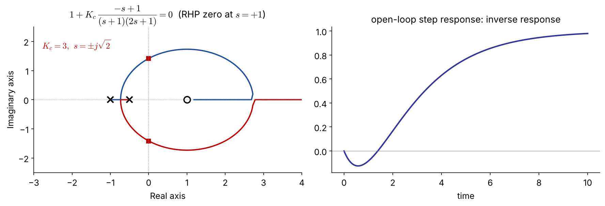{width="90%"}

::: {.small}
$1+K_c\dfrac{-s+1}{(s+1)(2s+1)}=0 \Rightarrow 2s^2+(3-K_c)s+(1+K_c)=0$ → stable only for $0<K_c<3$.

A locus **ends at the RHP zero** $s=+1$, so high gain is **always** unstable — no controller tuning can remove this limit. Typical of inverse-response processes (e.g. drum-level "swell", some reactors).
:::

# 4.5 Root-Locus Design

## Dominant poles and performance specs

::: {.columns}
::: {.column width="50%" .small}
Approximate the closed loop by its **dominant underdamped pair**

$$
s=-\frac{\zeta}{\tau}\pm j\frac{\sqrt{1-\zeta^2}}{\tau},\quad |s|=\frac1\tau=\omega_n,\quad \zeta=\cos\psi
$$
:::
::: {.column width="50%" .small}
::: {.box}
[NEW]{.new} $\;\%OS=100\exp\!\left(-\dfrac{\pi\zeta}{\sqrt{1-\zeta^2}}\right),\qquad t_s(2\%)\approx\dfrac{4}{\zeta\omega_n}$
:::
$\zeta$ spec → a **ray** at angle $\psi$; $\ t_s$ spec → a **vertical line** $\mathrm{Re}\,s=-4/t_s$
:::
:::

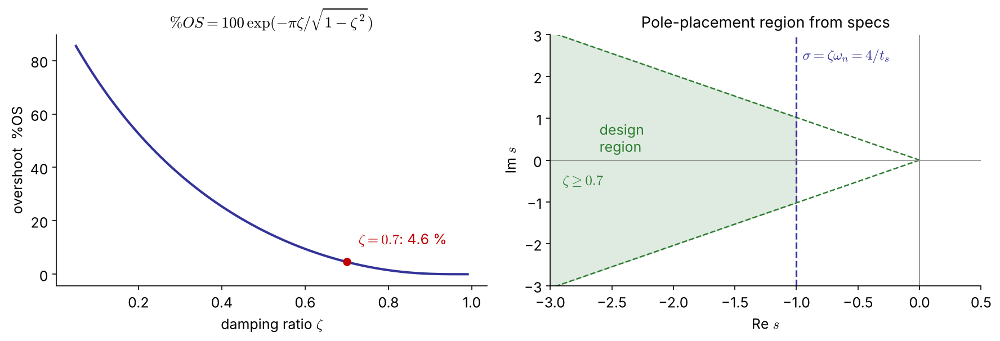{width="88%"}

## [Example 4.7]{.ex} &nbsp; Gain for $\zeta=0.7$ (P control)

$G_p=\dfrac{1}{(2s+1)(4s+1)}$ $\;(K_p=1,\ \tau_1=2,\ \tau_2=4)$: $\;8s^2+6s+(1+K_c)=0$

::: {.columns}
::: {.column width="50%" .small}
$$
\omega_n^2=\frac{1+K_c}{8},\quad 2\zeta\omega_n=\frac{6}{8}
\;\Rightarrow\;\zeta=\frac{3}{\sqrt{8(1+K_c)}}
$$

::: {.box}
$\zeta=0.7\ \Rightarrow\ K_c=\dfrac{127}{98}=1.30$ [FIX]{.fix}

poles $-0.375\pm0.383j$, $\ \%OS=4.6\%$, $\ t_s\approx11$
:::

- Graphical `rlocfind` gave 1.23 — use the **magnitude condition** for an exact value.
- Offset: $\dfrac{1}{1+K_c}=0.44$ (!) → P control alone is not enough → Ex 4.8 (PI)
:::
::: {.column width="50%"}
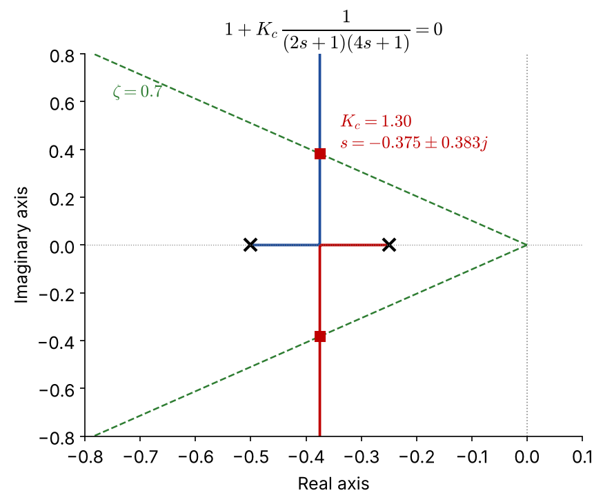{width="100%"}
:::
:::

## Example 4.7 in code

::: {.panel-tabset}
### Python

```{.python}
import numpy as np, control as ct, matplotlib.pyplot as plt

G = ct.tf(1, np.polymul([2, 1], [4, 1]))
ct.root_locus_plot(G, grid=True)                 # s-plane grid incl. zeta lines
zeta = 0.7
# analytic: zeta = 3/sqrt(8(1+Kc))
Kc = 9/(8*zeta**2) - 1                           # 1.296
print(Kc, ct.feedback(Kc*G, 1).poles())          # -0.375 ± 0.383j
print(ct.step_info(ct.feedback(Kc*G, 1)))        # overshoot 4.6 %
```

### MATLAB

```{.matlab}
G = tf(1, conv([2 1],[4 1]));
rlocus(G); axis([-0.8 0 -1 1]); sgrid(0.7, 0:0.2:1)
zeta = 0.7;
Kc = 9/(8*zeta^2) - 1                 % exact: 1.296  (rlocfind click: ~1.23)
pole(feedback(Kc*G,1))
stepinfo(feedback(Kc*G,1))
```
:::

## [Example 4.8]{.ex} &nbsp; PI design for $\zeta=0.7$

First-order process $K_p=0.5$, $\tau_p=2$ min, $G_a=G_m=1$:

$$
1+K_c\frac{0.5(\tau_Is+1)}{\tau_Is(2s+1)}=0\;\Rightarrow\;
2\tau_Is^2+\tau_I(1+0.5K_c)s+0.5K_c=0
$$

::: {.columns .small}
::: {.column width="50%"}
**(a) $\tau_I=3$ min:** zero at $-1/3$ lies between the poles $0$ and $-1/2$

$\zeta=\dfrac{3(1+0.5K_c)}{2\sqrt{3K_c}}\ \ge\ 1.22$ for all $K_c$

→ always **overdamped**; $\zeta=0.7$ is **not attainable**
:::
::: {.column width="50%"}
**(b) $\tau_I=2/3$ min:** zero at $-1.5$ — loci form a circle

$\zeta=0.7\Rightarrow 0.0625K_c^2-0.485K_c+0.25=0$

::: {.box}
$K_c=0.555$ [FIX]{.fix}: poles $-0.32\pm0.33j$, $t_s\approx12$ min

$K_c=7.20$ [FIX]{.fix}: poles $-1.15\pm1.17j$, $t_s\approx3$ min
:::
:::
:::

## Example 4.8: root loci and a caveat

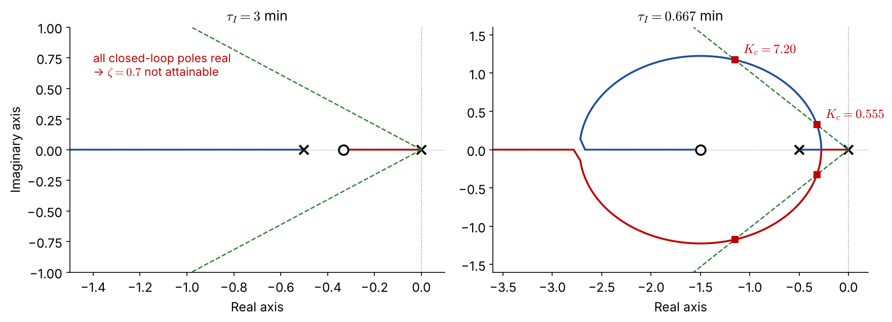{width="92%"}

::: {.small}
- Choose $K_c=7.20$ for the **faster** response.
- **Caveat:** the PI zero at $-1.5$ is close to the dominant poles → actual overshoot is **13 %**, not 4.6 %. The second-order approximation must be checked by simulation.
- Alternative: $\tau_I=\tau_p=2$ cancels the process pole → $1+\dfrac{0.5K_c}{2s}=0$, a first-order closed loop with $\tau_{cl}=4/K_c$.
:::

## Interactive: move $K_c$, watch poles and response [NEW]{.new}

::: {.screen-only}

:::

::: {.print-only}
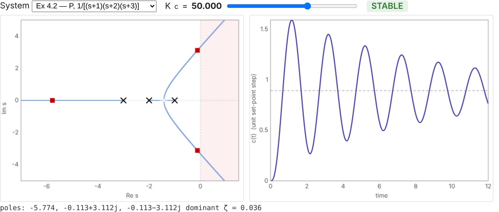{width="92%"}

::: {.small .center}
Interactive version: [seoultechpse.github.io/ProCon/ch4/ch4_stability.html](https://seoultechpse.github.io/ProCon/ch4/ch4_stability.html) — move $K_c$ and switch between Ex 4.2, 4.3, 4.8 and the RHP-zero case.
:::
:::

## Final remarks on root-locus plots

1. Root locus **cannot handle dead time easily** — frequency-response analysis handles it exactly (Ch. 5).
2. Root locus gives **absolute** stability only; there is no general "safety margin" — frequency response defines **relative** stability (gain/phase margins).
3. In return, root locus shows the **dynamic response** (damping, speed) directly — something frequency response does not do easily.

::: {.box .small}
**Toolbox summary**

| Task | MATLAB | Python (`control`, `scipy`, `sympy`) |
|:--|:--|:--|
| transfer function | `tf(num,den)` | `ct.tf(num,den)` |
| root locus | `rlocus(G)`, `sgrid` | `ct.root_locus_plot(G, grid=True)` |
| closed loop / poles | `feedback`, `pole` | `ct.feedback`, `.poles()` |
| Padé / margins | `pade`, `margin` | `ct.pade`, `ct.margin` |
| Routh array | (custom function) | `routh.py` (sympy) |
| step response | `step`, `stepinfo` | `ct.step_response`, `ct.step_info` |
:::

## [Problem #1]{.ex} &nbsp; (homework)

$$
G_p=\frac{2(s+1)}{s(s+2)(s^2+1)},\qquad 1+G_cG_p=0
$$

(a) Show with an analytical technique of your choice that the closed loop **cannot** be stabilized by a proportional controller.

(b) With a PI or a PD controller (positive gain), write the characteristic equations. *Without further analysis*, which is more likely to stabilize the system?

(c) Use root-locus plots to illustrate your answer.

::: {.small .navy}
Hint for (b): recall what an added zero and an added pole at the origin do to $n-m$ and to the asymptote centroid.
:::

## Resources

::: {.box}
- **Slides (interactive HTML):** [seoultechpse.github.io/ProCon/ch4/ch4_stability.html](https://seoultechpse.github.io/ProCon/ch4/ch4_stability.html)
- **PDF:** [slides](https://seoultechpse.github.io/ProCon/ch4/ch4_stability.pdf) · [handout with note space](https://seoultechpse.github.io/ProCon/ch4/ch4_stability_handout.pdf)
- **Python notebook:** [Open in Colab](https://colab.research.google.com/github/SeoulTechPSE/ProCon/blob/main/ch4/ch4_stability.ipynb) — every calculation and figure of this chapter
- **Routh-array helper:** [`routh.py`](https://github.com/SeoulTechPSE/ProCon/blob/main/ch4/routh.py)
:::

# Appendix

## Routh array: 4th-order polynomial

$p(s)=a_4s^4+a_3s^3+a_2s^2+a_1s+a_0$

| | | | |
|:--|:--:|:--:|:--:|
| $s^4$ | $a_4$ | $a_2$ | $a_0$ |
| $s^3$ | $a_3$ | $a_1$ | 0 |
| $s^2$ | $b_1=\dfrac{a_3a_2-a_4a_1}{a_3}$ | $b_2=a_0$ | |
| $s^1$ | $c_1=\dfrac{b_1a_1-a_3a_0}{b_1}$ | 0 | |
| $s^0$ | $d_1=a_0$ | | |

Stable ⇔ all $a_i>0$, $\;b_1>0$, $\;c_1>0$, i.e. $\;a_3a_2>a_4a_1\;$ and $\;a_3a_2a_1>a_4a_1^2+a_3^2a_0$.
