## What are we up to?

Frequency-response analysis is the substitution $s=j\omega$: everything we need is the **magnitude** $|G(j\omega)|$ and the **phase** $\angle G(j\omega)$.

::: {.columns}
::: {.column width="55%"}
- Impose a **sinusoidal input** and measure the response — dynamics can be identified even **without a model**
- **Bode** and **Nyquist** plots are two pictures of the same functions of $\omega$
- Gives a **relative** stability measure (gain and phase margins) and handles **dead time exactly**
:::
::: {.column width="45%"}
::: {.box .small}
**Running examples**

- Ex 5.10–5.13: inverse-response process $\dfrac{3(-2s+1)}{(10s+1)(5s+1)}$ under P and PI control
- Ex 4.4 revisited: $\dfrac{0.8e^{-2s}}{5s+1}$ — the dead-time case Routh could not do exactly
:::
:::
:::

# 5.1 Magnitude and Phase Lag

## A sine in, a sine out

First-order process $\;\tau_p\dfrac{dy}{dt}+y=K_pu,\quad G(s)=\dfrac{K_p}{\tau_ps+1},\quad u=A\sin\omega t$:

$$
y(t)=\underbrace{\frac{AK_p\tau_p\omega}{\tau_p^2\omega^2+1}e^{-t/\tau_p}}_{\to\,0}
+\frac{AK_p}{\sqrt{\tau_p^2\omega^2+1}}\sin(\omega t+\phi),\qquad \phi=-\tan^{-1}(\omega\tau_p)
$$

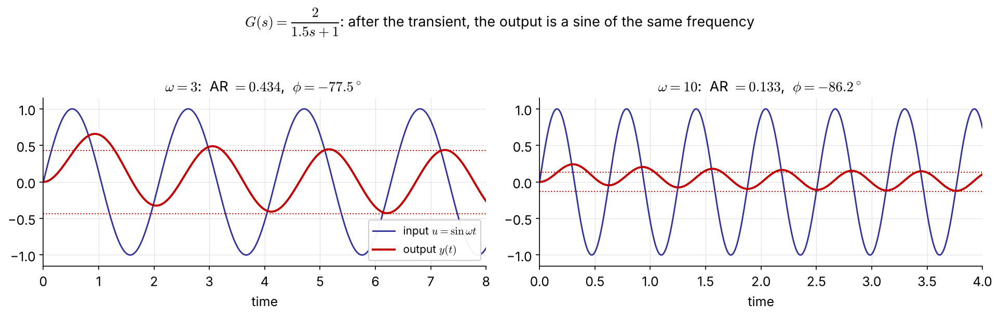{width="94%"}

::: {.small}
Same frequency; the **amplitude ratio** $\text{AR}=K_p/\sqrt{\tau_p^2\omega^2+1}$ falls and the **phase lag** grows as $\omega$ increases.
:::

## … and $G(j\omega)$ gives AR and $\phi$ directly

$$
G(j\omega)=\frac{K_p}{j\omega\tau_p+1}=\frac{K_p}{\tau_p^2\omega^2+1}-j\,\frac{K_p\omega\tau_p}{\tau_p^2\omega^2+1}=|G(j\omega)|\,e^{j\phi}
$$

$$
|G(j\omega)|=\frac{K_p}{\sqrt{\tau_p^2\omega^2+1}},\qquad \phi=\angle G(j\omega)=-\tan^{-1}(\omega\tau_p)
$$

::: {.boxr}
**General result** (any **stable** $G$, see Appendix for the derivation): at large times

$$
\frac{y_\infty(t)}{A}=|G(j\omega)|\,\sin\big(\omega t+\angle G(j\omega)\big)
$$

No partial fractions needed — substitute $s=j\omega$ and take modulus and argument.
:::

## Products of transfer functions

For $\;G(s)=\dfrac{G_a(s)G_b(s)\cdots G_m(s)}{G_1(s)G_2(s)\cdots G_n(s)}$:

$$
\log|G(j\omega)|=\sum_{\text{num}}\log|G_a(j\omega)|-\sum_{\text{den}}\log|G_i(j\omega)|,\qquad
\angle G(j\omega)=\sum_{\text{num}}\angle G_a(j\omega)-\sum_{\text{den}}\angle G_i(j\omega)
$$

::: {.box}
On log scales, magnitudes **add** and phases **add** → a Bode plot is the **sum of simple pieces**.
:::

[Example 5.1]{.ex} &nbsp; $G(s)=\dfrac{\tau_as+1}{(\tau_1s+1)(\tau_2s+1)}$ [NEW]{.new}

$$
|G(j\omega)|=\frac{\sqrt{1+\omega^2\tau_a^2}}{\sqrt{1+\omega^2\tau_1^2}\,\sqrt{1+\omega^2\tau_2^2}},\qquad
\phi=\tan^{-1}(\omega\tau_a)-\tan^{-1}(\omega\tau_1)-\tan^{-1}(\omega\tau_2)
$$

<span class="small">(The original slide left this blank — solution added.)</span>

# 5.2 Graphical Analysis Tools

## Bode and Nyquist plots

::: {.columns}
::: {.column width="56%"}
**Bode plot** — two plots against $\log\omega$

- magnitude: log–log ($|G|$ or **dB** $=20\log_{10}|G|$)
- phase: semi-log, in **degrees**
- frequency in **rad per unit time**

**Nyquist (polar) plot** — $G(j\omega)$ drawn in the **complex $G$-plane** with $\omega$ as the parameter [FIX]{.fix}

$$
G(j\omega)=\mathrm{Re}\,G+j\,\mathrm{Im}\,G=|G|e^{j\phi}
$$

Same information; more compact, but $\omega$ is not shown explicitly.
:::
::: {.column width="44%"}
| AR | dB |
|:--:|:--:|
| 0.01 | −40 |
| 0.1 | −20 |
| 0.5 | −6 |
| 1 | 0 |
| 2 | +6 |
| 10 | +20 |
| 100 | +40 |

<span class="small">A factor 10 is 20 dB; a factor 2 is ≈ 6 dB.</span>
:::
:::

## [Example 5.2]{.ex} &nbsp; First-order lag $\;K_p/(\tau_ps+1)$

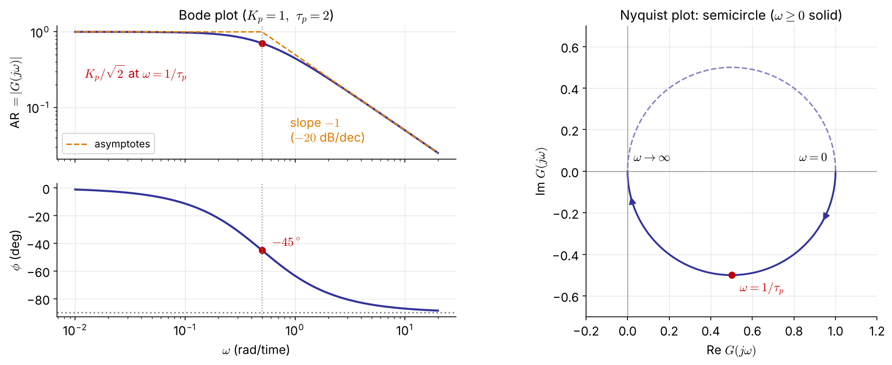{width="96%"}

::: {.columns .small}
::: {.column width="50%"}
- $\omega\to0$: $|G|=K_p,\ \phi=0$; $\ \omega\to\infty$: $|G|\to K_p/\tau_p\omega,\ \phi\to-90^\circ$
- **Corner frequency** $\omega=1/\tau_p$: $|G|=K_p/\sqrt2,\ \phi=-45^\circ$
:::
::: {.column width="50%"}
- **Bandwidth** $\omega_b$: where $|G|$ drops to 0.707 of its low-frequency value ($=1/\tau_p$ here)
- A **low-pass filter**: small $\tau$ ⇒ wide bandwidth ⇒ fast system
:::
:::

## [Example 5.3]{.ex} &nbsp; Second-order $\;K/(\tau^2s^2+2\zeta\tau s+1)$

::: {.columns}
::: {.column width="50%"}
$$
G(j\omega)=\frac{K\left[(1-\tau^2\omega^2)-j\,2\zeta\tau\omega\right]}{(1-\tau^2\omega^2)^2+(2\zeta\tau\omega)^2}
$$
$$
|G|=\frac{K}{\sqrt{(1-\tau^2\omega^2)^2+(2\zeta\tau\omega)^2}}
$$
$$
\phi=\tan^{-1}\!\frac{-2\zeta\tau\omega}{1-\tau^2\omega^2}\quad(0\to-180^\circ)
$$
:::
::: {.column width="50%"}
- $\omega\to0$: $\ |G|=K,\ \phi=0$
- $\omega=1/\tau$: $\ |G|=K/2\zeta,\ \phi=-90^\circ$
- $\omega\to\infty$: $\ |G|\to K/\tau^2\omega^2$ (slope $-2$), $\ \phi\to-180^\circ$

::: {.boxr}
**Resonance** for $0<\zeta<1/\sqrt2$ [FIX]{.fix}
$$
\omega_r=\frac{\sqrt{1-2\zeta^2}}{\tau},\qquad M_{p\omega}=\frac{K}{2\zeta\sqrt{1-\zeta^2}}
$$
Smaller $\zeta$ → higher peak → more overshoot in time (derivation: Appendix).
:::

::: {.tiny}
The original said the curve rises above $K$ for $\zeta<1/2$; that is the condition for $|G(j/\tau)|>K$. The resonant peak itself exists for $\zeta<0.707$.
:::
:::
:::

## Example 5.3: Bode and Nyquist for $\zeta=1.2\ldots0.2$

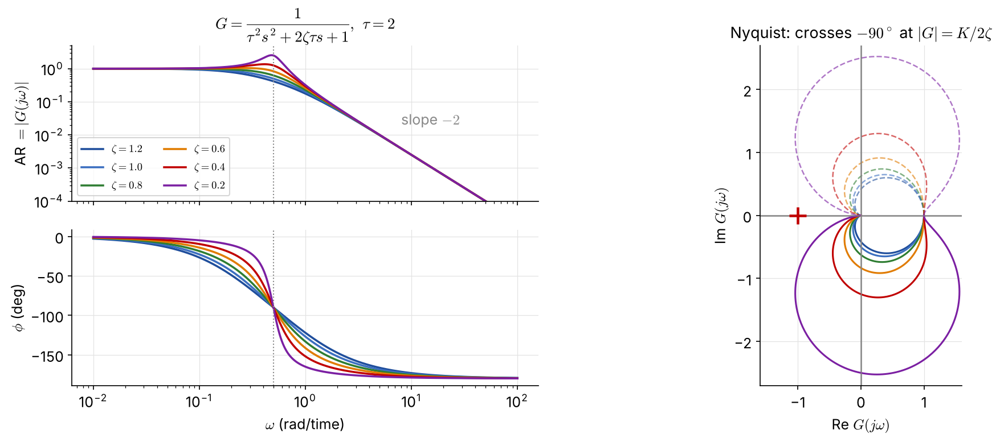{width="100%"}

::: {.small}
Low damping: a sharp **resonant peak** in $|G|$ and a fast phase drop at $\omega=1/\tau$; the Nyquist curve bulges far beyond the radius-$K$ circle.
:::

## Examples 5.4, 5.7, 5.8: lead, integrator, lag + integrator

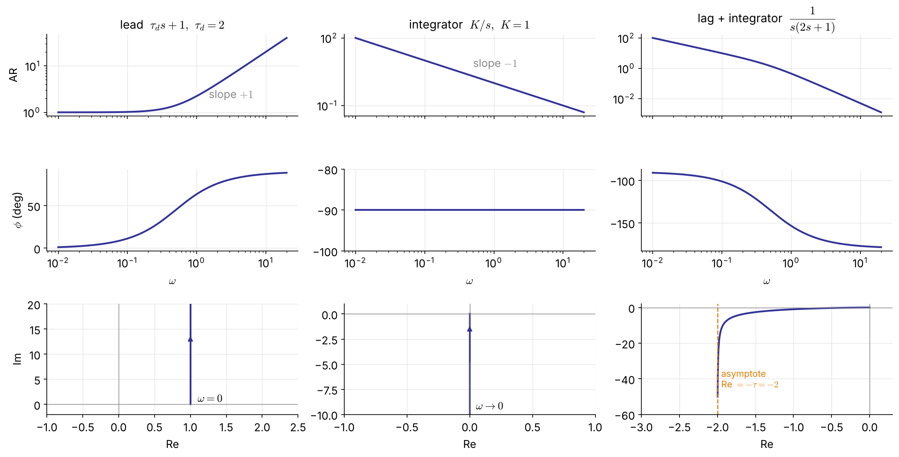{width="92%"}

::: {.columns .small}
::: {.column width="33%"}
$|G|=\sqrt{1+\omega^2\tau_d^2}$, $\ \phi=+\tan^{-1}\omega\tau_d$ (phase **lead**)
:::
::: {.column width="33%"}
$|G|=K/\omega$, $\ \phi=-90^\circ$ for all $\omega$
:::
::: {.column width="33%"}
$\phi$ from $-90^\circ$ to $-180^\circ$; Nyquist asymptote $\mathrm{Re}=-\tau$
:::
:::

## Examples 5.5, 5.6: dead time

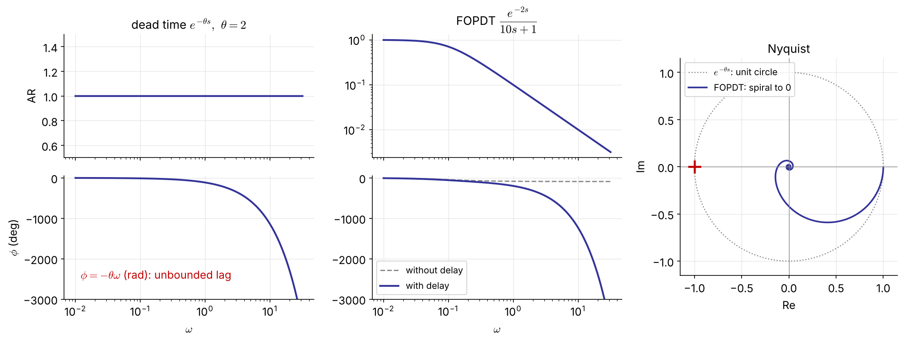{width="92%"}

::: {.small}
$|e^{-j\omega\theta}|=1,\ \angle e^{-j\omega\theta}=-\omega\theta$ (rad): the phase lag **grows without bound**. FOPDT: $|G|=\dfrac{K_p}{\sqrt{1+\omega^2\tau_p^2}},\ \ \phi=-\tan^{-1}(\omega\tau_p)-\omega\theta$.

**Nonminimum-phase** systems contain dead time or RHP zeros (Ex 5.10); a **minimum-phase** system has neither, and no RHP poles.
:::

## Building blocks at a glance

| Factor | AR $=|G(j\omega)|$ | $\phi=\angle G(j\omega)$ | high-$\omega$ slope | $\phi$ range |
|:--|:--:|:--:|:--:|:--:|
| $K$ | $K$ | $0$ | $0$ | $0$ |
| $\dfrac{1}{\tau s+1}$ | $\dfrac{1}{\sqrt{1+\omega^2\tau^2}}$ | $-\tan^{-1}\omega\tau$ | $-1$ | $0\to-90^\circ$ |
| $\tau s+1$<br>(LHP zero) | $\sqrt{1+\omega^2\tau^2}$ | $+\tan^{-1}\omega\tau$ | $+1$ | $0\to+90^\circ$ |
| $-\tau s+1$<br>(RHP zero) | $\sqrt{1+\omega^2\tau^2}$ | $-\tan^{-1}\omega\tau$ | $+1$ | $0\to-90^\circ$ |
| $\dfrac{1}{s}$ | $\dfrac1\omega$ | $-90^\circ$ | $-1$ | — |
| $s$ | $\omega$ | $+90^\circ$ | $+1$ | — |
| $\dfrac{1}{\tau^2s^2+2\zeta\tau s+1}$ | see Ex 5.3 | | $-2$ | $0\to-180^\circ$ |
| $e^{-\theta s}$ | $1$ | $-\omega\theta$ | $0$ | unbounded |

::: {.small .navy}
Slopes are in decades of AR per decade of $\omega$ (×20 for dB/dec). The RHP zero has the **magnitude** of an LHP zero but the **phase** of a pole — the origin of its trouble.
:::

## Sketching a Bode plot by asymptotes [NEW]{.new}

1. Write $G$ in **time-constant form** $\;K\dfrac{\prod(\tau_as+1)}{s^q\prod(\tau_is+1)}e^{-\theta s}$ and list the **corner frequencies** $1/\tau$.
2. **Low frequency**: $|G|\approx K/\omega^q$ — a line of slope $-q$ ($q=0$: horizontal at $K$).
3. Moving right, at each corner the slope changes by **−1 for a pole, +1 for a zero** (−2 for an underdamped pair).
4. **Phase**: each pole contributes $0\to-90^\circ$ (−45° at its corner), each zero $0\to+90^\circ$; dead time adds $-\omega\theta$.

::: {.box .small}
For real poles and zeros the asymptotes are within 3 dB of the exact curve (largest error at a corner; underdamped pairs can deviate more near resonance) — good enough to read crossover frequencies and margins by hand.
:::

## [Example 5.9]{.ex} &nbsp; $(5s+1)/[(10s+1)(2s+1)]$ by asymptotes

::: {.columns}
::: {.column width="68%"}
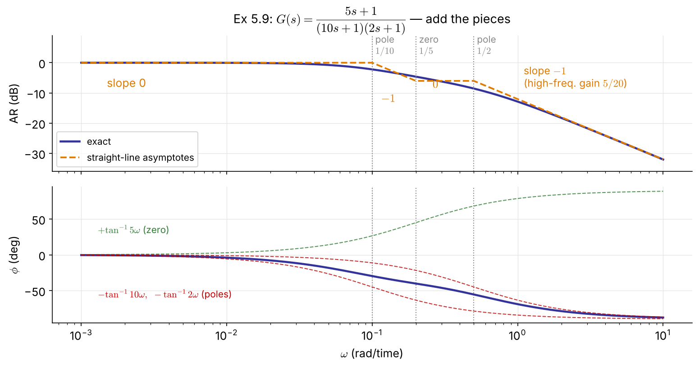{width="100%"}
:::
::: {.column width="32%" .small}
Corners: $0.1$ (pole), $0.2$ (zero), $0.5$ (pole)

| $\omega$ range | slope |
|:--|--:|
| $<0.1$ | $0$ |
| $0.1$–$0.2$ | $-1$ |
| $0.2$–$0.5$ | $0$ |
| $>0.5$ | $-1$ |

High frequency: $|G|\to\dfrac{5}{20\omega}$, $\ \phi\to-90^\circ$

Phase: $\tan^{-1}5\omega-\tan^{-1}10\omega-\tan^{-1}2\omega$ never reaches $-90^\circ$ at finite $\omega$
:::
:::

## Bode and Nyquist in code

::: {.panel-tabset}
### Python

```{.python}
import numpy as np, control as ct, matplotlib.pyplot as plt

G = ct.tf(1, [2, 1])                              # Ex 5.2
ct.bode_plot(G, dB=False, deg=True)               # AR (log) and phase (deg)
ct.nyquist_plot(G)

# dead time: evaluate G(jw) e^{-jw*theta} exactly (no Pade)
w = np.logspace(-3, 2, 2000)
g = ct.tf(1, [10, 1])(1j*w) * np.exp(-2j*w)       # Ex 5.6, theta = 2
mag, phase = np.abs(g), np.degrees(np.unwrap(np.angle(g)))
fig, (a1, a2) = plt.subplots(2, 1, sharex=True)
a1.loglog(w, mag); a2.semilogx(w, phase)
```

### MATLAB

```{.matlab}
G = tf(1, [2 1]);                       % Ex 5.2
figure(1), bode(G)
figure(2), nyquist(G)

G6 = tf(1, [10 1], 'InputDelay', 2);    % Ex 5.6: exact dead time
figure(3), bode(G6)
figure(4), nyquist(G6)

K = 1; tau = 2;                         % Ex 5.3: family in zeta
for zeta = [1.2 1.0 0.8 0.6 0.4 0.2]
    bode(tf(K, [tau^2 2*zeta*tau 1])), hold on
end
```
:::

# 5.3 Stability Analysis

## Two frequency-domain tests

::: {.columns}
::: {.column width="50%"}
### Bode stability criterion

$G_{OL}$ strictly proper, **no poles on or right of the imaginary axis** (a single pole at the origin is allowed), and **one** phase crossover $\omega_c$ ($\angle G_{OL}=-180^\circ$) and one gain crossover $\omega_g$ ($|G_{OL}|=1$):

::: {.boxr}
closed loop stable $\iff |G_{OL}(j\omega_c)|<1$
:::

<span class="small">Applies with dead time — unlike Routh.</span>
:::
::: {.column width="50%"}
### Nyquist stability criterion

$G_{OL}$ proper, no unstable pole–zero cancellations.

- $N$ = **clockwise** encirclements of $(-1,0)$ by the Nyquist plot ($\omega:-\infty\to\infty$)
- $P$ = open-loop poles in the RHP
- $Z$ = closed-loop poles in the RHP

::: {.boxr}
$$Z=N+P\qquad\text{stable}\iff Z=0$$
:::
[FIX]{.fix} <span class="small">(the original had $Z=N-P$; with clockwise $N$ the sign is $+$)</span>
:::
:::

::: {.small .navy}
Why $-1$? The characteristic equation $1+G_{OL}=0$ means $G_{OL}=-1$, i.e. $|G_{OL}|=1$ **and** $\phi_{OL}=-180^\circ$ — the **critical point**.
:::

## Reading the Nyquist criterion

- Most process loops are **open-loop stable**: $P=0\Rightarrow Z=N$ — unstable iff the curve **encircles $-1$**.
- A **counterclockwise** encirclement counts $N=-1$: each one can stabilize one open-loop unstable pole.
- Nyquist works where Bode does not: **open-loop unstable** processes, **several** crossover frequencies.



## [Examples 5.10, 5.11]{.ex} &nbsp; Inverse-response process, P control

$G=\dfrac{3(-2s+1)}{(10s+1)(5s+1)}$ has a **RHP zero** at $s=0.5$ → high gain is fundamentally limited.

$$
(10s+1)(5s+1)+3K_c(-2s+1)=0\iff 50s^2+(15-6K_c)s+(1+3K_c)=0
$$

Routh: $\;15-6K_c>0,\ 1+3K_c>0\;\Rightarrow\;-\tfrac13<K_c<2.5$ $\quad$ → [**ultimate gain** $K_u=2.5$]{.key}; at $K_u$: $50s^2+8.5=0$, $s=\pm j0.412$

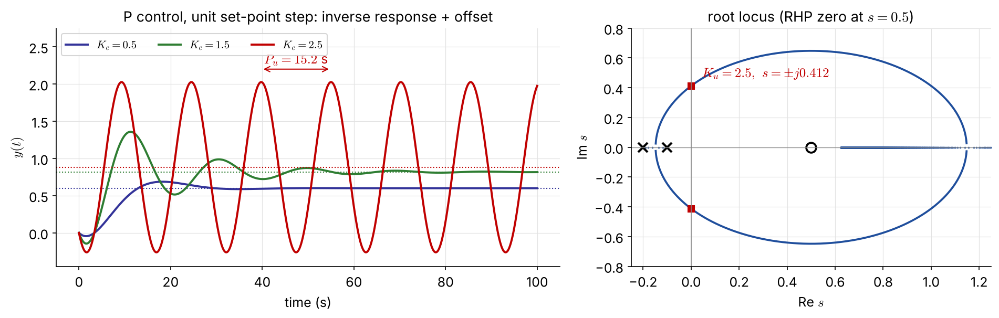{width="88%"}

## Example 5.11 by frequency response

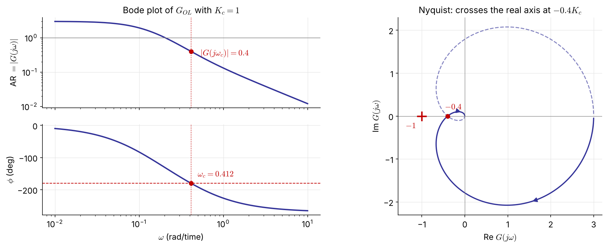{width="96%"}

::: {.columns .small}
::: {.column width="55%"}
With $K_c=1$: phase crossover $\omega_c=0.412$, $\ |G(j\omega_c)|=0.4$

$|G_{OL}(j\omega_c)|=0.4K_c<1\iff$ [$K_c<2.5$]{.key} — the same as Routh
:::
::: {.column width="45%"}
Nyquist: the real-axis crossing at $-0.4K_c$ reaches $-1$ when $K_c=2.5$; $\ P_u=2\pi/\omega_c=15.2$ s
:::
:::

## Ex 4.4 revisited: dead time handled exactly [NEW]{.new}

::: {.columns}
::: {.column width="58%"}
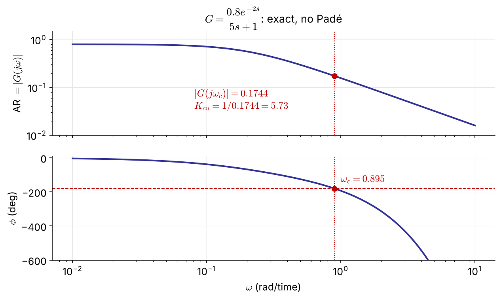{width="100%"}
:::
::: {.column width="42%" .small}
$G_{OL}=K_c\dfrac{0.8e^{-2s}}{5s+1}$

Phase crossover: $\;-\tan^{-1}(5\omega_c)-2\omega_c=-\pi$ $\Rightarrow\omega_c=0.895$

$$
K_{cu}=\frac{1}{|G(j\omega_c)|}=\frac{\sqrt{1+25\omega_c^2}}{0.8}=5.73
$$

::: {.box}
The **same** answer as direct substitution in Ch 4 — read off one Bode plot, with no Padé approximation (1st-order Padé gave 7.5).
:::
:::
:::

## [Example 5.14]{.ex} &nbsp; Nyquist for an open-loop unstable process [NEW]{.new}

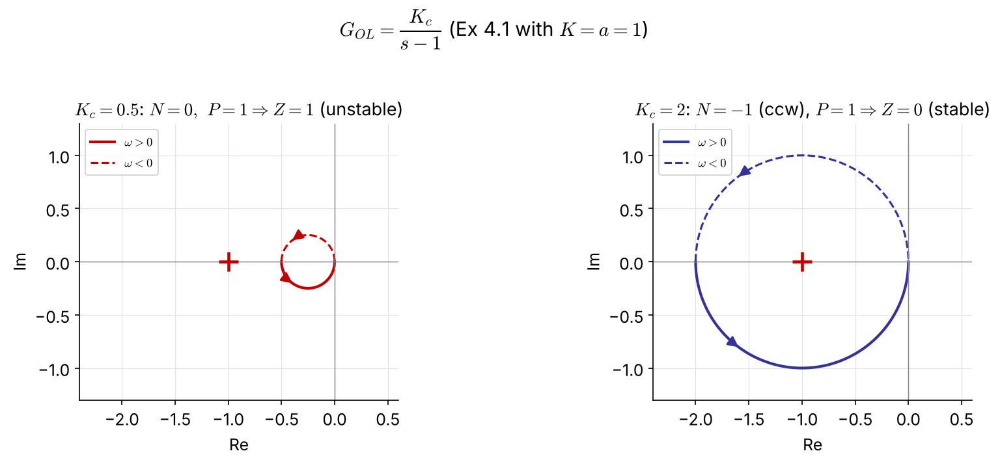{width="86%"}

::: {.small}
$K_c/(s-1)$ is a circle of diameter $K_c$ through $0$ and $-K_c$, traversed **counterclockwise**. $P=1$, so stability needs $N=-1$: the circle must enclose $-1$ ⇒ $K_c>1$ — exactly Ex 4.1 ($K_cK>a$). The Bode criterion cannot be used here ($P\neq0$).
:::

## Gain and phase margins

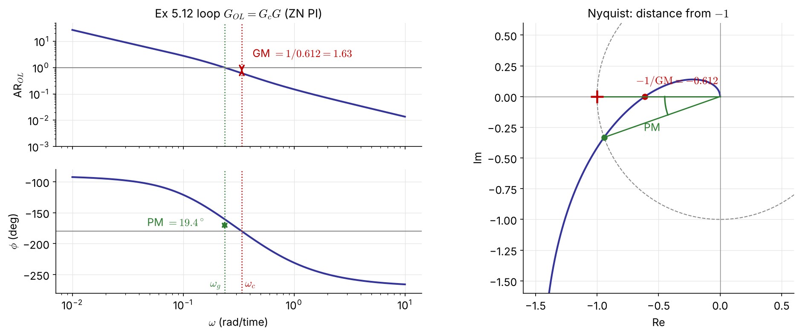{width="92%"}

::: {.columns .small}
::: {.column width="50%"}
**Gain margin** (at $\omega_c$, where $\angle G_{OL}=-180^\circ$)
$$
\mathrm{GM}=\frac{1}{|G_{OL}(j\omega_c)|}
$$
:::
::: {.column width="50%"}
**Phase margin** (at $\omega_g$, where $|G_{OL}|=1$)
$$
\mathrm{PM}=180^\circ+\angle G_{OL}(j\omega_g)
$$
:::
:::

## What the margins protect against

::: {.columns}
::: {.column width="50%"}
::: {.box}
**GM** — factor by which the loop gain can grow before instability → safeguard against **gain (model) error**

Typical spec: [GM > 2]{.key} (6 dB)

GM $=1/|G_{OL}(j\omega_c)|$ is the distance from $-1$ along the real axis
:::
:::
::: {.column width="50%"}
::: {.box}
**PM** — extra phase lag tolerated at $\omega_g$ → safeguard against **dead-time error**

Typical spec: [PM > 30°]{.key} (often 45°)

Extra delay that destabilizes: [FIX]{.fix}
$$
\theta_{\max}=\frac{\mathrm{PM}\ (\text{rad})}{\omega_g}
$$
:::
:::
:::

::: {.small}
- If several crossings: take the one closest to $-1$ (largest $|G_{OL}|$) for GM, the smallest PM. Low-order minimum-phase plants may have GM $=\infty$.
- Lowering $\omega_g$ (smaller bandwidth, slower loop) tolerates larger delay errors. Ex 5.12: $\theta_{\max}=0.339/0.236=1.4$ s.
:::

## Phase margin and damping [NEW]{.new}

::: {.columns}
::: {.column width="55%"}
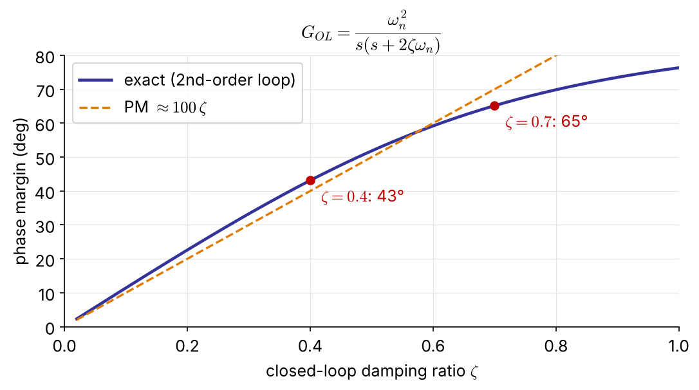{width="100%"}
:::
::: {.column width="45%" .small}
For a loop that behaves like $\dfrac{\omega_n^2}{s(s+2\zeta\omega_n)}$:

$$
\mathrm{PM}=\tan^{-1}\!\frac{2\zeta}{\sqrt{\sqrt{1+4\zeta^4}-2\zeta^2}}
\;\approx\;100\,\zeta\ (\text{deg})
$$

::: {.boxr}
PM 45° ↔ $\zeta\approx0.4$ (overshoot ≈ 25 %)

PM 65° ↔ $\zeta\approx0.7$ (overshoot ≈ 5 %)
:::

A small PM means an oscillatory closed loop — the bridge to the $\zeta$-based root-locus design of Ch 4.
:::
:::

## [Example 5.12]{.ex} &nbsp; Ziegler–Nichols PI for the inverse-response process

::: {.columns}
::: {.column width="60%"}
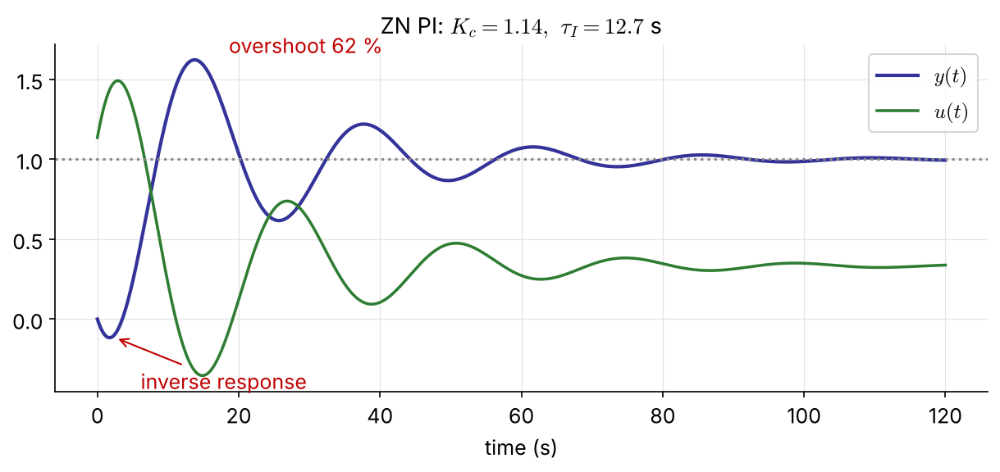{width="100%"}
:::
::: {.column width="40%" .small}
$G_c=K_c\left(1+\dfrac{1}{\tau_Is}\right)$ removes the P-control offset.

ZN settings from Ex 5.11 ($K_u=2.5,\ P_u=15.2$ s):

$$
K_c=\frac{K_u}{2.2}=1.14,\qquad \tau_I=\frac{P_u}{1.2}=12.7\ \text{s}
$$

::: {.boxr}
GM $=1.63$, PM $=19.4^\circ$<br>— **too small** (GM > 2, PM > 30°)

→ 62 % overshoot, slow-decaying oscillation
:::

ZN tunings are deliberately "aggressive" (quarter-decay); use them only as a starting point.
:::
:::

## Margins in code

::: {.panel-tabset}
### Python

```{.python}
import numpy as np, control as ct

G = ct.tf([-6, 3], np.polymul([10, 1], [5, 1]))
gm, pm, wc, wg = ct.margin(G)          # P control with Kc = 1
Ku, Pu = gm, 2*np.pi/wc                # 2.5, 15.2 s

Kc, tI = Ku/2.2, Pu/1.2                # Ziegler-Nichols PI
L = Kc*ct.tf([tI, 1], [tI, 0])*G
gm, pm, wc, wg = ct.margin(L)          # GM 1.63, PM 19.4 deg
theta_max = np.radians(pm)/wg          # 1.43 s of extra dead time
ct.bode_plot(L, display_margins=True)
```

### MATLAB

```{.matlab}
G = tf([-6 3], conv([10 1],[5 1]));
[Ku,~,wc] = margin(G);   Pu = 2*pi/wc;      % 2.5, 15.2 s

Kc = Ku/2.2;   tI = Pu/1.2;                 % Ziegler-Nichols PI
L = Kc*tf([tI 1],[tI 0])*G;
[GM,PM,wc,wg] = margin(L)                   % 1.63, 19.4 deg
theta_max = PM*pi/180/wg                    % 1.43 s
margin(L)                                   % Bode plot with margins marked
```
:::

# 5.4 Controller Design

## Choosing $K_c$ without trial and error

Write the loop as $\;1+G_{OL}=1+K_cG^*=0$, where $G^*$ contains **everything except $K_c$** (process, valve, sensor, and the $\tau_I,\tau_D$ terms of the controller).

::: {.columns}
::: {.column width="50%"}
::: {.box}
**From a GM spec**

$\angle K_c=0$, so $G^*$ and $G_{OL}$ share $\omega_c$:

$$
K_{cu}=\frac{1}{|G^*(j\omega_c)|},\qquad K_c=\frac{K_{cu}}{\mathrm{GM}}
$$
:::
:::
::: {.column width="50%"}
::: {.box}
**From a PM spec**

Find $\omega_g$ where $\angle G^*=-180^\circ+\mathrm{PM}$ <br>(e.g. $-135^\circ$ for 45°):

$$
K_c=\frac{1}{|G^*(j\omega_g)|}
$$
:::
:::
:::

::: {.small}
Compute both and take the **smaller** $K_c$, which satisfies both specs. One Bode plot of $G^*$ does it all.
:::

## [Example 5.13]{.ex} &nbsp; Retuning Ex 5.12 for GM ≥ 2 and PM ≥ 45° [NEW]{.new}

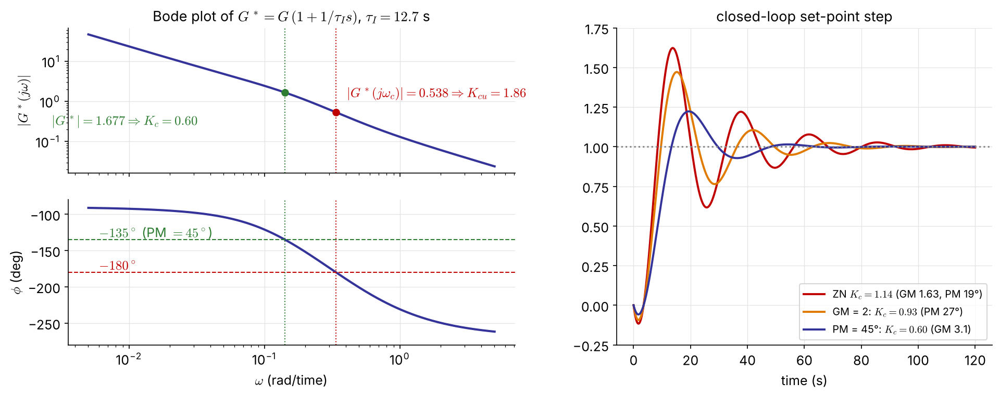{width="96%"}

::: {.columns .small}
::: {.column width="55%"}
Keep $\tau_I=12.7$ s: $\;G^*=G\,(1+1/\tau_Is)$, $\ \omega_c=0.338$, $\ K_{cu}=1.86$

- GM $=2$ → $K_c=0.93$ (but PM only 27°)
- PM $=45^\circ$ → $\omega_g=0.142$, $\ K_c=0.60$ (GM 3.1)
:::
::: {.column width="45%"}
::: {.boxr}
$K_c=0.60$ meets **both** specs: overshoot 62 % → 22 %, settles in 45 s instead of 89 s
:::
:::
:::

## Example 5.13 in code

::: {.panel-tabset}
### Python

```{.python}
tI = Pu/1.2
Gs = ct.tf([tI, 1], [tI, 0])*G                  # G* = everything except Kc

Kcu = ct.margin(Gs)[0]                          # 1.86
Kc_GM = Kcu/2                                   # GM = 2   -> 0.93

w = np.logspace(-3, 1, 100000)
g = Gs(1j*w)
phase = np.degrees(np.unwrap(np.angle(g)))
i = np.argmin(abs(phase - (-180 + 45)))         # phase = -135 deg
Kc_PM = 1/abs(g[i])                             # PM = 45 deg -> 0.60

Kc = min(Kc_GM, Kc_PM)
print(ct.margin(Kc*Gs), ct.step_info(ct.feedback(Kc*Gs, 1)))
```

### MATLAB

```{.matlab}
tI = Pu/1.2;
Gs = tf([tI 1],[tI 0])*G;                       % G* = everything except Kc

Kcu = margin(Gs);   Kc_GM = Kcu/2;              % 1.86 -> 0.93

w = logspace(-3, 1, 1e5);
[m, p] = bode(Gs, w);   m = squeeze(m);   p = squeeze(p);
[~, i] = min(abs(p + 135));                     % phase = -135 deg
Kc_PM = 1/m(i)                                  % 0.60

Kc = min(Kc_GM, Kc_PM);
margin(Kc*Gs), stepinfo(feedback(Kc*Gs, 1))
```
:::

## Interactive: move $K_c$, watch the margins [NEW]{.new}

::: {.screen-only}

:::

::: {.print-only}
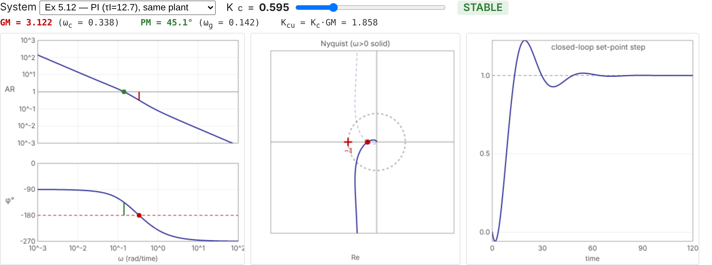{width="96%"}

::: {.small .center}
Interactive version: [seoultechpse.github.io/ProCon/ch5/ch5_frequency.html](https://seoultechpse.github.io/ProCon/ch5/ch5_frequency.html) — move $K_c$ for Ex 5.11, 5.12, Ex 4.4 and Ex 4.2.
:::
:::

## A final word: frequency response or root locus?

They **complement** each other; a design decision is often made only after both.

::: {.columns .small}
::: {.column width="50%"}
::: {.box}
**Root locus (Ch 4)**

- shows the **transient response** and how it moves with $K_c$
- needs a fairly accurate model
- does not handle dead time well
:::
:::
::: {.column width="50%"}
::: {.box}
**Frequency response (Ch 5)**

- **relative** stability: GM, PM; dead time **exactly**
- Bode plot can come from **experiments** (sine or pulse tests) — no model needed, or a check of one
- several crossovers: use Nyquist, not Bode alone
:::
:::
:::

::: {.small}
| Task | MATLAB | Python (`control`) |
|:--|:--|:--|
| Bode / Nyquist | `bode(G)`, `nyquist(G)` | `ct.bode_plot(G)`, `ct.nyquist_plot(G)` |
| dead time | `tf(..., 'InputDelay', θ)` | `G(1j*w)*np.exp(-1j*w*θ)` |
| margins | `[GM,PM,wc,wg] = margin(L)` | `gm, pm, wc, wg = ct.margin(L)` |
:::

## [Problem #2]{.ex} &nbsp; (homework) [NEW]{.new}

$$
G_p=\frac{2e^{-s}}{10s+1},\qquad G_c=K_c\left(1+\frac{1}{\tau_Is}\right),\quad \tau_I=10
$$

(a) Show that $\tau_I=10$ makes $G_{OL}$ a pure integrator with dead time. Sketch its Bode plot by hand.

(b) Find the phase crossover $\omega_c$ and the ultimate gain $K_{cu}$ analytically.

(c) Find $K_c$ for PM $=45^\circ$. What is the resulting GM? Comment on the result.

(d) Check (b)–(c) with `ct.margin` and simulate the set-point response.

::: {.small .navy}
Hint: the phase of $e^{-j\omega}/j\omega$ is $-\pi/2-\omega$.
:::

## Resources

::: {.box}
- **Slides (interactive HTML):** [seoultechpse.github.io/ProCon/ch5/ch5_frequency.html](https://seoultechpse.github.io/ProCon/ch5/ch5_frequency.html)
- **PDF:** [slides](https://seoultechpse.github.io/ProCon/ch5/ch5_frequency.pdf) · [handout with note space](https://seoultechpse.github.io/ProCon/ch5/ch5_frequency_handout.pdf)
- **Python notebook:** [Open in Colab](https://colab.research.google.com/github/SeoulTechPSE/ProCon/blob/main/ch5/ch5_frequency.ipynb) — every calculation and figure of this chapter
:::

# Appendix

## General frequency response: derivation

Stable $G=Q/P$, input $A\sin\omega t$: $\;Y(s)=\dfrac{Q(s)}{P(s)}\dfrac{A\omega}{(s+j\omega)(s-j\omega)}$

All roots of $P$ have negative real parts, so their terms decay. At large times only the input poles remain:

$$
Y_\infty(s)=\frac{a}{s+j\omega}+\frac{a^*}{s-j\omega},\qquad
a=(s+j\omega)Y(s)\big|_{s=-j\omega}=\frac{AG(-j\omega)}{-2j}
$$

With $G(\pm j\omega)=|G(j\omega)|e^{\pm j\phi}$:

$$
\frac{y_\infty(t)}{A}=|G(j\omega)|\left(\frac{e^{-j(\omega t+\phi)}}{-2j}+\frac{e^{j(\omega t+\phi)}}{2j}\right)=|G(j\omega)|\sin(\omega t+\phi),\qquad \phi=\angle G(j\omega)
$$

## Resonance of the second-order system

$$
\frac{d}{d\omega}\Big[(1-\tau^2\omega^2)^2+(2\zeta\tau\omega)^2\Big]=0
\;\Rightarrow\;\tau^2\omega_r^2=1-2\zeta^2
$$

$$
M_{p\omega}=|G(j\omega_r)|=\frac{K}{\sqrt{(2\zeta^2)^2+4\zeta^2(1-2\zeta^2)}}=\frac{K}{2\zeta\sqrt{1-\zeta^2}}
$$

A real $\omega_r$ requires $1-2\zeta^2>0$, i.e. $\zeta<1/\sqrt2$.

| $\zeta$ | 0.2 | 0.4 | 0.6 |
|:--|:--:|:--:|:--:|
| $\tau\omega_r$ | 0.96 | 0.82 | 0.53 |
| $M_{p\omega}/K$ | 2.55 (8.1 dB) | 1.36 (2.7 dB) | 1.04 (0.4 dB) |
