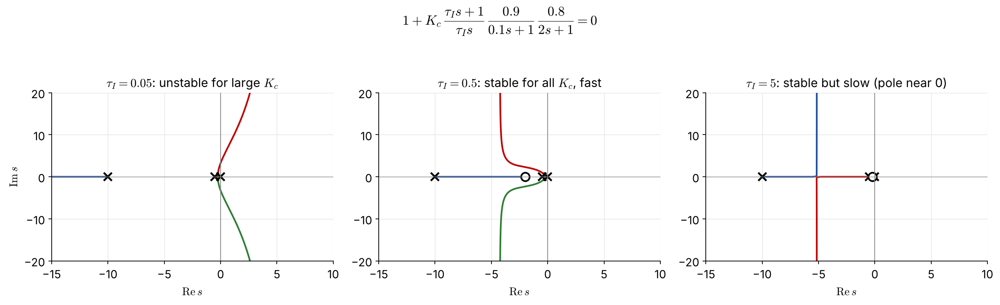
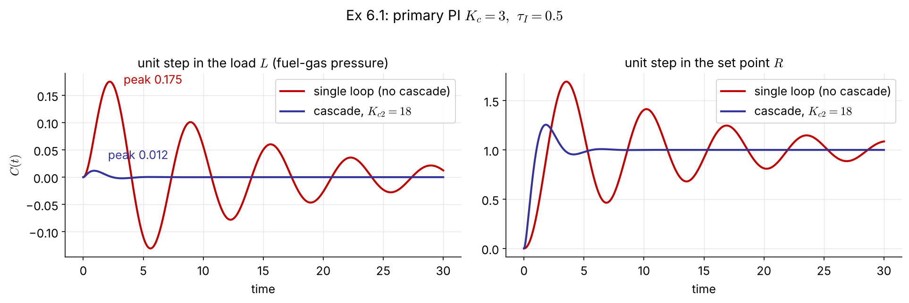
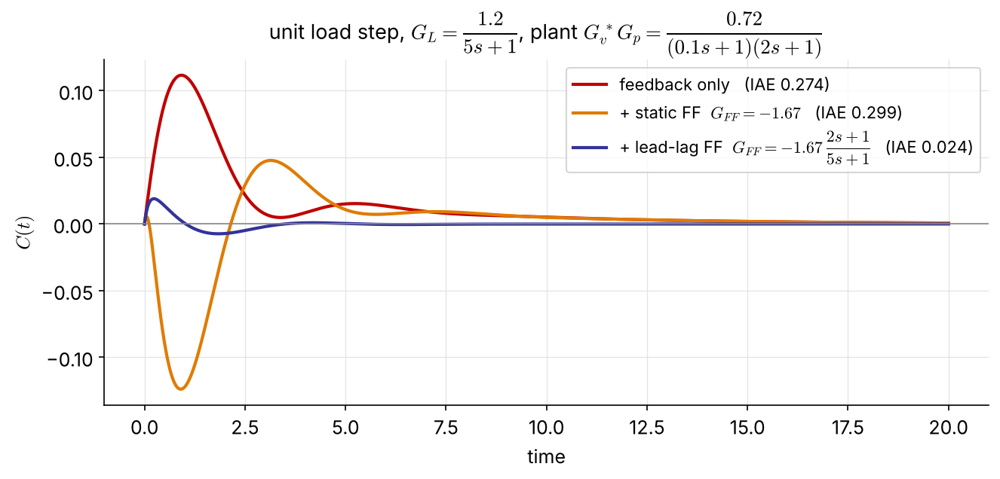
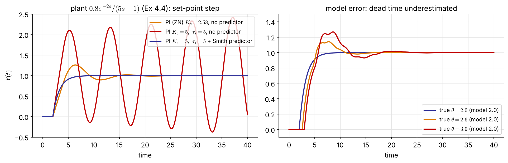
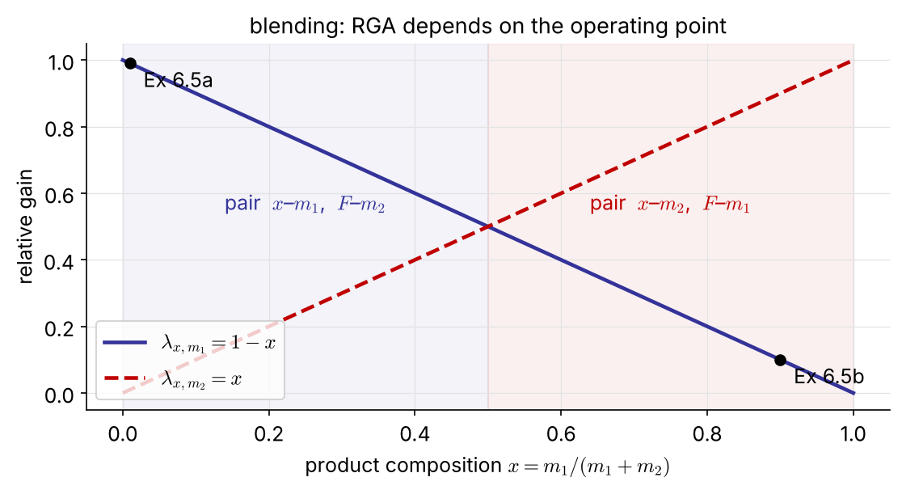
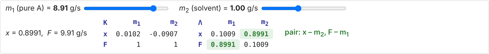
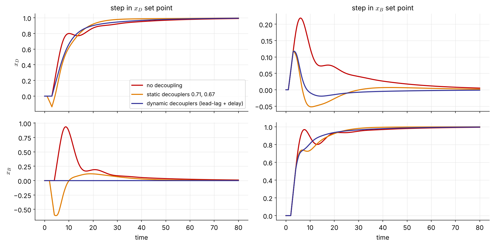
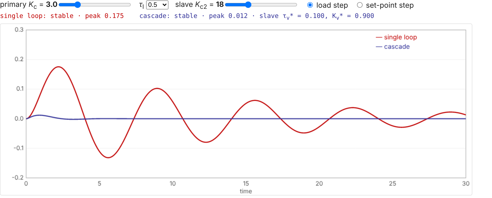

## What are we up to?

Single-loop feedback (Ch 4–5) reacts only **after** the controlled variable has moved. This chapter adds structure around the loop.

| Strategy | What it handles | Key idea |
|:--|:--|:--|
| **Cascade** (6.1) | disturbances in the manipulated variable | a fast inner loop fixes them before they reach the process |
| **Feedforward** (6.2–6.3) | measured disturbances | act on the disturbance itself, with a model |
| **Ratio** (6.4) | streams that must stay in proportion | one flow follows another |
| **Smith predictor** (6.5) | large dead time | feed back a *prediction* of the output |
| **MIMO, RGA, decoupling** (6.6–6.7) | several interacting loops | choose the pairing, then cancel the interaction |

::: {.small .navy}
Running example for 6.1–6.4: the **fired heater** — outlet temperature controlled with the fuel-gas flow.
:::

# 6.1 Cascade Control

## The fired-heater problem



::: {.small}
The temperature controller (TC) does **not** move the valve directly: its output is the **set point of a flow controller** (FC), which holds the fuel-gas flow against upstream pressure changes.
:::

## Master and slave loops

- **Master (primary) controller** TC: compares $T$ with $T^s$ and asks for a fuel-gas flow.
- **Slave (secondary) loop** FC + FT + valve: delivers that flow, correcting supply-pressure upsets **before** they change the temperature.

::: {.boxr}
To be effective, the **slave loop must be much faster** (smaller time constant) than the outer loop.
:::

::: {.box .small}
**Design rules**

1. Tune the slave loop first, with the master in manual. Use as high a gain as feasible; P-only is usually enough.
2. Then tune the master loop on the closed slave loop. Integral action belongs here, because it removes the offset.
:::

## Block diagram



::: {.columns}
::: {.column width="50%"}
$$
e_2=p-a,\qquad a=G_{c2}G_v\,e_2+G_LL
$$
:::
::: {.column width="50%"}
$$
a=\underbrace{\frac{G_{c2}G_v}{1+G_{c2}G_v}}_{G_v^*}\,p+\underbrace{\frac{G_L}{1+G_{c2}G_v}}_{G_L^*}\,L
$$
:::
:::

## Reduced block diagram



$$
C=\frac{G_cG_v^*G_p}{1+G_cG_v^*G_p}\,R+\frac{G_L^*G_p}{1+G_cG_v^*G_p}\,L
$$

::: {.small}
The slave loop turns the valve $G_v$ into a faster, more accurate actuator $G_v^*$, and it shrinks the load path to $G_L^*$.
:::

## [Example 6.1]{.ex} &nbsp; Choosing the slave gain $K_{c2}$

PI master, P slave: $\;G_p=\dfrac{0.8}{2s+1},\quad G_v=\dfrac{0.5}{s+1},\quad G_L=\dfrac{0.75}{s+1}$

::: {.columns}
::: {.column width="55%"}
$$
G_v^*=\frac{K_{c2}K_v}{\tau_vs+1+K_{c2}K_v}=\frac{K_v^*}{\tau_v^*s+1}
$$
$$
\tau_v^*=\frac{\tau_v}{1+K_{c2}K_v},\qquad K_v^*=\frac{K_{c2}K_v}{1+K_{c2}K_v}
$$
$$
K_L^*=\frac{K_L}{1+K_{c2}K_v}
$$

As $K_{c2}$ grows: $K_v^*\to1$ (the valve does what it is told), $K_L^*\to0$ (load rejected), $\tau_v^*\to0$ (faster).
:::
::: {.column width="45%"}
| $K_{c2}$ | $\tau_v^*$ | $K_v^*$ | $K_L^*$ |
|--:|--:|--:|--:|
| 0 | 1 | — | 0.75 |
| 2 | 0.50 | 0.50 | 0.375 |
| 5 | 0.29 | 0.71 | 0.21 |
| **18** | **0.10** | **0.90** | **0.075** |
| 50 | 0.04 | 0.96 | 0.029 |

::: {.box .small}
**(b)** For $\tau_v^*=0.1\tau_v$: $\;1+0.5K_{c2}=10\Rightarrow K_{c2}=18$, giving $K_v^*=0.9$ (10 % offset in the slave loop).
:::
:::
:::

::: {.small}
**(c)** Why P-only in the slave? The master PI removes the steady-state error in $C$; the slave offset is harmless.
:::

## Example 6.1 (d): choosing the master $\tau_I$

{width="100%"}

::: {.columns .small}
::: {.column width="58%"}
Poles $0,\,-0.5,\,-10$; PI zero at $-1/\tau_I$; $\ n-m=2$, $\ \gamma=\dfrac{-10.5+1/\tau_I}{2}$

- $\tau_I=0.05$: $\gamma=+4.75$ → unstable for $K_c>1.54$
- $\tau_I=0.5$: $\gamma=-4.25$, stable for all $K_c$, dominant poles far left
- $\tau_I=5$: stable, but a closed-loop pole is trapped near the zero at $-0.2$ → slow
:::
::: {.column width="42%"}
::: {.boxr}
Choose [$\tau_I=0.5$]{.key}: never unstable, and the fastest response.
:::
:::
:::

## Example 6.1 (e): without the cascade

$\tau_I=0.5$, single loop:

$$
1+K_c\,\frac{0.5s+1}{0.5s}\,\frac{0.5}{s+1}\,\frac{0.8}{2s+1}=0
\;\Rightarrow\;
s^3+1.5s^2+(0.5+0.2K_c)s+0.4K_c=0
$$

Routh: $\;1.5\,(0.5+0.2K_c)>0.4K_c\;\Rightarrow\;$ [$0<K_c<7.5$]{.key}

::: {.box}
With the cascade the same master loop is stable for **every** $K_c>0$. The slave loop removed the slow valve pole at $-1$ and replaced it with a fast one at $-10$.
:::

## Example 6.1: responses (replaces the Simulink runs)

{width="100%"}

::: {.small}
With the same master tuning ($K_c=3,\ \tau_I=0.5$), a fuel-gas pressure upset moves the temperature **15× less** with the cascade (peak 0.175 → 0.012). The set-point response is also much better damped.
:::

## Example 6.1 in code

::: {.panel-tabset}
### Python

```{.python}
import numpy as np, control as ct

Gp, Gv, GL = ct.tf(0.8, [2, 1]), ct.tf(0.5, [1, 1]), ct.tf(0.75, [1, 1])
Kc2 = 18
Gv_s = ct.feedback(Kc2*Gv, 1)                   # G_v*  = 9/(s+10)
GL_s = ct.minreal(GL/(1 + Kc2*Gv))              # G_L*  = 0.75/(s+10)

Kc, tI = 3, 0.5
Gc = ct.tf([Kc*tI, Kc], [tI, 0])
load_single  = ct.minreal(GL*Gp/(1 + Gc*Gv*Gp))
load_cascade = ct.minreal(GL_s*Gp/(1 + Gc*Gv_s*Gp))
t = np.linspace(0, 30, 3001)
for T in (load_single, load_cascade):
    print(ct.step_response(T, t).outputs.max())   # 0.175, 0.012
```

### MATLAB

```{.matlab}
Gp = tf(0.8,[2 1]);  Gv = tf(0.5,[1 1]);  GL = tf(0.75,[1 1]);
Kc2 = 18;
Gv_s = feedback(Kc2*Gv, 1);                % G_v*
GL_s = minreal(GL/(1 + Kc2*Gv));           % G_L*

Kc = 3;  tI = 0.5;  Gc = Kc*tf([tI 1],[tI 0]);
load_single  = minreal(GL*Gp/(1 + Gc*Gv*Gp));
load_cascade = minreal(GL_s*Gp/(1 + Gc*Gv_s*Gp));
step(load_single, load_cascade, 30), legend('single loop','cascade')
```
:::

# 6.2 Feedforward Control

## Act on the disturbance, not on the error

Measure the disturbance $L$ and use a **process model** to move $M$ **before** $C$ is affected:

$$
C=G_LL+G_pM\quad\xrightarrow{\;C=R\;}\quad M=\frac{1}{G_p}R-\frac{G_L}{G_p}L
$$

- Set-point changes are normally left to the feedback loop; only the second term is implemented.
- The **feedforward controller** is the model-based rule $-G_L/G_p$.



## The feedforward controller

$$
C=\big[G_L+G_{mL}G_{FF}G_v^*G_p\big]L \;\xrightarrow{\;C=0\;}\; G_{FF}=-\frac{G_L}{G_{mL}G_v^*G_p}
$$

[FIX]{.fix} <span class="small">(the original wrote $F_{FF}$ for $G_{FF}$)</span>

::: {.columns}
::: {.column width="46%"}
**Pitfalls of the ideal $G_{FF}$:**

- often **not realizable**: the numerator order exceeds the denominator order
- a dead time in $G_p$ larger than in $G_L$ gives $e^{+\theta s}$, which would need the future
- it is only as good as the model
:::
::: {.column width="54%"}
::: {.box}
**Practical form: lead-lag × gain**

$$
G_{FF}=K_{FF}\,\frac{\tau_{ld}s+1}{\tau_{lg}s+1}
$$
$$
K_{FF}=-\frac{K_L}{K_{mL}K_v^*K_p}
$$

- static part $K_{FF}$: steady-state compensator
- lead-lag: dynamic compensator
:::
:::
:::

::: {.small}
If the measurement is fast and $\tau_v^*$ is small (a cascade slave loop), the static gain alone may be enough — **but check** (Ex 6.7).
:::

## [Example 6.7]{.ex} &nbsp; Static or dynamic feedforward? [NEW]{.new}

::: {.columns}
::: {.column width="62%"}
{width="100%"}
:::
::: {.column width="38%" .small}
Cascade plant of Ex 6.1 with a load at the output: $G_L=\dfrac{1.2}{5s+1}$, $\ G_{mL}=1$, PI $K_c=3,\ \tau_I=0.5$

$$
G_{FF}^{\text{ideal}}=-1.67\,\frac{(0.1s+1)(2s+1)}{5s+1}
$$
improper → drop the fast $(0.1s+1)$:
$$
G_{FF}=-1.67\,\frac{2s+1}{5s+1}
$$

::: {.boxr}
The **static** $G_{FF}$ acts too early (the load is slower than the process) and makes things **worse** than feedback alone. The **lead-lag** cuts IAE **11×**.
:::
:::
:::

# 6.3 Feedforward–Feedback Control

## Feedforward never works alone



::: {.columns}
::: {.column width="62%"}
$$
C=\frac{G_L+G_{mL}G_{FF}G_v^*G_p}{1+G_mG_cG_v^*G_p}\,L+\frac{G_cG_v^*G_p}{1+G_mG_cG_v^*G_p}\,R
$$
:::
::: {.column width="38%" .small}
::: {.boxr}
Characteristic equation $1+G_mG_cG_v^*G_p=0$: **$G_{FF}$ does not affect stability**.
:::
Feedforward does most of the work; feedback removes what the imperfect model leaves behind.
:::
:::

## [Example 6.2]{.ex} &nbsp; Furnace with feedforward, feedback and cascade



::: {.small}
Inlet temperature and flow of the process stream (the main loads) feed the **FFC**; its signal is **added** (Σ) to the TC output. The sum is the set point of the fuel-gas **flow** controller, so cascade handles the fuel-supply upsets.
:::

# 6.4 Ratio Control

## Keeping air in proportion to fuel



::: {.columns .small}
::: {.column width="50%"}
**(a) Simple ratio:** the fuel flow is "wild" (set elsewhere). The ratio station RS multiplies its measurement by $R=F_A/F_{FG}$ to give the air-flow set point.
:::
::: {.column width="50%"}
**(b) Full metering:** both flows are controlled. The fuel set point comes from the FF–FB loops, and the ratio controller RC sets the air flow from the **measured** fuel flow.
:::
:::

::: {.small .navy}
Sufficient air means efficient combustion and lower emissions of CO and unburnt hydrocarbons.
:::

# 6.5 The Smith Predictor

## Dead time in the loop

$$
1+G_c(s)G(s)e^{-\theta s}=0
$$

- Dead time adds phase lag $-\omega\theta$, lowers the gain margin, and forces a small $K_c$ (Ch 5).
- The root cause is that the measured output is **outdated** information.

::: {.boxr}
If $G(s)$ and $\theta$ are known, **predict** the undelayed output and feed that back instead.
:::

[Notation: the original slides use $t_d$; here $\theta$, as in Ch 4–5.]{.small .navy}

## The Smith predictor



::: {.columns .small}
::: {.column width="55%"}
$$
E=R-Y-G_cG\left(1-e^{-\theta s}\right)E,\qquad Y=G_cGe^{-\theta s}E
$$
$$
\Rightarrow\;E=R-G_cG\,E,\qquad \frac{Y}{R}=\frac{G_cG}{1+G_cG}\,e^{-\theta s}
$$
:::
::: {.column width="45%"}
::: {.box}
The characteristic equation $1+G_cG=0$ has **no dead time**. Tune $G_c$ as if the delay were absent; the response is the same, only shifted by $\theta$. [NEW]{.new}
:::
:::
:::

## [Example 6.8]{.ex} &nbsp; Smith predictor on the Ex 4.4 plant [NEW]{.new}

{width="96%"}

::: {.columns .small}
::: {.column width="55%"}
$G=\dfrac{0.8e^{-2s}}{5s+1}$, $\ K_{cu}=5.73$ (Ch 4–5). PI with $\tau_I=5$ cancels the lag, and $K_c=5$ gives a first-order loop with $\tau_{cl}=5/(0.8K_c)=1.25$.

- without the predictor, $K_c=5$ is **unstable**
- with it: no overshoot, $Y(t)$ is the ideal response delayed by 2
:::
::: {.column width="45%"}
::: {.boxr}
**Caveats:** it needs an accurate model; a 50 % dead-time error brings back overshoot. For **load** disturbances the delay is not removed; the predictor only speeds up the correction.
:::
:::
:::

## Smith predictor in code

::: {.panel-tabset}
### Python

```{.python}
from blocks import FOPDT, Delay, PI, DT     # exact dead time (no Pade); blocks.py in ch6/
import numpy as np

def smith(Kc, tI, theta_true=2.0, theta_model=2.0, tf=40):
    G  = FOPDT(0.8, 5, theta_true)           # plant  0.8 e^{-theta s}/(5s+1)
    M0 = FOPDT(0.8, 5, 0.0)                  # model without delay
    Md = Delay(theta_model)                  # model delay
    c  = PI(Kc, tI)
    y = ym0 = ymd = 0.0; out = []
    for k in range(int(tf/DT) + 1):
        u = c(1.0 - y - (ym0 - ymd))         # feed back y + G(1 - e^{-theta s}) u
        y, ym0 = G(u), M0(u); ymd = Md(ym0)
        out.append(y)
    return np.arange(len(out))*DT, np.array(out)

t, y = smith(5, 5)                           # Kc = 5 > Kcu: still stable
```

### MATLAB

```{.matlab}
s  = tf('s');
G0 = 0.8/(5*s + 1);                  % model without delay
Gd = G0*exp(-2*s);                   % plant with delay
Gc = 5*(1 + 1/(5*s));                % PI, Kc = 5, tauI = 5

C_smith = feedback(Gc, G0 - Gd);     % controller + dead-time compensator
T_smith = feedback(C_smith*Gd, 1);   % = Gc*G0/(1+Gc*G0) * exp(-2s)
T_plain = feedback(Gc*Gd, 1);        % unstable
step(T_smith, 40)
```
:::

# 6.6 Multiple-Input Multiple-Output Control

## A blending process



$$
C_1=G_{11}M_1+G_{12}M_2,\qquad C_2=G_{21}M_1+G_{22}M_2
$$

::: {.small}
Every manipulated variable affects **both** outputs. The questions are: **which** $M$ should control **which** $C$, and how strongly do the loops fight?
:::

## MIMO closed loop

::: {style="width:78%;margin:0 auto"}

:::

::: {.small}
With $M_i=G_{ci}(R_i-C_i)$, the closed loop is

$$
\begin{bmatrix}C_1\\C_2\end{bmatrix}=\frac{1}{p(s)}
\begin{bmatrix}G_{11}G_{c1}+g(s) & G_{12}G_{c2}\\ G_{21}G_{c1} & G_{22}G_{c2}+g(s)\end{bmatrix}
\begin{bmatrix}R_1\\R_2\end{bmatrix},\qquad g=(G_{11}G_{22}-G_{12}G_{21})G_{c1}G_{c2}
$$
:::

::: {.boxr .small}
$p(s)=(1+G_{11}G_{c1})(1+G_{22}G_{c2})-G_{12}G_{21}G_{c1}G_{c2}=0$: tuning one loop changes the stability of **both**.
:::

## Process gain matrix

Mass balances ($m_1$ pure A, $m_2$ solvent): $\;F=m_1+m_2,\quad x=\dfrac{m_1}{m_1+m_2}$

$$
x\approx x_s+\underbrace{\left[\frac{m_2}{(m_1+m_2)^2}\right]_s}_{K_{11}}(m_1-m_{1,s})\;\underbrace{-\left[\frac{m_1}{(m_1+m_2)^2}\right]_s}_{K_{12}}(m_2-m_{2,s})
$$

::: {.columns}
::: {.column width="50%"}
$$
\begin{bmatrix}X\\F\end{bmatrix}=\underbrace{\begin{bmatrix}K_{11}&K_{12}\\K_{21}&K_{22}\end{bmatrix}}_{\mathbf K}\begin{bmatrix}M_1\\M_2\end{bmatrix},\quad K_{21}=K_{22}=1
$$
:::
::: {.column width="50%"}
::: {.box .small}
[Example 6.3]{.ex} &nbsp; $m_1=0.1,\ m_2=10$ g/s:
$$
\mathbf K=\begin{bmatrix}9.8\times10^{-2} & -9.8\times10^{-4}\\ 1 & 1\end{bmatrix}
$$
$|K_{11}|\gg|K_{12}|$: $m_2$ barely affects $x$, a nearly **one-way** interaction.
:::
:::
:::

## Relative gain array (RGA)

$$
\lambda_{ij}=\frac{\left.\dfrac{\partial c_i}{\partial m_j}\right|_{m_k,\,k\neq j}}{\left.\dfrac{\partial c_i}{\partial m_j}\right|_{c_k,\,k\neq i}}
=\frac{\text{gain with all other loops open}}{\text{gain with all other loops closed (perfect control)}}
$$

::: {.columns}
::: {.column width="52%"}
For a $2\times2$ system, with $\kappa=\dfrac{K_{12}K_{21}}{K_{11}K_{22}}$:

$$
\lambda_{11}=\frac{1}{1-\kappa},\qquad
\boldsymbol\Lambda=\begin{bmatrix}\lambda_{11}&1-\lambda_{11}\\1-\lambda_{11}&\lambda_{11}\end{bmatrix}
$$
:::
::: {.column width="48%"}
::: {.box .small}
**Properties** [NEW]{.new}

- each **row and column sums to 1**
- independent of the units and scaling of the variables
- any size: $\;\boldsymbol\Lambda=\mathbf K\circ\left(\mathbf K^{-1}\right)^{T}$ (element-wise product)
:::
:::
:::

## [Example 6.4]{.ex} &nbsp; RGA of the blending process

$$
\left.\frac{\partial x}{\partial m_1}\right|_{m_2}=\frac{m_2}{(m_1+m_2)^2},\qquad
\left.\frac{\partial x}{\partial m_1}\right|_{F}=\frac{1}{F}=\frac{1}{m_1+m_2}
\;\Rightarrow\;
\lambda_{x,m_1}=\frac{m_2}{m_1+m_2}=1-x
$$

::: {.columns}
::: {.column width="40%"}
$$
\boldsymbol\Lambda=\begin{bmatrix}\lambda_{x,m_1}&\lambda_{x,m_2}\\\lambda_{F,m_1}&\lambda_{F,m_2}\end{bmatrix}=\begin{bmatrix}1-x&x\\x&1-x\end{bmatrix}
$$

Same result from the gains: $\kappa=K_{12}K_{21}/(K_{11}K_{22})=-m_1/m_2$
:::
::: {.column width="60%"}
{width="100%"}
:::
:::

## Reading the RGA: pairing rules [FIX]{.fix}

| $\lambda_{ij}$ | $\kappa$ (2×2) | meaning | pair $m_j$–$c_i$? |
|:----------:|:----------:|:------------------------------------------|:--------------:|
| $1$ | $0$ | no interaction from the other loop | **yes, ideal** |
| $0.5$–$1$ | $<0$ | closing the other loop **raises** this loop's gain | yes |
| $>1$ | $0$–$1$ | closing the other loop **lowers** the gain | yes; avoid $\lambda\gg1$ |
| $0.5$ | $-1$ | the other loop doubles the gain; both pairings bad | — |
| $0$ | — | $m_j$ has no effect on $c_i$ | **no** |
| $<0$ | $>1$ | the gain **changes sign** when the other loop closes | **never** |

::: {.small .navy}
Rule: pair on relative gains that are **positive and closest to 1**. The **sign of $\kappa$** decides the case, not the signs of the gains (Ex 6.6: mixed signs, $\lambda=1.91$).
:::

## [Example 6.5]{.ex} &nbsp; Pairing depends on the operating point

::: {.columns}
::: {.column width="45%"}
**(a)** $m_1=0.1,\ m_2=10$ g/s ($x=0.0099$)
$$
\boldsymbol\Lambda=\begin{bmatrix}\mathbf{0.9901}&0.0099\\0.0099&\mathbf{0.9901}\end{bmatrix}
$$
pair $x$–$m_1$, $F$–$m_2$

**(b)** $m_1=9,\ m_2=1$ g/s ($x=0.9$)
$$
\boldsymbol\Lambda=\begin{bmatrix}0.1&\mathbf{0.9}\\\mathbf{0.9}&0.1\end{bmatrix}
$$
pair $x$–$m_2$, $F$–$m_1$
:::
::: {.column width="55%"}
::: {.screen-only}

:::
::: {.print-only}
{width="100%"}
:::

::: {.small}
Control the composition with the **smaller** stream: it changes $x$ more and $F$ less.
:::
:::
:::

## RGA in code

::: {.panel-tabset}
### Python

```{.python}
import numpy as np

def rga(K):
    K = np.asarray(K, float)
    return K * np.linalg.inv(K).T            # Lambda = K o (K^-1)^T

m1, m2 = 0.1, 10.0; F = m1 + m2
K = [[m2/F**2, -m1/F**2],
     [1.0,      1.0    ]]
print(rga(K))                                # [[0.9901 0.0099] [0.0099 0.9901]]

K66 = [[0.07, -0.05], [0.1, -0.15]]          # distillation, Ex 6.6
print(rga(K66))                              # [[ 1.91 -0.91] [-0.91  1.91]]
```

### MATLAB

```{.matlab}
rga = @(K) K .* inv(K).';                    % Lambda = K o (K^-1)^T

m1 = 0.1;  m2 = 10;  F = m1 + m2;
K = [m2/F^2, -m1/F^2;
     1,       1     ];
rga(K)                                       % [0.9901 0.0099; 0.0099 0.9901]

K66 = [0.07 -0.05; 0.1 -0.15];               % distillation, Ex 6.6
rga(K66)                                     % [1.91 -0.91; -0.91 1.91]
```
:::

# 6.7 Decoupling of Interacting Systems

## Feedforward-like decouplers

::: {style="width:80%;margin:0 auto"}

:::

::: {.columns .small}
::: {.column width="50%"}
Cancel the effect of controller 2 on $C_1$:
$$
G_{12}+G_{11}D_{12}=0\;\Rightarrow\;D_{12}=-\frac{G_{12}}{G_{11}}
$$
:::
::: {.column width="50%"}
Cancel the effect of controller 1 on $C_2$:
$$
G_{21}+G_{22}D_{21}=0\;\Rightarrow\;D_{21}=-\frac{G_{21}}{G_{22}}
$$
:::
:::

::: {.small .navy}
Implement them like feedforward controllers: lead-lag plus gain, dropping any $e^{+\theta s}$ term that would need the future.
:::

## [Example 6.6]{.ex} &nbsp; Distillation column

$$
\begin{bmatrix}X_D\\X_B\end{bmatrix}=
\begin{bmatrix}\dfrac{0.07e^{-3s}}{12s+1}&\dfrac{-0.05e^{-s}}{15s+1}\\[2mm]\dfrac{0.1e^{-4s}}{11s+1}&\dfrac{-0.15e^{-2s}}{10s+1}\end{bmatrix}
\begin{bmatrix}L\\V\end{bmatrix}
\qquad L:\text{ reflux},\ V:\text{ boil-up}
$$

::: {.columns}
::: {.column width="45%"}
$$
\mathbf K=\begin{bmatrix}0.07&-0.05\\0.1&-0.15\end{bmatrix}
$$
$$
\boldsymbol\Lambda=\begin{bmatrix}1.91&-0.91\\-0.91&1.91\end{bmatrix}
$$

Pair [$x_D$–$L$, $x_B$–$V$]{.key}: $\lambda=1.91$ is not 1 but it is positive, and the reflux enters next to the distillate.
:::
::: {.column width="55%" .small}
**Decouplers**
$$
D_{12}=-\frac{G_{12}}{G_{11}}=0.714\,\frac{12s+1}{15s+1}\,e^{+2s}\approx0.71
$$
$$
D_{21}=-\frac{G_{21}}{G_{22}}=0.667\,\frac{10s+1}{11s+1}\,e^{-2s}\approx0.67
$$
$D_{12}$ would need a prediction ($e^{+2s}$) → drop it; $D_{21}$ is realizable as it stands. [NEW]{.new}
:::
:::

## Example 6.6: PI tuning (ITAE)

ITAE set-point correlations for FOPDT loops, applied to the diagonal elements:
$\;K_c=\dfrac{0.586}{K}\left(\dfrac{\theta}{\tau}\right)^{-0.916},\quad \tau_I=\dfrac{\tau}{1.03-0.165\,\theta/\tau}$

::: {.columns}
::: {.column width="50%"}
$$
K_{c1}=\frac{0.586}{0.07}\left(\frac{12}{3}\right)^{0.916}=29.8
$$
$$
\tau_{I1}=\frac{12}{1.03-0.165(3/12)}=12.1
$$
:::
::: {.column width="50%"}
$$
K_{c2}=-\frac{0.586}{0.15}\left(\frac{10}{2}\right)^{0.916}=-17.1
$$
$$
\tau_{I2}=\frac{10}{1.03-0.165(2/10)}=10.0
$$
:::
:::

::: {.small .navy}
$K_{c2}<0$ because $K_{22}<0$: more boil-up lowers $x_B$.
:::

## Example 6.6: does decoupling help? (replaces the Simulink runs)

{width="92%"}

::: {.columns .small}
::: {.column width="58%"}
- **No decoupling:** an $x_D$ set-point step drives $x_B$ up to 0.94.
- **Static** decouplers: $x_B$ now dips to $-0.61$. $D_{21}$ acts at $t=2$ through $G_{22}$, before $G_{21}$ arrives at $t=4$.
- **Dynamic** $D_{21}$ (with its $e^{-2s}$): $x_B$ stays at **0**, exact decoupling. [NEW]{.new}
:::
::: {.column width="42%"}
::: {.boxr}
A decoupler that ignores the **timing** can trade one interaction for another. Keep realizable delays and lags.
:::
:::
:::

## Decoupling in code

::: {.panel-tabset}
### Python

```{.python}
from blocks import simulate_2x2              # exact dead time; blocks.py in ch6/

G = [[(0.07, 12, 3), (-0.05, 15, 1)],        # (K, tau, theta) of each G_ij
     [(0.10, 11, 4), (-0.15, 10, 2)]]
Kc = (29.8, -17.1);  tI = (12.1, 10.0)

cases = {'none':    (None, None),
         'static':  (0.714, 0.667),
         'dynamic': ((0.714, 12, 15, 0), (0.667, 10, 11, 2))}   # (K, tau_lead, tau_lag, theta)
for name, (D12, D21) in cases.items():
    t, xD, xB, L, V = simulate_2x2(G, Kc, tI, D12, D21, r1=1, r2=0, tf=80)
    print(name, 'max |x_B| =', abs(xB).max().round(2))     # 0.93, 0.61, 0.00
```

### MATLAB

```{.matlab}
s = tf('s');
G = [0.07*exp(-3*s)/(12*s+1), -0.05*exp(-s)/(15*s+1);
     0.10*exp(-4*s)/(11*s+1), -0.15*exp(-2*s)/(10*s+1)];
C = blkdiag(29.8*(1 + 1/(12.1*s)), -17.1*(1 + 1/(10.0*s)));

D_static  = [1, 0.714; 0.667, 1];                          % M = D * u
D_dynamic = [1, 0.714*(12*s+1)/(15*s+1);
             0.667*(10*s+1)/(11*s+1)*exp(-2*s), 1];
for D = {eye(2), D_static, D_dynamic}
    T = feedback(G*D{1}*C, eye(2));
    step(T(:,1), 80), hold on                              % step in r1 (x_D)
end
```
:::

## Interactive: cascade vs. single loop [NEW]{.new}

::: {.screen-only}

:::

::: {.print-only}
{width="96%"}

::: {.small .center}
Interactive version: [seoultechpse.github.io/ProCon/ch6/ch6_multiloop.html](https://seoultechpse.github.io/ProCon/ch6/ch6_multiloop.html) — change $K_c$, $\tau_I$ and $K_{c2}$, and switch between load and set-point steps.
:::
:::

## Summary: which structure for which problem?

| Symptom | Structure | Needs |
|:--|:--|:--|
| upsets enter through the manipulated stream | **cascade** | a secondary measurement much faster than the primary |
| a large disturbance can be measured | **feedforward + feedback** | a model of $G_L/G_p$ (lead-lag is usually enough) |
| two streams must stay proportional | **ratio** | flow measurements |
| dead time dominates | **Smith predictor** | an accurate model, especially of $\theta$ |
| several loops interact | **RGA pairing**, then **decoupling** | gain matrix (pairing); dynamic model (decoupling) |

::: {.small .navy}
None of these replaces feedback: each one is built **around** a feedback loop.
:::

## [Problem #3]{.ex} &nbsp; (homework) [NEW]{.new}

$$
\mathbf G(s)=\begin{bmatrix}\dfrac{2e^{-s}}{10s+1} & \dfrac{1.5e^{-s}}{15s+1}\\[2mm] \dfrac{1.5e^{-s}}{15s+1} & \dfrac{2e^{-s}}{10s+1}\end{bmatrix}
$$

(a) Compute the RGA. Which pairing do you choose, and how strong is the interaction?

(b) Design the two decouplers. Are they realizable? Compare the static and dynamic versions.

(c) Tune two PI controllers with the ITAE correlations and simulate a step in $R_1$ with and without decoupling (use `simulate_2x2` from `blocks.py`).

::: {.small .navy}
Hint: $\kappa=\dfrac{K_{12}K_{21}}{K_{11}K_{22}}$.
:::

## Resources

::: {.box}
- **Slides (interactive HTML):** [seoultechpse.github.io/ProCon/ch6/ch6_multiloop.html](https://seoultechpse.github.io/ProCon/ch6/ch6_multiloop.html)
- **PDF:** [slides](https://seoultechpse.github.io/ProCon/ch6/ch6_multiloop.pdf) · [handout with note space](https://seoultechpse.github.io/ProCon/ch6/ch6_multiloop_handout.pdf)
- **Python notebook:** [Open in Colab](https://colab.research.google.com/github/SeoulTechPSE/ProCon/blob/main/ch6/ch6_multiloop.ipynb) — every calculation and figure of this chapter
- **Simulator with exact dead time:** [`blocks.py`](https://github.com/SeoulTechPSE/ProCon/blob/main/ch6/blocks.py)
:::

::: {.small}
**Further reading:**

- D. E. Seborg, T. F. Edgar, D. A. Mellichamp, *Process Dynamics and Control*
- P. C. Chau, *Process Control: A First Course with MATLAB*
- B. W. Bequette, *Process Control: Modeling, Design, and Simulation*
- C. D. Johnson, *Process Control Instrumentation Technology*
- S. Skogestad, I. Postlethwaite, *Multivariable Feedback Control: Analysis and Design*
:::

## A final word — Neal R. Amundson (University of Minnesota, circa 1970)

::: {.columns .small}
::: {.column width="50%"}
1. In an advanced course … when has any substance there will be **no text which contains all of the material presented**.
2. Teachers who know their subject well will always present material not in the prescribed text when one is prescribed.
3. If there were a text which presented all of the materials there would be no need for the lecturer.
4. In a course of any substance it will not be possible for the student to understand or follow all of the arguments instantaneously all of the time.
5. Assuming that 4 is true it is essential that **good notes be taken**. Usually this is not possible. Normally the notes will be very sketchy and if they are to be of any use later, they must be expanded upon by the student as soon after the lecture as possible.
6. Because of 5 notes in real courses must be recopied, filled out, corrected for teacher aberrations, misprints, errors, etc., so that **the student ends up with his own text**.
:::
::: {.column width="50%"}
7. Notes which have not been so treated are normally almost useless for later reference.
8. In core subjects one must learn and memorize and in this way make deposits in the bank from which he can withdraw later. If nothing is ever put in the bank then one is intellectually bankrupt. All knowledge is what one knows. **If one cannot verbalize what he knows then he properly does not understand what he thinks he knows.**
9. First-year graduate students, in general, must change their ways of studying from their undergraduate habits since in respectable graduate programs the emphasis is on understanding rather than getting through the course. This necessary shift is why many first-year graduate students go into shock after about six weeks of graduate work.
10. If a student aims toward a Ph.D. degree he is expected not only to understand but be able to improve by generalization or better by innovations. Good graduate programs require the latter.
11. **10 is what research is all about.**
:::
:::
